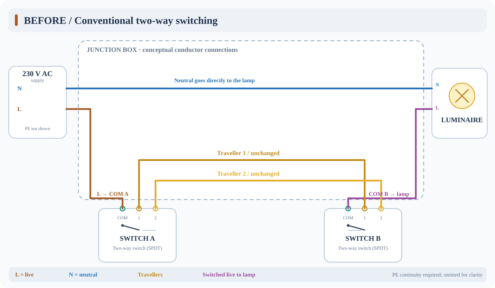
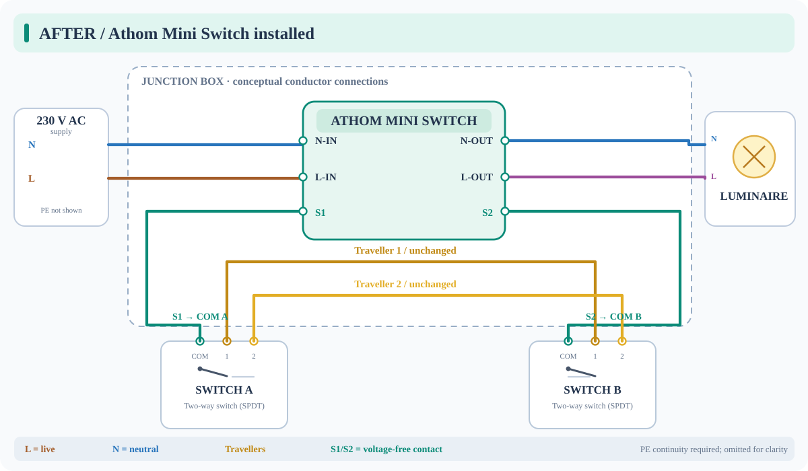

# Athom Mini Switch — wiring and installation

This runbook documents the **ESP8285/ESP8266 Athom Mini Relay Switch** used by
`mini-switch-{1,2,3,4,office-a}.yaml`. It covers one lamp controlled by
either **one wall switch** or **two mechanical two-way switches** (also called
*conmutadores* in Spain), with the Athom installed in a junction box.

> [!CAUTION]
> **230 V AC mains wiring. This is a functional reference, not a site-specific
> installation plan.** Work must be performed or verified by a qualified
> electrician under applicable local electrical regulations. Isolate the
> circuit, lock it out where appropriate, and verify absence of voltage with a
> suitable approved tester before touching conductors. Identify every
> conductor by testing; **do not infer conductor purpose from insulation
> colour alone**. The actual path through your junction boxes may differ.
>
> **S1 and S2 are voltage-free contact inputs. Never apply mains voltage,
> neutral, or any external supply to S1/S2.** Isolate both switch commons from
> all former live/load connections before wiring them to the Athom.
>
> This page is for the **six-terminal ESP8285/ESP8266 Mini Switch pictured in
> the hardware inventory**, **not** the ESP32-C3 Mini Relay V2. Verify the exact
> model's markings and manufacturer wiring documentation first.

## Where the module belongs

Install the Athom in a suitable, accessible junction box (or approved
enclosure) that provides **permanent live (L), neutral (N), and the
luminaire connections**. Provide correctly rated terminals, conductor
strain relief, enclosure space, electrical protection, and heat dissipation.
The box must remain accessible. The module is powered even when the light
is off.

The diagrams show **electrical connectivity**, *not* physical cable routes,
box positions, wire colours, or a guarantee that every existing conductor
passes through one junction box. A diagram line is a conductor connection;
intersections without junction dots are **not** intentional splices.

## Before — conventional two-way switching

The original circuit sends mains live through the two mechanical switches.
The two *travellers* determine which switch position completes the live
path to the lamp:

1. Permanent **L** goes to the **common (COM)** of switch A.
2. The two **travellers** join terminals 1 and 2 of switches A and B.
3. **COM** on switch B returns switched live to the lamp.
4. **N** goes directly to the lamp; protective earth (**PE**) remains
   continuous to the luminaire where required.

## After — Athom controlling the lamp

The Athom now supplies the lamp. Both mechanical switches are **fully
separated from mains power** and form only a passive contact network
between the Athom's `S1` and `S2` inputs.

| Athom terminal | Connection | Function |
| --- | --- | --- |
| `L-IN` | Permanent live (L) | Powers the device and relay supply |
| `N-IN` | Supply neutral (N) | Powers the device |
| `L-OUT` | Lamp live | Switched live to luminaire |
| `N-OUT` | Lamp neutral | Neutral connection to luminaire |
| `S1` | Common (COM) of switch A | **Voltage-free contact input only** |
| `S2` | Common (COM) of switch B | **Voltage-free contact input only** |

The **two travellers remain connected** between switches A and B.
The old connections from permanent live to switch A and from switch B
to the lamp **must be disconnected and reassigned** as shown. They
must not remain connected in parallel. No conductor connected to
`S1`, `S2`, or the switch commons may carry 230 V.

**Protective earth (PE):** not drawn. Its continuity to the luminaire,
metal boxes, and fixtures as required must be maintained. **Do not**
connect PE to any Athom terminal.

### A single wall switch

Use the same Athom supply and lamp wiring. Connect the two terminals
of the **isolated** ordinary ON/OFF switch directly to `S1` and `S2`.
There are no travellers. Neither terminal of that wall switch may
remain connected to mains.

### Three or more wall controls

Mechanical crossover (*cruzamiento*) switches can form the same
voltage-free contact network between the two end switches. Their
intermediate traveller pairs remain within that isolated network.
Verify continuity and isolation of the **entire** switch network;
do not assume an existing wiring topology from the number of plates.

## Existing ESPHome behavior

These devices share
[`packages/mini-switch.yaml`](../packages/mini-switch.yaml), which
defines the wall-switch input on **GPIO14** with `INPUT_PULLUP`.
Its `on_state` handler calls `light.toggle: mini_relay`, so **both**
contact transitions (closed → open and open → closed) toggle the lamp.
This is the appropriate edge-based behavior for mechanical two-way
switching: switch position is *not* bound to lamp ON/OFF state, and
Home Assistant can change the lamp independently.

The package currently applies a **100 ms `delayed_on`** filter
(not symmetric ON/OFF debounce). It also defines a **factory reset
sequence on seven rapid wired-switch activations**. Avoid rapidly
cycling the wall switch during normal functional verification. This
document does **not** change firmware or deployed configuration.

## Before commissioning: verification checklist

- [ ] Confirm the device is the **six-terminal ESP8285/ESP8266 Athom
      Mini Switch**, and compare its printed terminal markings with
      the manufacturer documentation; do not substitute V2 pinouts.
- [ ] With the supply **isolated and verified dead**, identify permanent
      L, N, lamp return, both switch commons, and both travellers.
- [ ] Verify that the complete `S1` ↔ wall-switch network ↔ `S2`
      is **fully isolated** from live, neutral, and PE; use suitable
      de-energized continuity/isolation checks by a qualified person.
- [ ] Verify neutral and PE continuity, load compatibility, conductor
      ratings, terminal tightening, enclosure accessibility, and
      suitable protection. Do not rely solely on the 16 A marking
      for load suitability.
- [ ] After safe reassembly and power restoration, verify that either
      wall switch toggles the lamp from **both** possible positions;
      then verify Home Assistant operation and behavior after power
      restoration.

## Related files and references

- [ESPHome device catalog and management runbook](../README.md)
- [Mini Switch package (GPIO mapping and edge behavior)](../packages/mini-switch.yaml)
- [Athom's official ESPHome Mini Switch configuration](https://github.com/athom-tech/athom-configs/blob/main/athom-mini-switch.yaml)
- [RS01 hardware notes and potential-free S1/S2 warning](https://templates.blakadder.com/athom_RS01.html)
