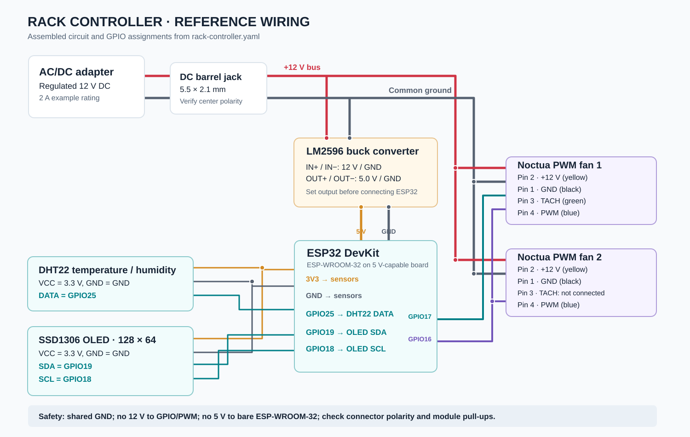
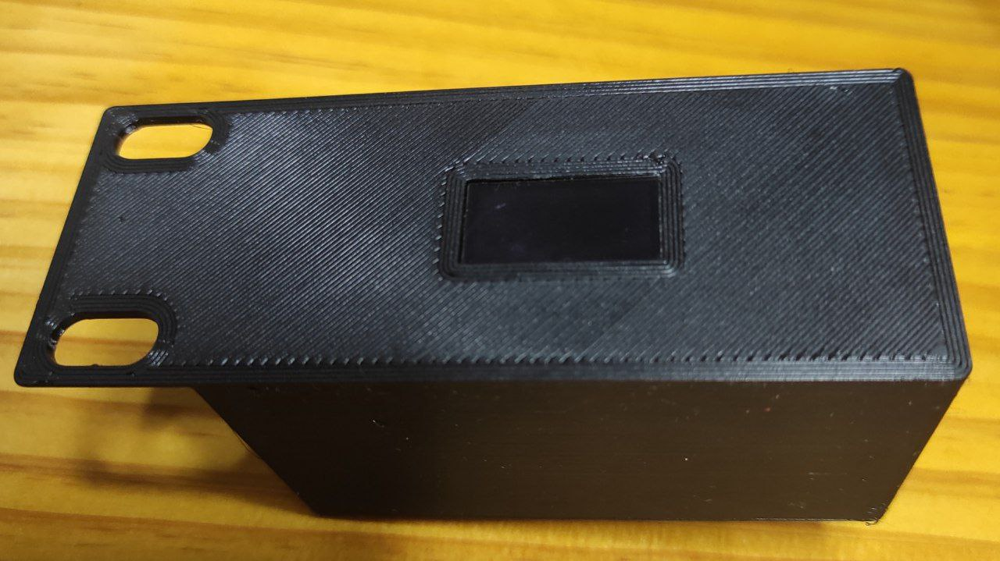
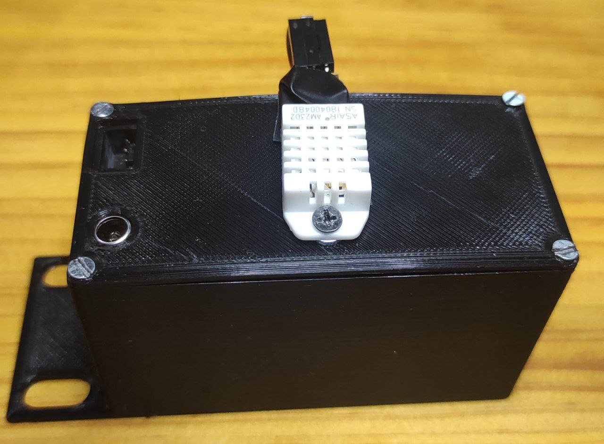
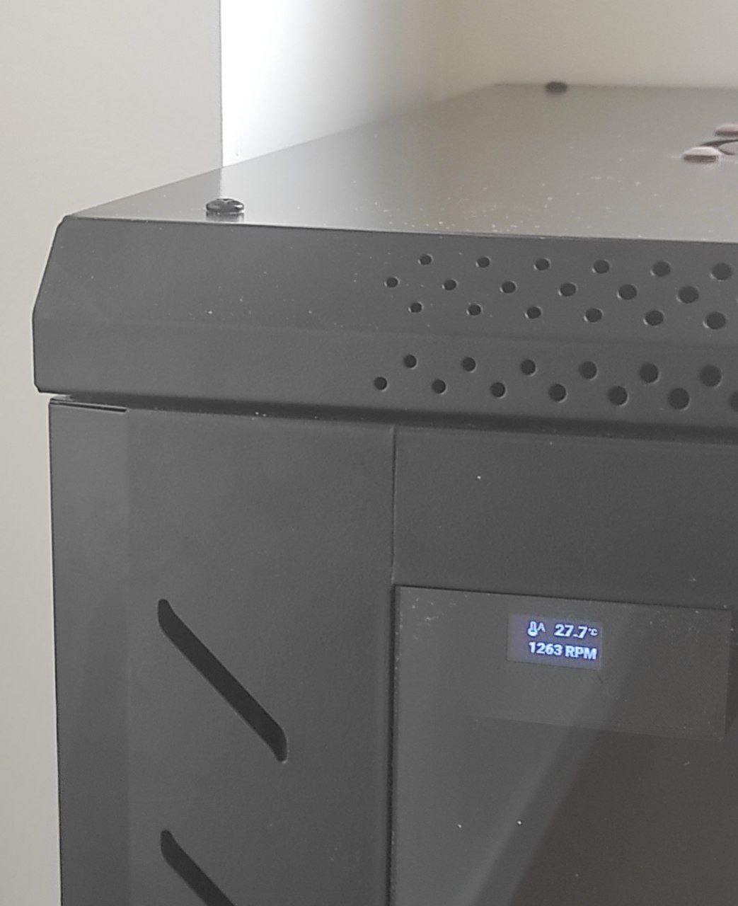

# Rack Controller

## Overview

Welcome to the Temperature Rack Controller README. This documentation guides you through assembling
and utilizing our controller for precision temperature management in rack-mounted environments.

## Components

- **Noctua NF-S12A PWM Fans:** Efficient and low-noise fans for optimal cooling.

- **ESP-WROOM-32 Microcontroller:** Powerful controller with Wi-Fi connectivity for remote
  monitoring.

- **OLED Display (128x64, I2C SSD1306):** High-resolution display for real-time temperature and
  system status.

- **Temperature Sensor (DHT22):** Accurate measurement of ambient temperature and humidity.

- **DC Power Female Jack (5.5x2.1mm):** Connector for powering the ESP32 and fans, ensuring a reliable power source.

- **DC-DC Step-down (LM2596):** Voltage regulation component that efficiently steps down the voltage, contributing to stable and reliable operation of the ESP32 controller.

## Electrical wiring (reference)

This is a **logical wiring reference**, derived from the components in this README and
[`rack-controller.yaml`](../rack-controller.yaml). The photos show the enclosure rather
than the internal connections, so the exact terminal placement, wire routing, and any
additional interface components are **not verified**. Check the physical assembly before
applying power.

### Power distribution

- Use a regulated **12 V DC** supply through the **5.5 × 2.1 mm barrel jack**. Confirm
  the actual jack polarity with a multimeter before choosing a center-positive adapter.
  A **12 V / 2 A** adapter is a reasonable starting point for a two-fan build, but size
  it for the *actual* fan current ratings, startup current, and controller overhead.
- Split the incoming **+12 V / GND** in parallel: supply the fans directly and connect
  the **LM2596 IN+ / IN−** terminals to the same supply.
- Adjust and measure the LM2596 **OUT+ / OUT− to 5.0 V** *before* connecting the ESP32.
  Feed **5 V to the VIN/5V input of a compatible ESP32 DevKit**, with common GND.
  **Never feed 5 V to a bare ESP-WROOM-32 module or its 3V3 pin**; a bare module
  requires a regulated 3.3 V supply.
- Use the DevKit's **3V3 and GND** for 3.3 V-compatible sensor modules. Confirm that the
  OLED breakout supports 3.3 V power and that its I²C pull-ups do not pull SDA/SCL to 5 V.

### Wiring / GPIO map

| Connection | From | To | Notes |
| --- | --- | --- | --- |
| Fan power | 12 V / GND bus | Noctua pin 2 (yellow) / pin 1 (black) | Continuous 12 V; do not PWM the supply rail |
| Fan speed command | ESP32 **GPIO16** | Noctua pin 4 (blue), shared by fans | ESPHome LEDC at **25 kHz**; PWM signal only |
| Speed feedback | Noctua **fan 1** pin 3 (green) | ESP32 **GPIO17** | Open-collector tachometer; 3.3 V pull-up configured in ESPHome |
| Other fan tachometers | Other fans' pin 3 (green) | **Leave unconnected** | Do not tie separate tachometer outputs together |
| Temperature / humidity | ESP32 **GPIO25** | DHT22 DATA | Power the sensor at 3.3 V; use a data pull-up to 3.3 V if the module lacks one |
| OLED SDA | ESP32 **GPIO19** | SSD1306 SDA | I²C, 3.3 V logic |
| OLED SCL | ESP32 **GPIO18** | SSD1306 SCL | I²C, 3.3 V logic |
| All logic grounds | Supply GND / LM2596 OUT− | ESP32, DHT22, OLED, fan GND | **Common ground is required** |

### Electrical precautions

- The Noctua PWM input is **not** a 12 V power input. Noctua specifies a **25 kHz**
  logic-level signal, and compatible fans accept 3.3 V control. The ESP32 GPIOs are
  **not 5 V tolerant**: ensure that the specific fan/input arrangement cannot pull a
  GPIO above 3.3 V, including during startup or when the ESP32 is unpowered. Use a
  suitable 3.3 V-safe buffer/interface if necessary; this diagram does not claim that
  an unverified direct connection is safe in every build.
- The tachometer is an open-collector signal. The configuration enables the ESP32's
  internal pull-up for GPIO17; verify the resulting high level never exceeds 3.3 V.
  The `pulse_counter` filter multiplies by **0.5**, accounting for two pulses per fan
  revolution.
- A bare four-pin DHT22 typically needs a **4.7–10 kΩ pull-up** from DATA to 3.3 V;
  many assembled sensor boards already include one.
- Verify all rails with a multimeter, insulate the power split and buck module, and
  provide strain relief for the barrel jack and fan cables. This wiring covers
  **low-voltage DC only**; use a certified external mains adapter.

**References:** [Noctua PWM specifications](https://noctua.at/pub/media/wysiwyg/Noctua_PWM_specifications_white_paper.pdf)
and [Noctua microcontroller PWM/RPM guide](https://www.noctua.at/cn/support/faqs/microcontroller-guide-pwm-setup-and-rpm-monitoring).

## Functionality

- **Home Assistant Integration:** Effortlessly manage and monitor sensors through Home Assistant
  control.

- **Fan Control:** Enjoy automated Noctua fan control using PID based on temperature readings, or
  opt for manual configuration with a specific speed.

- **Display Interface:** Experience real-time monitoring through the user-friendly OLED display.

## Images

  
  

  

