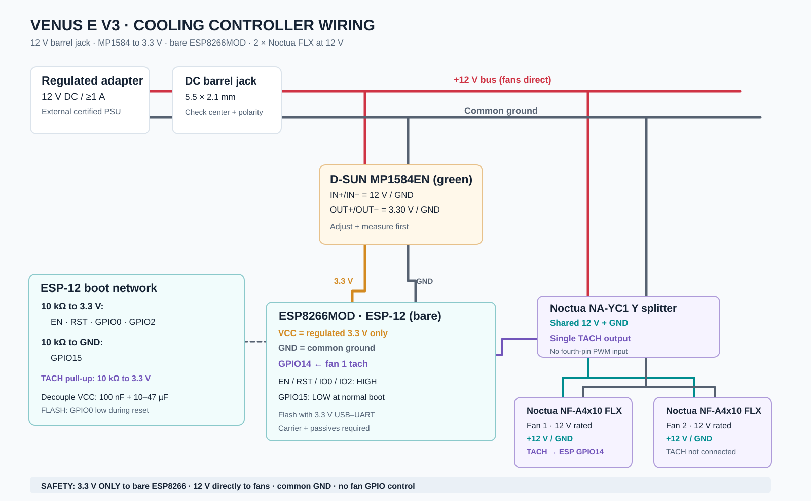

# Venus E V3 Cooling Controller

## Overview

Auxiliary **bottom-to-top airflow** for the floor-standing Marstek Venus E V3. This is
a **hardware assembly project**, modeled after the [Rack Controller](../rack-controller/README.md).
The fan controller firmware and Home Assistant integration will be provided separately.

The battery stands on the floor, with approximately **50 mm between the rear of the
battery and the wall**. Two existing **Noctua NF-A4x10 FLX** 40 × 40 × 10 mm
**three-pin, 12 V** fans will be mounted horizontally near the lower rear heatsink
to encourage upward airflow along its vertical fins. Reuse the **supplied, unused
Marstek wall-mount bars** only after confirming the real hole positions and
clearances; they are **not** carrying the battery's weight in this build.

## Electrical wiring

  

This circuit gives the fans a **fixed DC voltage** (initially **9 V**) and lets
the ESP8266 **observe the RPM of one fan**. **There is no PWM speed control,
on/off switching or independent RPM readout for both fans** in this minimal
configuration. The three-pin **FLX** fans have **no fourth-pin PWM input**:
do **not** connect an ESP GPIO to their power lead or PWM-chop their supply
without a separately validated driver. Adjusting the LM2596 trimmer is
**manual**, and its step-down output **cannot provide a regulated 12 V**
from a 12 V input; a direct 12 V bypass would be needed for full speed.

### Bill of materials

| Qty | Part | Notes |
| --- | --- | --- |
| 1 | Regulated **12 V DC / 1 A or higher** adapter | 5.5 × 2.1 mm **center-positive** plug; 2 A is also fine |
| 1 | Female 5.5 × 2.1 mm DC jack | Panel mount; check contact polarity with a meter |
| 1 | **D-SUN MP1584EN** adjustable buck (green board) | **12 V → 3.30 V** for the **bare** ESP8266MOD |
| 1 | **LM2596** adjustable buck (blue board) | **12 V → 9.0 V** to supply the fans |
| 1 | **ESP8266MOD / ESP-12** bare Wi-Fi module | Requires 3.3 V supply, boot straps and a carrier/breakout |
| 2 | Noctua **NF-A4x10 FLX** | 40 × 40 × 10 mm; 12 V, **0.05 A max each**, 3-pin |
| 1 | Noctua **NA-YC1** Y-splitter | Both fan power leads, **tach from one fan only** |
| 6 | 10 kΩ resistors | EN, RST, GPIO0, GPIO2 pull-up; GPIO15 pull-down; tach pull-up |
| 1 each | 100 nF ceramic and 10–47 µF capacitor | Place near ESP8266 VCC/GND on the carrier |
| 1 | ESP-12 breakout/carrier or suitable PCB | ESP module pads are **not** normal 2.54 mm header pins |
| 1 | 3.3 V USB–UART adapter (for programming) | UART TX/RX at 3.3 V logic; never 5 V |
| Optional | FLASH (GPIO0→GND) / RESET (RST→GND) buttons | Useful when programming the bare module |
| 1 | Inline low-voltage fuse, enclosure, wire and insulated terminals | Protect +12 V distribution and provide strain relief |
| 2 | Original Marstek wall-mount bars, if unused | Reuse only if the fit is confirmed; do not drill the battery |
| As needed | Small L-brackets, M3/M4 screws, nuts, spacers, rubber isolators | Exact sizes after physically measuring rail holes |
| Optional | Thin printed PETG fan cradle / deflector | Only if generic brackets do not fit; keep air intake unobstructed |

The fan pair draws **up to 0.10 A at 12 V** (1.2 W at rated voltage);
the ESP8266 needs a regulator capable of **Wi-Fi current bursts**.
A quality **12 V / 1 A** supply leaves substantial headroom for this
assembly. Do not interpret the adapter's current rating as forced current.

### Power and signal connections

| From | To | Function |
| --- | --- | --- |
| DC jack +12 V | MP1584 **IN+**, LM2596 **IN+** | Shared 12 V input, ideally through a fuse |
| DC jack GND | Both **IN−** | Common power return |
| MP1584 **OUT+** (measured **3.30 V**) | ESP8266 **VCC** | **Never use 5 V** on bare ESP8266MOD |
| MP1584 **OUT−** | ESP8266 **GND**, fan GND reference | Shared ground |
| LM2596 **OUT+** (measured **9.0 V**) | Y-cable fan **+V** (3-pin connector pin 2) | Fixed lower-speed fan supply |
| LM2596 **OUT−** | Y-cable fan **GND** (pin 1) | Fan return, common with ESP GND |
| Y-cable single **TACH** (pin 3) | ESP8266 **GPIO14** | One fan RPM only; **10 kΩ pull-up to 3.3 V**, no 12 V on GPIO |
| ESP8266 **EN**, **RST**, **GPIO0**, **GPIO2** | Individual **10 kΩ** pull-ups to 3.3 V | Normal boot and enable |
| ESP8266 **GPIO15** | **10 kΩ** pull-down to GND | Required normal boot strap |
| UART TX/RX on ESP8266 | 3.3 V USB–UART RX/TX, crossed | Only needed to flash/diagnose; shared GND |
| GPIO0 → GND during reset | Temporary FLASH button / jumper | Enter serial bootloader; release for normal boot |

**Do not parallel two tachometer outputs.** The NA-YC1 splitter provides
a single tach signal by design. Most Noctua PC fan tachometer outputs are
open-collector; use a **3.3 V pull-up** rather than a 5 V or 12 V pull-up,
and confirm the actual signal on your hardware. Typical PC fans generate
**two tach pulses per revolution** (RPM = pulses/s × 30).

The MP1584 and LM2596 are **adjustable**. Set and verify their respective
outputs **with no ESP or fans connected**, including polarity, then connect
the load. The ESP8266 must have nearby decoupling and a reliable 3.3 V rail.
Keep all low-voltage grounds common. **Neither buck can be controlled
by firmware in this configuration.**

## Mechanical arrangement

- **Airflow:** Both 40 mm fans lie **horizontally**, axes pointing upward,
  near the **bottom of the rear vertical-fin heatsink**. A small open-sided
  plenum may help feed the lower fins; air must escape **above** the battery.
- **50 mm wall gap:** The **40 mm footprint** of each fan must fit the rear
  gap **plus its fasteners and clearance**. Its 10 mm thickness is vertical.
  Do **not** confuse the 10 mm fan thickness with the 40 mm depth of the
  horizontally positioned fan.
- **Battery on the floor:** Keep the lower intake open to room air; the
  floor and skirting board can block an unraised intake. Verify the
  bottom of the fins is accessible and the fans **do not cover existing
  ventilation, connectors or drain paths**.
- **Original wall bars:** If they are unused, try them as a **removable
  support frame** with standard L-brackets and screw-on fan corners.
  Do not borrow load-bearing fasteners, rely on unmeasured hole spacing,
  or transfer vibration/weight into heatsink fins.
- **Enclosure:** Locate the ESP8266 and both bucks **outside the hot
  rear air channel**, with cable strain relief and insulated electronics.
  The ESP antenna should remain clear of metal profiles.

The Marstek mounting-bar dimensions and exact fin access have **not been
measured on this installation**. Cut length, bracket count and hole spacing
are intentionally left adjustable rather than inventing a drilling template.
Confirm the applicable Marstek installation-clearance requirements: an
auxiliary fan does **not** replace the manufacturer's minimum wall spacing.

## Bring-up checklist

1. Check jack **polarity** and verify the PSU's 12 V output.
2. Set the **green MP1584 to 3.30 V** and the **blue LM2596 to 9.0 V**
   independently using a multimeter, without loads connected.
3. Verify the ESP-12 carrier's boot straps (EN/RST/GPIO0/GPIO2 high;
   GPIO15 low), 3.3 V decoupling and GPIO14 tach pull-up.
4. Energize the ESP8266 **without** the fan harness first; check stable
   boot and absence of 5 V / 12 V on GPIOs.
5. Connect the Y-cable and confirm **both fans start reliably** at 9 V
   after every power cycle. If not, raise the voltage **within the
   converter's achievable range**, or use a separately switched direct
   12 V fan rail for startup.
6. Confirm one RPM signal, correct airflow direction and no blocked
   intake or excess vibration; measure temperature against a fan-off
   baseline at matched battery load and ambient temperature.

**Scope:** This PR documents mechanical and electrical assembly only.
The ESPHome firmware and Home Assistant entities will follow separately.
