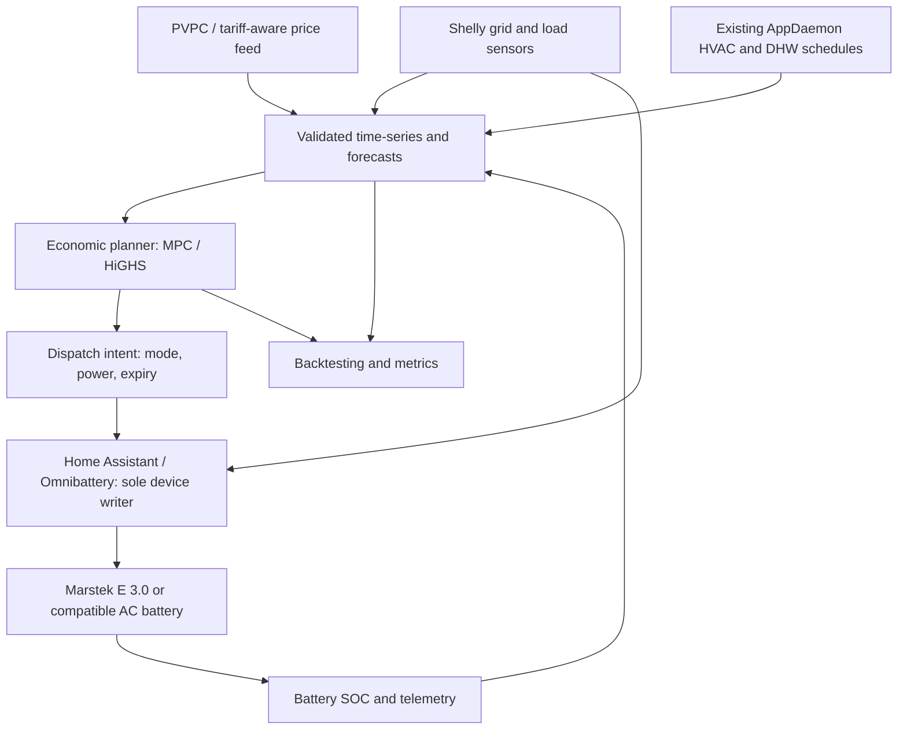

# ADR-0001: Forecast-informed economic dispatch for a home AC battery

- **Status:** Proposed
- **Date:** 2026-10-23
- **Decision owners:** Homelab maintainers
- **Implementation plan:** [Home battery optimizer](../../planning/home-battery-optimizer-implementation.md)

## Context

The homelab already operates Home Assistant under `apps/home-assistant/`, with:

- AppDaemon's `climate_control` and `dhw_control` choosing low-price PVPC hours for aerothermal heating and hot water (`apps/home-assistant/appdaemon/apps/`).
- An ESIOS PVPC sensor (`sensor.esios_pvpc`) and historical household electricity measurements.
- Shelly devices including `shellyem-main` and `shellypmmini-servers`, visible in the monitoring configuration. **Their electrical placement, sign convention, accuracy, and measurement interval must be verified before control**; a channel named "main" is not sufficient evidence that it measures net grid exchange.
- An approximately 250 W continuously running server load. The remaining demand is less predictable; the aerothermal load is already deliberately shifted to cheap hours.

A grid-charged AC battery of roughly 5 kWh is being evaluated, with Marstek Venus E 3.0 as the current leading candidate, not a committed dependency. It offers approximately 5.12 kWh nominal energy and up to 2.5 kW nominal AC power, subject to its exact hardware, firmware and installation configuration. The objective is **bill reduction through time-of-use arbitrage**, not solar self-consumption. Backup power, when available, is a separate electrical feature, not part of the dispatch guarantee.

PVPC prices can be negative and have publication delays; daily schedules must account for Europe/Madrid daylight-saving transitions (23-/25-hour days). A correct optimization needs both the *marginal billable import price* and a demand forecast. Merely running the battery whenever the home consumes power can exhaust it before the expensive evening hours.

Prior economic simulations were exploratory: their efficiencies, useful SOC window, equipment prices, forecast accuracy, idle draw, battery life and bill/tax assumptions are **not measurements** and must not become production constants without validation.

## Decision

**Build a forecast-informed, receding-horizon economic planner, while delegating device-level regulation and safety to one existing Home Assistant battery integration.** Implement it progressively, with an offline backtest and shadow mode before enabling any battery writes.

### Logical architecture

1. **Metering and data:** Preserve raw UTC/offset-aware intervals, source provenance, units, interval duration and missing-data flags. The input demand is gross household consumption, not observed grid import while the battery is active. For a home with no PV, using the chosen sign convention: `P_home = P_grid - P_battery_charge + P_battery_discharge`, where `P_grid` is signed positive for import. Validate each sign from real observations; account for inverter standby and any other production.
2. **Forecasting:** Start with a transparent calendar/seasonal/rolling-median predictor, with the ~250 W server baseline and the **already committed** AppDaemon climate/DHW schedule as explicit inputs. Report prediction intervals (e.g. P10/P50/P90), not only point forecasts. Consider gradient-boosted models only if out-of-sample economic savings improve.
3. **Economic optimization:** Re-solve every 15 minutes, with a configurable rolling 24–48 hour horizon; execute only the current interval and replan on new readings. Optimize net **marginal import cost** including applicable variable taxes/charges, converter losses, standby consumption and an explicit throughput/degradation sensitivity. Represent an unknown future price as a forecast with uncertainty; never treat tomorrow's unpublished tariff as known. Preserve a terminal SOC value or equivalent terminal penalty instead of artificially emptying the battery at midnight.
4. **Physical constraints:** Respect verified power, SOC and energy limits (provisional 20–95% SOC, ≤2.5 kW for the E 3.0), import power ceiling, realistic charge/discharge efficiencies, and no simultaneous charge/discharge. Enforce no intentional export via independent **real-time grid-feedback control**; the economic optimizer alone is not a sufficiently fast export guard. The charge target must not violate the household's contracted/import limit.
5. **Control ownership:** Start with [Omnibattery](https://ffunes.github.io/Omnibattery/) for local Marstek E v3 Modbus TCP communication and grid-feedback control. Confirm actual device firmware support and the integration's external-command or manual-control contract before writing an adapter. **Only one component may write battery setpoints at a time.** The planner must not write raw Modbus registers concurrently with Omnibattery automatic control. The documented manual-mode handoff isolates a battery from Omnibattery automatic dispatch, but using it requires a dedicated single-writer adapter, explicit lease/heartbeat and a tested safe-stop sequence; prefer extending Omnibattery with a higher-level dispatch-intent interface if a reliable public interface is absent.
6. **Safety and operations:** A missing/stale meter, stale SOC, lost battery connectivity, control lease expiry, invalid price schedule, solver failure, import limit breach or uncertain inverter response cancels economic dispatch and requests safe idle (0 W) through the established controller. Independently configured battery/BMS protection remains authoritative. Alert and require explicit acknowledgement for recurrent command failures. After safe idle is acknowledged, manual control can be returned to Omnibattery; do not assume an API timeout guarantees the physical output is zero. Never depend on the planner to provide anti-islanding or backup safety.
7. **Integration boundary:** The existing AppDaemon heating and DHW algorithms retain authority over comfort/heat scheduling. The battery planner observes their schedules, not their control entities. Joint heat-pump/battery scheduling is an optional later ADR; it must preserve comfort and prevent two controllers independently changing the same load.
8. **Deployment:** Keep application/config changes GitOps-managed. Begin with an offline Python model; introduce a small dedicated `apps/battery-optimizer/` deployment only after shadow testing, rather than placing optimization and device communication inside one monolithic HA automation. Publish metrics to the existing Prometheus/Grafana stack. Store credentials through the established Vault/ExternalSecret workflow.

### Optimization formulation (first implementation)

For each interval `t`, decide nonnegative grid charge `c_t`, AC discharge `d_t`, and battery energy `E_t` (kWh). With duration `Δt` in hours:

- Battery state: `E_(t+1) = E_t + η_c c_t Δt - (d_t / η_d) Δt - standby_loss_t`.
- Grid import: `g_t = max(0, forecast_home_load_t + c_t - d_t)`. A model of export must constrain it to zero, not discard/export energy for free.
- Minimize `Σ_t [buy_price_t * g_t * Δt + throughput_cost(d_t, c_t)] + terminal_SOC_penalty`, subject to energy, power, grid and mode constraints.
- For unknown future prices or load, use scenarios/robust margins rather than a fictitious perfect forecast.
- A linear model with HiGHS is the first choice where its assumptions suffice; use MILP for binary charge/discharge state or piecewise efficiency only when it materially changes the optimum. Verify that the objective does not allow pathological simultaneous flow or artificial negative-price cycling.

The economic planner emits **requested** setpoints. Actual output is capped by live load, grid meter feedback, hardware protections and command acknowledgement. A 15-minute plan is not an authorization to inject into the grid for 15 minutes.

### Comparison and validation

Compare the same date ranges and the same *available-at-the-time* information for all policies:

1. **No battery** — existing HVAC/DHW scheduling remains in place.
2. **Omnibattery/native rule** — its supported price-based schedule and regulation, as actually configured.
3. **Price-only planner** — tariff and SOC, simple baseline demand.
4. **MPC with statistical demand forecast** — expected first custom implementation.
5. **MPC with advanced/quantile forecast** — optional, only if its net economic value warrants it.
6. **Perfect-foresight oracle** — diagnostic upper bound only, not an achievable saving estimate.

Use walk-forward training/evaluation without future consumption leakage, measure demand prediction accuracy **and** incremental EUR savings (including converter losses and idle energy), equivalent full cycles, curtailed commands, export/import violations, controller availability and forecast regret. Retain uncertainty bands via day/week block bootstrap and tariff/efficiency sensitivity. Reconcile to monthly invoices and report fixed charges separately.

## Rejected or deferred alternatives

| Alternative | Rationale |
|---|---|
| Hardcoded cheap/expensive windows only | Valuable baseline and safe fallback, but ignores SOC opportunity cost and shifting peaks. |
| Forecast model choosing setpoints directly | Entangles demand inference, economics and hardware safety; difficult to test and audit. |
| End-to-end LLM/agent control | Unnecessary, non-deterministic and difficult to enforce hard constraints. |
| Direct Modbus writes from a second controller | Conflicting device ownership with Omnibattery and weak failure isolation. |
| Rewrite Omnibattery/HA control | Reimplements known hardware/protocol and feedback problems before proving any economic upside. |
| Optimize heat-pump hours jointly in v1 | AppDaemon already owns HVAC/DHW schedules and comfort; adds a conflicting control surface. |
| Machine-learning forecast from day one | More complexity without evidence that forecast MAE improvement creates financial value. |

## Consequences

- Positive: explainable dispatch, local operation, an auditable savings model, reusable battery adapter and a gradual path to more advanced forecasts.
- Costs: historical data normalization, tariff accounting, command ownership integration and persistent observation/metrics require engineering and calibration.
- Unresolved: exact main Shelly grid boundary, PVPC billed tariff reconciliation, the real E 3.0/alternative model and firmware, achievable Modbus command contract, measured efficiency vs output power, idle draw, and local electrical protection/certification. These are Phase 0 gates, not assumed away.
- No hardware purchase or automatic actuation is authorized by accepting this ADR.

## References

- [Implementation plan](../../planning/home-battery-optimizer-implementation.md)
- [Current AppDaemon PVPC climate/DHW configuration](../../apps/home-assistant/appdaemon/apps/apps.yaml)
- [Home Assistant deployment](../../apps/home-assistant/values.yaml)
- [Existing negative-price fallback runbook](../troubleshooting/appdaemon-pvpc-negative-prices.md)
- [Omnibattery overview](https://ffunes.github.io/Omnibattery/)
- [Omnibattery model compatibility](https://ffunes.github.io/Omnibattery/compatibility/)
- [Omnibattery manual-control ownership](https://ffunes.github.io/Omnibattery/features/multi-battery/)
