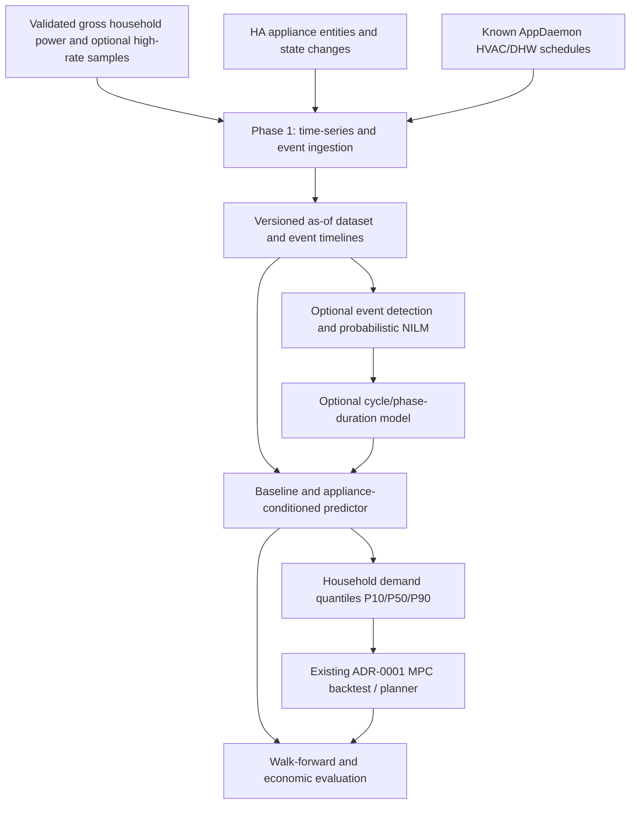

# ADR-0002: Appliance-aware household demand forecasting with Home Assistant telemetry and NILM

- **Status:** Proposed
- **Date:** 2026-10-23
- **Decision owners:** Homelab maintainers
- **Extends:** [ADR-0001 — Forecast-informed economic dispatch](0001-home-battery-economic-dispatch.md)
- **Implementation plan:** [Home battery optimizer](../../planning/home-battery-optimizer-implementation.md)
- **Scope:** Phase 1 instrumentation/data contract and optional Phase 3 forecasting improvements; Phase 4 offline economic evaluation. No live dispatch change.

## Context

[ADR-0001](0001-home-battery-economic-dispatch.md) uses forecast household demand for a receding-horizon battery economic planner. Its first predictor is deliberately simple: calendar and lag features, the ~250 W server baseline, and already-committed AppDaemon climate/DHW schedules. More complex models are permitted only if they improve out-of-sample dispatch savings.

Home Assistant already exposes information about the **washing machine and dishwasher**. Their exact entity IDs, attributes, event semantics, historical retention and whether they expose an individual power meter **have not been audited**. We must not invent these capabilities. Program, operational state, current phase, remaining time, scheduled start and completion time are useful *if available*.

Gross household power alone conflates unrelated loads. A washing-machine heating phase can resemble an oven or hob at low sampling rates; simultaneous devices make attribution ambiguous. Nevertheless, a known appliance state can explain part of current demand and, if a cycle is already running, may predict its remaining energy better than extrapolating aggregate power.

This suggests two complementary sources of appliance knowledge:

1. **Direct appliance telemetry:** Home Assistant states/events provide strong supervision about whether an appliance is running and, potentially, its program/phase/remaining time.
2. **Non-Intrusive Load Monitoring (NILM):** Detect power changes and recurring signatures in the aggregate household meter to propose identities for **unobserved** appliances; treat such identities as uncertain, not as ground truth.

The original Phase 1 ingests meter, prices and existing heating schedules, while Phase 3 develops demand predictors. Appliance data collection belongs to **Phase 1**; model fitting, inferred appliance detection and cycle forecasting belong to **Phase 3**. The economic benefit is established only in Phase 4.

## Decision

**Extend the Phase 1 data pipeline with a typed, timestamped appliance state/event stream and optional higher-frequency power measurements. In Phase 3, compare an appliance-conditioned demand predictor against the ADR-0001 baseline; develop NILM and explicit cycle-state models incrementally, only where supported by observable data and demonstrated dispatch value.**

Direct Home Assistant telemetry is the authoritative source for known device state. NILM is a probabilistic fallback or discovery mechanism for other loads, not a reason to infer what HA already reports.

Keep this pipeline **read-only**. It produces demand forecasts and uncertainty; it does not schedule appliances or send battery commands. The existing AppDaemon schedulers and Omnibattery remain sole owners of their respective actuators, per ADR-0001.

### Proposed data flow



### 1. Phase 1 — Inventory and ingest appliance telemetry

- Audit available washing machine and dishwasher entities: state, program, phase, remaining time, start/completion events, connectivity, update frequency and optional per-appliance power/energy. Store a versioned **entity mapping** and semantic normalizers; HA integration-specific strings are not model contracts.
- Ingest Home Assistant state transitions via an authenticated local API subscription, including **event time, ingestion/observation time, source, state, attributes, quality and availability**. Historical backfill may use HA's recorder/history interface where retained; choose a durable local sink for longer-term training rather than assuming recorder retention or exact history availability.
- Distinguish `off`, `idle`, `scheduled`, `running`, `paused`, `completed`, `unavailable` and `unknown` **when the integration distinguishes them**. Avoid inferring `completed` from a connectivity loss. Use `unknown` for missing semantics.
- Normalize program/phase identifiers but retain the raw values and schema version. Remaining time is an **as-observed estimate**, not an oracle for the actual completion time; it can jump, stall or be absent.
- Add raw power samples at the highest **verified, sustainable and meaningful** rate. Sub-minute/approximately 1–2-second readings may help change-point detection if the actual Shelly entity and transport can provide them; minute/15-minute data supports coarser patterns. Do not fabricate high-resolution samples by interpolating hourly kWh.
- Join readings by UTC instants and explicit interval duration, preserving sensor placement, unit, sign, source timestamps, missing/late/duplicate event flags and Europe/Madrid display metadata. Reconstruct **gross home demand** independently of battery charging/discharging as defined by ADR-0001 before appliance analysis.
- Keep raw telemetry local. Do not commit household presence schedules, activity histories, credentials or raw appliance events into Git.

**Phase 1 exit extension:** produce a reproducible feature-ready dataset, a documented inventory of actually available entity fields, timestamp/provenance tests, and example event timelines for at least the two HA-connected appliances. Absence of an attribute must degrade gracefully, not block the basic ADR-0001 path.

### 2. Phase 3 — Forecasting and appliance discovery (progressive options)

Use an intentionally conservative progression; do not require all stages to ship:

| Candidate | Inputs | Purpose | Selection condition |
|---|---|---|---|
| A. ADR-0001 baseline | Lagged gross demand, calendar, servers, committed HVAC/DHW | Mandatory reference | Always retained as fallback |
| B. Appliance-conditioned aggregate model | Baseline features plus HA-observed running/program/phase/remaining-time states | Predict total future demand directly without decomposition | First experiment |
| C. Explicit cycle model | Observed starts, program/phase transitions, durations, optional direct appliance power | Predict remaining duration and conditional future energy of *active* cycles | Only when cycles and energy targets can be calibrated |
| D. NILM-assisted model | Change points, aggregate-power patterns, HA-derived weak labels | Find uninstrumented loads; produce candidate appliance identities and probabilities | Only with adequate sampling and validation |
| E. More complex sequence model (HSMM/LSTM, etc.) | Event/cycle sequences and adequate labeled data | Capture stage durations or complex waveform behavior | Only if simpler models are insufficient and uplift is repeatable |

Start with deterministic rules, per-program empirical profiles and/or CatBoost/LightGBM. A Hidden Semi-Markov Model (HSMM) can explicitly model stage duration; LSTM is optional, **not** an architectural dependency. Neither model learns reliable appliance identity from aggregate readings without adequate supervision/ground truth.

**Do not assume that a running appliance exposes individual electricity usage.** If it has a dedicated meter, fit per-program power/energy profiles against that sensor. If only aggregate home power is measured, attribute energy conservatively using device events and low-overlap windows, report identification ambiguity and account for other loads; do not call aggregate increments a measured appliance kWh value.

For an appliance known to be running, a cycle model may predict its remaining consumption. For an appliance **not yet running**, estimate *whether and when it might start* using historical probabilities; do not use a later observed start or the eventual cycle duration as if it were known at forecast creation.

### 3. Forecast composition and double-counting control

Initially prefer **one aggregate predictor** using appliance state features, as it avoids requiring exact per-device energy attribution.

Consider an additive predictor only for **well-identified** loads:

```text
forecast_home(t+h | information_at_t)
  = forecast_residual(t+h | information_at_t)
  + sum(forecast_known_appliance_i(t+h | information_at_t))
```

The residual target must then be trained against *household demand minus the same appliance components*, with coherent uncertainty handling. It is **not** acceptable to add a washing-machine cycle forecast on top of a generic whole-household model that already includes typical washing-machine usage.

When no device-level ground truth exists, prefer the aggregate model; any decomposition is an estimated latent model with appropriate uncertainty. Avoid negative residual predictions and implausible conservation errors.

Produce forecasts aligned to ADR-0001's 15-minute dispatch intervals, with 24–48-hour horizon where possible, quantiles (P10/P50/P90), feature provenance, creation time, horizon, model version and a fallback reason. Test near-term horizons (15 minutes, 1 hour, 6 hours) separately from 24-hour forecasting: known running cycles may help most in the short term, while unknown future starts dominate long horizons.

### 4. Example canonical feature and forecast contract

Illustrative fields, **not claims about currently available HA entity names or attributes**:

```yaml
as_of_utc: "2026-10-23T16:30:00Z"
interval_minutes: 15
gross_household_power_w: 910
appliances:
  washer:
    availability: available
    operating_state: running
    program: cotton_40
    phase: washing             # optional: unknown when unsupported
    remaining_minutes: 55      # optional: last observed estimate
    observed_at_utc: "2026-10-23T16:29:59Z"
    direct_power_w: null       # optional, not guessed from whole-house power
  dishwasher:
    operating_state: idle
    observed_at_utc: "2026-10-23T16:29:45Z"
prediction:
  target_start_utc: "2026-10-23T16:30:00Z"
  target_end_utc: "2026-10-23T16:45:00Z"
  home_energy_kwh:
    p10: null                  # generated by fitted model
    p50: null
    p90: null
  model_version: null
```

Every feature must be available at `as_of_utc` under the actual read/publish latency. A historical completed cycle may be used as a *training label*, but never as a feature at an earlier prediction timestamp. Observed future HVAC commands, tariff publications or weather also must follow ADR-0001's as-of rule.

### 5. NILM detection and confidence policy

- Start with robust filtered power-change events, sustained level changes, duty-cycle patterns and co-occurring HA state changes; optionally train LightGBM/CatBoost classifiers with labels derived from observed HA starts/stops.
- Preserve `unknown` and `ambiguous` outcomes. Handle multi-appliance overlap as multi-label or uncertain combinations; **never force every step into a single appliance identity**.
- Calibrate classifier confidence on chronologically separate labeled sessions. A confidence score is not proof of identity or power attribution. For a detected oven vs hob, a short 2 kW increase alone is insufficient; use longer temporal patterns if available.
- Use HA-exposed state as observed evidence, but still apply freshness/availability checks. If HA is offline, do not assert that its last-known running state remains true indefinitely.
- Never allow device classification to bypass MPC, the physical no-export guard, grid-meter freshness requirements or single-writer control.

### 6. Validation, acceptance and rollout gates

Replay all forecasts chronologically with only information observable at each decision instant; use walk-forward splits grouped by complete calendar periods and appliance **sessions** (no adjacent fragments of the same cycle across train and test). Include typical weekdays/weekends and seasons if captured.

Measure at least:

- **Data quality:** state/event freshness, delayed or missing transitions, meter resolution and coverage, inferred vs directly metered labels, overlap frequency.
- **Appliance inference:** precision/recall/F1 and confusion/abstention rates on verified known-device events; phase/duration error only where independently labeled. Unlabeled unknown devices cannot count as verified successes.
- **Demand:** MAE/WAPE by 15 min/1 h/6 h/24 h, P10/P50/P90 empirical coverage and probabilistic loss; report errors during high-price hours and during appliance starts/completions.
- **Economic relevance:** replay candidates A–E against the same ADR-0001 MPC, battery assumptions, as-of tariff information, and held-out date ranges; report incremental net EUR/year, uncertainty, implementation cost and forecast regret versus the feasible comparator/oracle.

Acceptance follows ADR-0001's **predeclared economic uplift threshold from Phase 2**. Do not retain ML/NILM just because classification accuracy or MAE improves; require repeatable net value without material safety or operational regressions.

Test missing HA integrations, incomplete/misclassified events, paused/restarted/cancelled cycles, simultaneity, overlapping loads, manual overrides, meter dropouts, timestamps out of order, DST 23/25-hour days and battery-induced grid-power distortion. An unknown appliance or failed model must fall back to the validated ADR-0001 aggregate predictor.

### 7. Boundaries and deployment

- **Phase 1:** local, read-only ingestion plus schema/config and offline dataset; no K3s deployment required for initial experiments.
- **Phase 3:** offline prototypes, training, feature snapshots, labeled replay fixtures and versioned models. Deploy inference as a separate service only when shadow testing warrants it.
- **Phase 4:** economic head-to-head replay and go/no-go decision.
- **Phases 5–6:** if accepted, inference joins the existing planner's inputs in shadow mode first; unchanged single-writer, safe-stop and no-export protections. Battery actuation remains governed exclusively by ADR-0001.
- **Privacy/operations:** local retention policy for appliance/activity histories; authenticated HA API access with least privilege where supported; persistent model provenance, data-quality and fallback metrics; no raw telemetry in source control.

## Alternatives considered

| Alternative | Decision |
|---|---|
| Pure NILM for all devices | Rejected: discards stronger HA ground truth and adds identification error. |
| Always deploy an LSTM / deep NILM model | Deferred: higher complexity and labeling requirements without demonstrated economic benefit. |
| Require smart plugs on every appliance | Rejected as a dependency; optional temporary/reference submeters can improve calibration. |
| Add device forecasts directly to unchanged whole-home forecast | Rejected: double-counting risk. |
| Replace the current demand predictor immediately | Rejected: baseline, holdouts and EUR uplift must remain the selection criterion. |
| Control washing machine or dishwasher start times | Out of scope; separate ADR would need device safety, user intent and explicit control ownership. |
| Make NILM a prerequisite for the battery controller | Rejected: classification is advisory and cannot be a safety dependency. |

## Consequences

**Benefits:** better awareness of active cycles; potentially improved short-horizon load estimates; reusable appliance-event dataset; a disciplined path toward identifying other loads.

**Costs and risks:** state semantics differ between HA integrations; historical telemetry may be incomplete; low-frequency total-power samples cannot uniquely attribute many loads; appliance usage is behavior-dependent; additional models can create leakage, false certainty, training drift and operational burden.

**Open questions for Phase 1 audit:** exact washer/dishwasher entities and available attributes, their historian retention and event latency; meter topology and real sampling rate; existence of independently metered appliance power; examples of overlapping cycles; measurement/retention overhead; predeclared incremental EUR threshold.

**This ADR authorizes only documentation and future read-only experiments, not deployment, hardware purchase, new appliance control, or battery setpoint writes.**

## References

- [ADR-0001 — Battery economic dispatch](0001-home-battery-economic-dispatch.md)
- [Battery optimizer implementation plan](../../planning/home-battery-optimizer-implementation.md)
- [Existing Home Assistant installation](../../apps/home-assistant/values.yaml)
- [AppDaemon scheduler configuration](../../apps/home-assistant/appdaemon/apps/apps.yaml)
- [Home Assistant REST API](https://developers.home-assistant.io/docs/api/rest/)
- [Home Assistant WebSocket API](https://developers.home-assistant.io/docs/api/websocket/)
- [NILMTK — Non-Intrusive Load Monitoring Toolkit](https://github.com/nilmtk/nilmtk)
