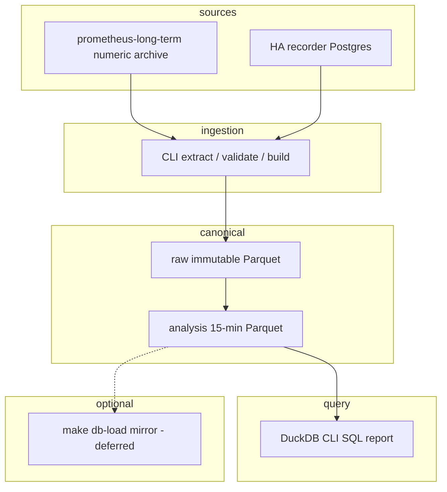

# ADR-0003: Phase 1 — measurement, reproducible dataset and strategy baseline

- **Status:** Accepted (2026-10-23) — Phase 1 Definition of done is met: the pre-tax cost basis is settled by decision, and the optional `mirror` command stays deferred
- **Date:** 2026-10-23
- **Decision owners:** Homelab maintainers
- **Extends:** [ADR-0001](0001-home-battery-economic-dispatch.md), [ADR-0002](0002-appliance-aware-load-forecasting.md)
- **Supersedes scope of:** the original Phase 1/2 plan in [implementation plan](../../planning/home-battery-optimizer-implementation.md)

## Context

ADR-0001 and ADR-0002 proposed a broad build: a dedicated ingestion service, demand forecasts, an economic planner, appliance-aware NILM. An empirical audit of the existing telemetry showed that several planning premises were wrong and most of the proposed data infrastructure already exists. This ADR records the corrections and narrows scope to what measurement actually requires.

**This phase does NOT select controller architecture** — native Omnibattery, extending it, or bespoke — and does NOT require benchmarking Omnibattery as a completion criterion. No economic stop-threshold is imposed. The goal is: (1) reproducible chronological comparison of no-battery cost, (2) a simple causal price-only policy implementable without future knowledge, (3) a day-ahead policy that plans each local day from that day's published prices with a strictly causal load forecast, and (4) a physically feasible perfect-information optimum computed offline. Four goals were stated at acceptance and four kinds of capability were built; the ladder now carries **five** rungs, because a fifth policy (`rolling_horizon`, promoted 2026-10-24) sits between goals (3) and (4) — see *Strategy comparison*.

### Metering mapping (user-confirmed)

The Grafana dashboard "IoT - Energy" (uid `fe5f72fc-46b6-4cb0-adbf-cb08582dfd9e`, source [`apps/home-assistant/dashboards/iot-energy.json`](../../apps/home-assistant/dashboards/iot-energy.json)) defines "Total Energy" as `shellyem-main` channel 1 and "Circuit 1" as `ch1 − ch2`; circuit 2 is ch2 directly. **The physical wiring was confirmed by the user on 2026-10-23: `sensor.shellyem_main_channel_1_energy` is the whole-home feed, channel 2 is the aerotherm/appliance branch, and the servers are already included in ch1.** Servers are therefore nested within ch1 — and within the dashboard's `ch1 − ch2` circuit — not additive to it. This is the metering basis shared by the dashboard, this ADR, and the pipeline; it is a confirmed mapping, not an assumption to be validated against installer documentation.

**The export sign is untested.** No PV is installed and no forced-export condition has been created, so ch1's behaviour on export is not established from measurement. Nothing here asserts a reversed-CT wiring or diagnoses one — the available evidence neither supports nor rules it out. Determining the export sign is **not a requirement for this offline phase**: the pipeline treats ch1 as an import-dominant whole-home total and flags negative counter deltas as a data-quality event rather than assigning them a sign interpretation, so the baselines are unaffected while no generation or storage exists. Resolving it is a validation item for the phase that installs hardware.

### Prometheus data characteristics

`prometheus-long-term` holds the numeric archive; 1-minute scrape interval is configured. Per-series full history completeness **must be audited** rather than asserted as "2.5 years for all entities" — retention is 9999d but individual series may have started later. At scrape time, numeric series whose value is unchanged may be re-exported as repeated samples by the HA Prometheus integration; enum `sensor` domain strings are not exported as state-value gauges (only `hass_state_change_total`, `entity_available`, `last_updated_time_seconds` are available — no per-enum gauge for the `sensor` domain). Pod IP series churn requires identity stitching; overlaps must be investigated rather than unconditionally summed (instant max/sum is semantically different from counter-delta stitching across pod restarts). Prefer manifest-stable entity identity and label precedence over naive cumulative counter summation, which creates artificial resets.

**Counter deltas are the primary energy signal; power is a crosscheck.** `query_range` lookback fills repeated samples across short gaps, overstating apparent density. For true scraped-sample counts: use `timestamp()` on source samples, or extract raw range vectors in bounded chunks. `count_over_time` on a raw window counts ACTUAL samples received in that window — not all PromQL aggregation is unreliable; the issue is specific to `query_range` step interpolation filling gaps. Device freshness (when the device last reported) is separate from HA-export scrape freshness; `timestamp(series)` reflects Prom scrape time, not a device event timestamp. Preserve HA `last_updated` and availability metadata if known; flag explicitly as unknown otherwise.

### Cost model

The PVPC sensor is a published input. Per ESIOS documentation for indicator 1001 ("PVPC"), the published price **includes** access tolls, charges, and production cost; it **excludes** taxes (Impuesto Especial de Electricidad, IVA). Tax rates are effective-dated and sourced from verified invoices or official tariff documentation; the pipeline reads them from configuration keyed by date, never from hardcoded defaults. The installed sensor is `pvpc_updated` (HACS custom integration from [oscarrgarciia/HA-PVPC-Updated](https://github.com/oscarrgarciia/HA-PVPC-Updated)), which reads from the ESIOS API (`api.esios.ree.es`). The exact component composition delivered by the installed version **must be verified** against the live sensor output before double-adding tolls or decomposing into OMIE residuals — the upstream integration's behaviour may differ from the built-in [`pvpc` integration](https://www.home-assistant.io/integrations/pvpc/). See [ESIOS indicator 1001](https://www.esios.ree.es/es/indicadores/1001) for the official price definition.

The existing dashboard cost model has an identifiable defect: a `>= 0` guard silently discards negative-price intervals, destroying the best charging opportunities. The precise magnitude of this defect is **not claimed** here — the dashboard code shows the filter; its impact must be measured by the pipeline.

Fixed contracted power and rental charges are outside energy savings under an unchanged contract and are excluded from the energy objective. A constant tax factor scales a pure-energy objective uniformly and preserves argmin. However, an energy-vs-degradation mixed objective must use a coherent monetary basis — uniform scaling of the full objective preserves argmin; otherwise model taxed energy plus independently costed degradation and terminal value. Tax rate changes are date-dependent and invoice-scoped; billed comparisons use rates effective at each time. **The rates are unconfirmed and stay unconfirmed by decision, so the pipeline's monetary basis is pre-tax; this is settled for Phase 1 and is not an open gap** — see *Cost basis — pre-tax, by decision* under [Decision](#decision).

## Decision

Build a narrow, reproducible measurement-and-baseline capability as an offline in-repo Python CLI package. Ingests from Prometheus numeric archive and HA recorder into immutable Parquet, normalizes to 15-minute analysis intervals, and produces DuckDB CLI SQL reports. No deployed service, no live actuation, no controller architecture selection.

### Scope boundary

| In scope | Out of scope |
|----------|-------------|
| Reproducible Parquet dataset from Prometheus | Any cluster deployment *in this phase* (a scheduled extractor CronJob is planned for a later phase — see [production execution plan](../../planning/energy-baseline-production-execution.md)) |
| Tariff-verified cost model — pre-tax basis, by decision | Controller architecture selection |
| Five benchmark policies on historical intervals, one per information level (four at acceptance; `rolling_horizon` promoted 2026-10-24) | Appliance-aware forecasting / NILM |
| Monthly reconciliation report (pre-tax basis) | Live battery writes or actuation |
| Appliance enum extraction into Parquet, and a read-side reader for it (`ha-states`, 2026-10-24) | Recorder retention change / dedicated capture service |
| In-repo Python package with pytest and pre-commit | Optimiser deployment |
| Provisional battery assumptions (flagged, and pinned by a test since 2026-10-24) | Hardware measurement or bringup |

### Architecture

Price input comes from HA/Prometheus as the **current** input source. ESIOS tomorrow-prices are still not piped in as a separate feed: the `day_ahead` rung reads each day's curve from the archived hourly prices rather than from an ESIOS pull, which rests on the disclosed published-equals-realised assumption (see *Open validation item: day-ahead publication versus realised archive*). The optional `make db-load` mirror is dotted — no deployed DB is mandatory, and this phase deploys nothing. The offline dataset lives in a local output directory (private) or user-selected storage. Durable production storage is a **planned follow-on**: a prusik-backed PVC mounted by a scheduled extractor CronJob, described in the [production execution plan](../../planning/energy-baseline-production-execution.md) and deliberately not created by this phase. Concurrent DuckDB processes may read immutable Parquet; Postgres can snapshot for other consumers. TimescaleDB is preloaded in the observed Spilo image, making an optional mirror path plausible, but this is an extension availability observation, not a commitment. `openebs-zfspv` PVs are node-local and cannot mount on a remote node; scheduling guidance is limited to aligning PV affinity.

### Development and production deployment clarification (2026-10-23)

This ADR was committed with status **Proposed**; it was set to **Accepted** on 2026-10-23 when the Definition of done below was met. The following clarification was recorded on 2026-10-23 and changes neither the decision nor its scope:

- **Current development**: supervised offline work on a local PC, using `/tmp` for temporary exports. No cluster deployment, no persistent storage, no live battery/controller/Home Assistant configuration changes.
- **Future production**: when the extraction pipeline is mature, it will run as a **scheduled batch extractor CronJob** in the cluster via GitOps, with a persistent PVC on prusik. This is an architecture clarification for future implementation, not a deployment decision made now. The extractor is a batch job, not a deployed service.
- **Scope boundary preserved**: no live actuation, no controller architecture selection, no Home Assistant configuration changes. The production CronJob extracts data; it does not control anything.

See [planning/energy-baseline-production-execution.md](../../planning/energy-baseline-production-execution.md) for concrete requirements when the production CronJob is scheduled.

### Data contract

The analysis grid contains **gross household load only** (ch1), the user-confirmed whole-home feed. With no battery installed, raw ch1 approximates gross household load directly. Once a battery is active, gross load must be reconstructed from ch1 plus AC charge/discharge telemetry, or the interval must be flagged as unusable for gross-load analysis. Nested submetered loads (servers, circuits) are NOT added to avoid double-counting, since they are already inside ch1. The schema carries nullable `raw_grid` and `gross` columns with a quality flag and a `battery_absent` indicator. Raw prices retain hourly or actual cadence with original validity timestamps. The 15-minute load interval is computed from actual energy counter deltas, not interpolated from power. Counter deltas spanning gaps (missing scrapes, device outages) are not attributed to invented intervals — the gap is flagged and the energy total for that span is marked as known total over the full span with allocation-quality separate (unknown where gap). Optional power estimates, when computed, are explicitly labeled as estimates and are distinct from measured energy.

Each extraction records a reproducible manifest: schema version, code version, config version, extraction timestamp, stable input identity and content hash, units, data-quality flags, UTC start/end with actual duration (half-open intervals `[start, start + interval)`). `source_observed` and ingestion timestamps are distinct from any reconstructed series. Historical published-at times are flagged as unknown — this pipeline records extraction time, not as-of availability forecasts. All timestamps are stored in UTC. Europe/Madrid local days are 23 hours on spring-forward (2026-03-29) and 25 hours on fall-back (2025-10-26 or 2024-10-27). Tariff period assignment (P1/P2/P3) is defined in local time and must be applied via timezone-aware conversion. The pipeline must tag DST-transition intervals explicitly.

### Policy design

The baseline policy uses **only current price and past state** — fixed thresholds derived from a training period of past prices. No day-ahead price array is required or assumed. If a later policy variant uses a day-ahead price array, that assumption is explicitly labelled: the policy requires that prices are published and known ahead of time, and the pipeline verifies that the sensor actually archives them (e.g. `price_00h..price_23h`) rather than assuming realised prices are available ahead of time. Allowed inputs for the baseline: current price plus past state. No tomorrow needed. Threshold parameters are selected on an earlier train split and frozen for evaluation — this prevents overfitting to the evaluation period. Charge/discharge decisions use current-meter feedback. The policy is a current-price-plus-past-state feedback loop, simple enough to implement without future load knowledge. That variant now exists — `day_ahead`, rung 3 of the ladder in *Strategy comparison* — so this condition is live rather than hypothetical, and it is **met on both halves**: the publication half is verified from this household's production automation, and the archival half is resolved by owner assertion (`user_assertion`, `asserted_on: "2026-10-24"`, `verified_from_data: false`), as recorded under *Open validation item: day-ahead publication versus realised archive* under [Decision](#decision).

### Battery physical simulator

SOC recurrence with signed flows, per-direction efficiencies, per-duration resolution. Net grid flow ≥ 0 (no intentional export). Import ceiling is configured or unknown — not asserted from any sensor reading. Negative-price pathologies are avoided by enforcing one binary mode per interval (charge OR discharge, never both simultaneously). The oracle computes a feasible chronological horizon with SOC bounds at each step; initial and terminal SOC are equal or have an explicit defensible valuation. No arbitrary daily or annual scaling.

**Technology choices:** Python, DuckDB, PyArrow, pytest, uv (chosen for per-package lock reproducibility — each run pins exact dependency versions). Package path: `scripts/energy-baseline/` (consistent with the repository `scripts/` directory). Solver: `scipy.optimize.milp` (bundles HiGHS) for the **offline benchmark oracle only**, not deployed MPC. The solver minimises cost; the incumbent feasible solution provides an upper bound on optimal cost and therefore a lower bound on optimal savings relative to baseline. The dual (lower cost bound) provides an upper bound on savings. When the solver gap exceeds the configured absolute or relative tolerance, the report states the feasible savings and the certified bound separately. A result is treated as proven optimum when the gap is within the configured tolerance, not when it is literally zero. Solver gap and time limit are always reported. A time-limited incumbent is a feasible bound, never a proven optimum, and on a full-year horizon the default time limit does not certify — see *Benchmark methodology clarifications* under [Decision](#decision).

Coverage target: ≥ 1 full calendar year if available; audit for missing periods rather than assuming completeness. Full chronological evaluation, not a repeated 90-day window. No guessed realistic ranges or payback periods. Cost/savings, cycle EFC, and throughput boundaries are reported; gap exclusions are identical across all policies. Monthly quality thresholds are configured and declared.

Synthetic tests cover: negative prices, counter resets, series churn, DST transitions (2026-03-29 spring forward: 23 h → 92 slots at 15 min; 2025-10-26 or 2024-10-27 fall back: 25 h → 100 slots). Spring-forward coverage was strengthened on 2026-10-24 from clock positions only to end-to-end runs over the 92-interval day, which is what a replanning rung actually needs: a fixed-slot horizon cannot be correct on both a 23-hour and a 24-hour day, so the tests now prove an evening solve on the short day still plans **across** midnight into the next one. Efficiency and SOC-window assumptions are distinct from each other (e.g. 80% usable capacity window ≠ 90% one-way efficiency); real values are user-configurable, not hardcoded. Battery nameplate is 5.12 kWh nominal; all else is a measurable assumption. The simulator respects physical constraints: energy conservation per interval, SOC bounds never violated, round-trip losses applied to both charge and discharge paths.

### Indicative dashboard observations

The existing dashboard shows whole-house consumption around 14.35 kWh/day over a recent 28-day window. This is indicative only, not a requirement or completion criterion. The main deliverable is the measurement tool, not an economic verdict. Specific savings estimates, oversizing conclusions, or payback ranges are intentionally omitted — they require the time-stepped simulation this phase builds. The dashboard also reveals that servers (submetered, nested within circuit 1) run at a relatively flat ~230-240 W, representing a non-shiftable baseload component. AppDaemon has already shifted some aerotherm consumption to cheaper hours, which reduces the incremental headroom available to a battery — but the magnitude of this prior optimization is not quantified here and must be measured by the pipeline. The mechanism behind that statement is now **verified from source**: two thermal actuators (aerotherm HVAC mode and DHW tank boost) are scheduled once daily at midnight against the full day-ahead PVPC curve, using a 7-day-mean × 2/3 threshold with a minimum-hours rank fallback for climate and a pure per-window argmin for DHW. Both read all 24 hours at decision time, so neither is strictly causal — which is why policy 1, not policy 2, carries the AppDaemon counterfactual. See [AppDaemon baseline context](../../planning/energy-baseline-appdaemon-baseline-context.md).

> **Note on household figures:** The "14.35 kWh/day" and "~230-240 W" figures above are pre-existing indicative consumption values retained as load-bearing context for why the causal policy's thresholds behave as they do. They predate the repository hygiene rule (no economics in committed files) that applies to everything added from 2026-10-23 onward; they are the only such figures in this ADR and are explicitly not new claims.

### Appliance enum telemetry — resolved

`recorder.purge_keep_days` is a single global setting (default 10 days, verified in effect: the `states` window measures 10.19 days). `include`/`exclude` gate whether an entity is recorded at all, never how long it is kept. There is no per-entity retention in Home Assistant.

**Raising global retention was rejected.** The decisive factor: one entity, `sensor.rack_controller_fan_speed`, accounts for 45.8% of all recorder rows (~83k rows/day) while carrying one constant attribute blob and no value to this project. The appliance enum entities actually needed are a few hundred rows per day — roughly 0.1% of write volume. Raising global retention therefore pays a large amount of write growth, about half of it for that one sensor, to preserve a negligible row count. Secondary: long retention implies very large `states` tables, where autovacuum and history/API latency, not disk capacity, become the binding constraint.

**Adopted:** recorder configuration is left UNCHANGED — default 10-day retention, no include/exclude filters added, no PVC expansion. Appliance enum telemetry is preserved by periodic extraction into the canonical Parquet store via the CLI's `extract` command, reading the Home Assistant history API. During development this runs manually on a local PC; when mature, extraction will run as a scheduled CronJob in the cluster (see [production execution plan](../../planning/energy-baseline-production-execution.md)). As of 2026-10-23 the manual arrangement is the operating one — a short, deliberate recurring cycle from the development PC — and the CronJob with its prusik PVC stays **deferred, not cancelled**. No new always-running service and no live configuration change is introduced.

The recorder is the only coverage gap:

| Data type | Source | Retention |
|-----------|--------|-----------|
| Numeric sensors (power, energy, price) | `prometheus-long-term` | retention 9999d; per-series start must be audited |
| Numeric hourly aggregates | HA long-term statistics | indefinite |
| Binary sensors | Prometheus `hass_binary_sensor_state` | retention 9999d; per-series start must be audited |
| Enum state strings (washer/dishwasher status, cycle) | HA recorder only | 10 days — **the only gap** |

`sensor`-domain non-numeric states are not exported to Prometheus as value gauges (only `state_change` counters, availability and last-updated), which is precisely why extraction is required. **Verified against the long-term archive on 2026-10-23, and the finding is stronger than the sentence above:** querying `{entity="sensor.lavadora_current_status"}` over 2025 returns 88 series spread across only four metric families — `hass_entity_available`, `hass_last_updated_time_seconds`, `hass_state_change_created`, `hass_state_change_total` — and **none of them carries a `state` label**; the dishwasher entity is the same. `hass_sensor_enum_None` exists in the label index but has 0 series in 2025, and `hass_sensor_state` covers 10 entities — including the numeric `sensor.lavadora_cycles`, but neither `*_current_status` — and it too has no `state` label. The exporter emits state-value series only for **numerically convertible** states, so appliance enum strings are genuinely absent from the durable archive: Prometheus retains *that* a transition happened and *when*, never *to what*. The recorder extraction is therefore the only source of appliance phase, and it is not re-extractable. **Scope correction, recorded the same day and the more important half of the finding:** nothing consumes that data today — `build.py` has no HA reader (`load_raw_inputs` walks `source == "prometheus"` manifests only), and neither the benchmark nor any policy reads it — so it is optionality on [ADR-0002](0002-appliance-aware-load-forecasting.md) Phase 3, **not** a dependency or blocker for the Phase 1 backtests. Framing enum preservation as urgently gating overstated it relative to the current goal; the manual cadence remains worthwhile because its cost is one command and the data is unrecoverable, but no Phase 1 result and no rung of the ladder depends on it.

**Update 2026-10-24 — the reader now exists, the dependency picture does not.** `src/energy_baseline/ha_states.py` (CLI subcommand `ha-states`) makes the preserved enum history queryable: it reads the recorded parts and **deduplicates at read time** on `(entity, last_changed, last_updated, state, attributes_json)`, because part files are immutable and 12 known pre-dedup duplicate rows were deliberately left in place rather than rewriting history; as-of queries are inclusive at the transition boundary and structurally cannot leak a later transition into an earlier snapshot, which is [ADR-0002](0002-appliance-aware-load-forecasting.md)'s as-of requirement. Verified live against the real store, read-only: `parts=12 rows_before_dedup=51 rows_after_dedup=39 duplicates=12 entities=2` for `sensor.lavadora_current_status` and `sensor.lavavajillas_current_status`. This is a **read-side** module: it does not feed `build`, does not change `dataset_id`, and no appliance modelling, NILM or forecasting was built on it. So the scope correction above stands — while the deferred B3 *reader* item it depended on is closed.

**Risk:** the 10-day recorder window is a hard deadline; enum history not extracted within it is permanently lost, and — unlike the Prometheus archive — it can never be re-extracted. Operating rule as decided on 2026-10-23: `extract` runs **manually on a short cycle from the development PC**, every 3 days over a window as deep as the declared retention, which keeps a 3× margin against the 10-day `purge_keep_days` default; the cluster CronJob stays deferred, not scheduled, and daily remains comfortable. Mitigations: the enum store is append-only and records which source window was pulled; re-extraction is now deduplicated per row against what is already stored, so overlapping windows are cheap and idempotent to re-pull because the volume is negligible — **and only while the chunk width stays constant**, because carry-in rows are synthesised at chunk-start anchors; gaps are flagged explicitly rather than silently assumed continuous. See [production execution plan](../../planning/energy-baseline-production-execution.md).

This decision is additive and reversible: nothing prevents raising recorder retention later for unrelated reasons, and no Home Assistant configuration change is required by this phase.

### Strategy comparison

Five benchmark policies evaluated on the same historical intervals, as an **information ladder** — what separates the rungs is precisely what each is allowed to know. The ladder was accepted on 2026-10-23 with **four** rungs; the fifth, `rolling_horizon`, was promoted from an offline experiment on 2026-10-24 and is placed **between `day_ahead` and `oracle`**, because it is strictly more informed than the rung below it: at 20:30 on day D−1 it already sees day D's exact prices, which `day_ahead` does not see until D's own midnight, and its horizon spans to the end of D rather than stopping at it (see *Two-publication schedule: 14:00 estimate source* under [Decision](#decision) for the promotion and for what it did not change).

1. **No battery** — existing AppDaemon scheduling, baseline cost. This is the counterfactual: what we pay today without any battery dispatch.
2. **Causal simple price-based policy** — a fixed-threshold rule (charge below a percentile, discharge above another) that uses only information causally available at decision time: current price and past state. Parameters are trained on an earlier split and frozen for evaluation. Represents a simple, interpretable dispatch strategy implementable without future knowledge.
3. **Day-ahead rolling optimiser (`day_ahead`)** — a rolling MILP solved at each **local (`Europe/Madrid`) midnight**, over that day's intervals only, reusing the oracle's constraint assembly so the physics cannot drift between the two rungs, with the **actual** end-of-day SOC rolled forward as the next day's initial condition. Its information set is today's published 24-hour curve and nothing beyond it, plus a strictly causal load forecast: a trailing same-slot mean over the previous `--day-ahead-forecast-window-days` local days (default 28) that may never read the target day. The rung is **myopic by construction** — a daily solve cannot arbitrage across days — and end-of-day SOC valuation is its only cross-day coupling, which implements ADR-0001's instruction to preserve a terminal SOC value rather than emptying the battery at midnight.
4. **Rolling-horizon replan optimiser (`rolling_horizon`)** — the day-ahead rung's own MILP machinery re-solved on a **schedule**, executing only up to the next event and carrying the **actually reached** SOC forward. Its information set is a function of the decision instant and of nothing else: prices for local day D+1 become exact at 20:30 on day D, so a 09:00 solve estimates D+1 and a 21:00 solve does not — at any cadence, because a single function derives the information set from the decision instant. Its load knowledge is the same strictly causal profile `day_ahead` uses, which is why it sits below the oracle rather than beside it. Canonical defaults, verified: `sigma = 0.0`, `bias_sigma = 0.0`, `seed = 0`, cadence `None` (the legacy two-publication 14:00/20:30 schedule), horizon `96` slots. **Exact prices by default** because the ladder is about *information*, not synthetic forecast error — every other rung sees exact prices, so a fifth rung that started from a noisy estimate would not be comparable to them; the noise grid stays an experiment reachable through flags. **Legacy cadence by default** because it is the configuration the golden-value tests pin bit-for-bit and the one validated on real data; ADR-0001's 15-minute cadence is reachable (`--rolling-horizon-replan-interval-slots 1 --rolling-horizon-horizon-slots 96`) but costs roughly **48× the solves** (8,832 against 185 over a 92-day holdout) — about **37× the wall time**, because a fine cadence solves faster per call (~20 ms against ~25 ms, a legacy event planning ~34 h where a cadence-1 solve plans a fixed 96 slots) — and has not been validated on real data.
5. **Perfect-information oracle** — an upper bound computed with full chronological knowledge of prices and load over the evaluation horizon, using `scipy.optimize.milp` to find the cost-minimizing charge/discharge schedule subject to physical SOC and power constraints. Not achievable in practice; a ceiling for comparison only.

| Policy | Prices known | Load known |
|---|---|---|
| `no_battery` | none | measured history |
| `causal_price` | none (frozen percentile thresholds) | none |
| `day_ahead` | today's 24 h, at local midnight | strictly causal forecast |
| `rolling_horizon` | today's 24 h from 20:30 **yesterday** (3.5 h earlier than `day_ahead` sees it), and tomorrow's from 20:30 today; horizon runs to the end of the next local day | strictly causal forecast (the same profile mechanism `day_ahead` uses) |
| `oracle` | whole horizon, perfectly | whole horizon, perfectly |

The day-ahead rung exists because the old gap conflated two things. The causal rule captured a known share of the oracle's optimum, but the oracle also knows future *load*, so calling the whole remainder "unreachable" mixed together two very different quantities: value reachable from prices that are genuinely published for free, and value that would require load foresight nobody has. `day_ahead` partially separates them, subject to the publication assumption below: its result combines today's price curve with one particular causal load forecast and a daily optimisation horizon. The remaining gap is **not purely a load-forecasting gap**: it also contains the oracle's cross-day price foresight, longer planning horizon, and differences caused by the daily terminal-value heuristic and execution clipping. No comparison here establishes that all remaining value requires impossible load foresight. The rung was previously recorded as considered and deferred in the [AppDaemon baseline context](../../planning/energy-baseline-appdaemon-baseline-context.md); it is now built — on the archived realised-price basis, with the published-equals-realised assumption resolved by owner assertion on 2026-10-24 (see *Open validation item: day-ahead publication versus realised archive*).

The fifth rung exists for the same reason the third one did: a gap that conflates two things cannot be read. `day_ahead` separates published-price value from load-foresight value only *within* a single day, because it never sees past its own midnight. `rolling_horizon` puts the next day's published curve inside the planning window, re-solves on a schedule and executes only what it must, so the distance between it and `day_ahead` is specifically the value of holding the same information **earlier and for longer**, while the distance between it and the oracle is still future *load* plus whole-horizon price foresight. The comparison is like-for-like by construction, not a new experiment: same physics, same mask, same scoring objective.

Report cost on the **pre-tax (untaxed) basis** for each policy, the distribution across intervals, equivalent full cycle count, and headroom versus the oracle bound. Gap exclusions are identical across all policies to ensure fair comparison, and so is the objective they are scored on (see *Comparability rule — one objective, different information*). The no-battery monthly baseline is a historical counterfactual; savings from the causal, day-ahead, rolling-horizon and oracle rungs are simulated, not realised. The monthly reconciliation reports simulated cost reduction against the no-battery baseline **on the pre-tax basis, and that satisfies the criterion**: it is not a billed figure, it cannot be compared against a utility bill, and by decision no billed comparison is pending or owed. No claim of realised saving is made in this phase.

These five policies are the complete set for this phase. They establish the data, the cost model, and benchmark references: no-battery cost, a physically constrained perfect-information optimum, and the share of the difference between them that published prices alone can reach — now measured at two information levels, one day at a time (`day_ahead`) and across a midnight on a replan schedule (`rolling_horizon`). The set was four at acceptance on 2026-10-23; the fifth was promoted on 2026-10-24 under the same comparability rule rather than added beside it. The causal policy may underperform the no-battery baseline, and the day-ahead policy may underperform the causal rule; report either outcome without clipping losses. No conclusion is drawn about which controller implementation should be used for live dispatch — that is a decision for a later phase with the evidence this phase produces.

### Comparability rule — one objective, different information (2026-10-23)

The day-ahead rung was built with a defect in its own scoring, caught in review **before any result was accepted** — recorded here because the lesson outlives the bug. The first implementation valued terminal SOC inside each daily solve at the frozen training-window mean price, while the oracle was scored with terminal SOC valued at zero. The two policies therefore reported costs computed on **different objectives**, so the headline comparison between them — and the dominance relation claimed from it — was mathematically false: the day-ahead number carried a credit for its ending inventory that the oracle never received, and that credit could exceed the entire causal→day-ahead difference the rung exists to measure. Planning value and scoring value are now separate parameters (`terminal_value_eur_per_kwh` inside the daily objective, `scoring_terminal_value_eur_per_kwh` for the reported cost), and the scoring value is threaded from the oracle's own keyword arguments so the two cannot drift apart again.

The rule that generalises: **policies may differ in what information they plan with, but must be scored on one common objective.** Information asymmetry is the experiment; accounting asymmetry is a defect dressed up as one. A per-policy terminal valuation, a per-policy cost basis, or per-policy clipping of unfavourable intervals each break comparability the same way, and none of them is visible in the resulting number.

Dominance is therefore stated honestly rather than optimistically. `oracle ≤ day_ahead` is guaranteed only when the oracle is **certified** as optimal **and** scored in `free` terminal mode: a free oracle minimises over exactly the feasible set that contains the day-ahead plan — same SOC floor, same physics, same endpoint freedom, same scoring terminal value — so the inequality is arithmetic. Under `fixed` terminal mode the oracle pins terminal SOC to the initial value, its feasible set may exclude the day-ahead plan, and **no dominance is provable and none is asserted**, even where the empirical comparison happens to hold. On a time-limited incumbent the oracle reports its own best feasible cost, which again makes the comparison empirical; the run artifact keeps the guaranteed flag separate from the empirical one for exactly that reason. The sign of `day_ahead` versus `causal_price` is asserted in **neither** direction: a myopic optimiser with a poor load forecast can lose to a threshold rule, and that would be a legitimate result to publish, not a defect to explain away.

**Extending the rule to the fifth rung (2026-10-24).** A new rung earns its place on the ladder only if it is scored on the same objective, so the extension is by construction rather than by re-derivation. `rolling_horizon` reaches the physics through the same battery kernel and the same `solve_oracle` assembly the ceiling uses; its scoring terminal value is the same shared 0.0 threaded from the oracle's own keyword arguments, not a per-policy number; and the cost-consistency check (`cost_eur == meter_cost_eur`, inventory adjustment 0) is a loop over whichever policies ran, so it was **extended** to the fifth rung rather than duplicated for it.

What the fifth rung changes about the dominance claims, stated only where it is provable:

- `oracle ≤ rolling_horizon` is guaranteed under exactly the two conditions already required for `oracle ≤ day_ahead` — the oracle **certified** and scored in `free` terminal mode — for the same reason: a free oracle minimises over precisely the feasible set that contains the rolling plan, same SOC floor, same physics, same endpoint freedom, same scoring terminal value. The artifact keeps the guaranteed flag (`comparison.oracle_dominates_rolling_horizon_guaranteed`) separate from the empirical one, and under `fixed` terminal mode it is `False` by construction.
- `rolling_horizon ≤ day_ahead` is asserted in **neither** direction. The artifact records `rolling_horizon_may_lose_day_ahead: true` (and the same for causal and baseline). The relation held in **81 of 81** offline configurations, which is strong empirical evidence **within that configuration** and not a proof — and the grid that produced it was run at the superseded 0.88 efficiency described under *Consequences*, so the count is recorded as an observation about the experiment, not as a current result of the ladder. All 81 configurations were a Q4 holdout immediately following the training cut; that scope does not transfer to evaluation windows that extrapolate far beyond the cut, and a measured counterexample now exists: on the 2025 full-year ladder the same rung cost MORE than `day_ahead`. The identified asymmetry sufficient to explain the reversal is the load-forecast basis: this rung's profile is frozen at the training cut while `day_ahead` re-learns before each dispatch day. Re-running the identical Q4-2025 window on the same dataset reproduced the win, which rules out the efficiency correction as the cause.
- More information is not the same as a better plan. This rung re-solves and executes only up to each event, so its plans are clipped against the measured load interval by interval, and a finer cadence changes how many times an interval is planned before it is executed once. A better-informed rung that still loses is a legitimate result to publish, not a defect to explain away.

### Open validation item: day-ahead publication versus realised archive

The `price_00h..price_23h` condition in *Policy design* is **met on both halves**: the publication half by verification from this household's production automation, the archival half by owner assertion.

**What is verified — the publication half.** Read from source on 2026-10-23, from this repository's own production automation: `apps/home-assistant/appdaemon/apps/apps.yaml:10` maps `pvpc_price: sensor.esios_pvpc`; `climate_control.py:45` registers `run_daily(..., "00:00:40")` and lines 73-91 of the same file read `pvpc["attributes"][f"price_{i:02d}h"]` for `i in range(24)`, re-labelling them onto that same local date at line 85; `dhw_control.py:48` does the same at `00:00:30`. Production automation consumes a complete 24-hour curve at local midnight — so a day's prices are demonstrably in hand at that moment.

**What was unverified — the archival half — is resolved by owner assertion (2026-10-24).** The archive holds the *realised* price per hour (established). The owner asserts that the prices published between 20:15 and 20:20 on day D−1 for delivery day D are always realised — published ≡ realised for that curve. Therefore the archived curve *is* the published curve, and `day_ahead`'s assumption holds. The same assertion resolves the ESIOS day-boundary convention (previously TODO-0.4 in the [implementation plan](../../planning/home-battery-optimizer-implementation.md)): the 20:15–20:20 publication on D−1 describes day **D**, which is consistent with production automation reading a complete 24-hour curve at 00:00:40 on day D (cited above from `apps/home-assistant/appdaemon/apps/apps.yaml:10` and `climate_control.py:45,73-91`).

**Epistemic status: `user_assertion`, `asserted_on: "2026-10-24"`, `verified_from_data: false`.** This is an owner assertion about how ESIOS publishes, not a measurement reconstructed from this pipeline's extracts. No artifact in the store verifies it. The pipeline still cannot reconstruct a midnight attribute-dict snapshot from what it extracts. Divergence remains plausible in principle: the 2024 reform of the PVPC active-energy term (Royal Decree 446/2023, effective 2024-01-01) indexes that term to long-term market prices and blends day-ahead, intraday and forward components, with intraday clearing continuing during the delivery day. But it does not follow that a divergent curve inflates the reported result, because the day-ahead plan is **re-scored by the battery kernel against the same archived realised prices every other policy is scored on**: a wrong midnight curve changes *which decisions the policy makes*, not the accounting basis of those decisions — the cost of whatever it decides is still computed on realised prices. A wrong price signal can therefore make the policy choose badly, yet "badly" is not guaranteed to mean "worse than reported": the pointwise sign of the error can flip, and its magnitude is unmeasured.

**The midnight snapshot is now an optional confirmation, no longer blocking.** Snapshotting the `sensor.esios_pvpc` attribute dict at `00:00:40` daily going forward would convert the assertion into a measurement. One scheduled pull, with no backfill possible, makes published-versus-realised error measurable within a few weeks. It is a Home Assistant-side change and is therefore explicitly not made in this phase; nothing here claims the snapshot exists.

The reliance is disclosed in the run artifact rather than quietly used: `day_ahead.information_set.assumptions_disclosed` records that the archive stores the price realised in each hour, that the policy therefore treats published-in-advance as equal to realised-and-archived, and that this rests on an owner assertion (`user_assertion`, `verified_from_data: false`) rather than a pipeline measurement. The same string calls it "true by construction for day-ahead PVPC" — a claim about how the tariff is *designed* to publish, now supported by the owner assertion recorded here rather than standing alone as an unverified design claim. The day-boundary convention is resolved by the same assertion (the 20:15–20:20 publication on D−1 describes day D), closing TODO-0.4 in the [implementation plan](../../planning/home-battery-optimizer-implementation.md) and the parallel note in the [AppDaemon baseline context](../../planning/energy-baseline-appdaemon-baseline-context.md). [ADR-0002](0002-appliance-aware-load-forecasting.md)'s requirement that tariff publications obey the as-of rule is unchanged.

### Two-publication schedule: 14:00 estimate source (2026-10-24)

**This section's first sentence has been overtaken by events, and is kept visible rather than deleted.** It recorded on 2026-10-24 that the two-publication rolling-horizon experiment — a 14:00 estimate on D−1 followed by the evening revision at 20:30, the first quarter-hour boundary safely after the stated publication window — lives in [forecast experiments](../../planning/energy-baseline-forecast-experiments.md) as an offline experiment, "**not** as a fifth canonical policy; the four-policy ladder above is unchanged". **That is no longer true: the policy has been promoted.** `rolling_horizon` is rung 4 of *Strategy comparison*, `all` includes it, `POLICY_NAMES` is the five-name tuple, and the ladder is five rungs.

What the promotion deliberately did **not** change is the epistemic status of the experiment's own numbers. The 81-configuration grid was executed **before** the promotion and **at the superseded 0.88** efficiency (see *Round-trip efficiency: 0.88 → 0.80, applied* under [Consequences](#consequences)), so it is evidence about the shape of the ladder, not a current result; corrected figures have not been re-derived on the rebuilt dataset. The canonical rung is also the **quietest** arm of that grid, not its noisiest: exact prices (`sigma = 0.0`, `bias_sigma = 0.0`) on the legacy two-publication cadence, because the ladder compares *information*, not synthetic forecast error.

The experiment previously had no identified real source for the 14:00 estimate and used explicitly synthetic noise. The owner stated on 2026-10-24 that a real 14:00 estimate is constructible from **OMIE day-ahead prices plus adjustments to derive PVPC**, with owner-stated accuracy around 0.80. This makes the two-publication schedule implementable in principle rather than hypothetical.

Three caveats qualify the strength of that statement:

1. **The accuracy is owner-stated, not measured by this pipeline.** There is still no archived record of any 14:00 estimate; the synthetic-noise sensitivity grid in [forecast experiments](../../planning/energy-baseline-forecast-experiments.md) remains the only quantitative evidence about how accuracy affects dispatch.
2. **That grid already brackets 0.80 accuracy**, and the measured sensitivity is small relative to the policy margin — see [forecast experiments](../../planning/energy-baseline-forecast-experiments.md) for the numbers. The corollary: **price-forecast skill is not the lever**; the value of the two-publication schedule sits in horizon length and the evening revision, not in the accuracy of the first estimate. This is stated within what the sensitivity grid supports, not as a measured certainty beyond it. The grid was computed at the superseded 0.88 efficiency on the dataset this ADR now supersedes; the ordering it establishes is an information ordering, which does not depend on the battery's friction, but no figure from it is current.
3. **No monetary figure is imported here.** The sensitivity grid reports relative policy comparisons; the hygiene rule on committed files is unchanged.

### Cost basis — pre-tax, by decision (2026-10-23)

Tax treatment is **decided**, not an open gap. Asked how tax rates should be sourced for Phase 1 — researching statutory rates from BOE/AEAT/CNMC, supplying them from a real invoice, or staying pre-tax — the owner answered on 2026-10-23 that no further data is needed and that what already exists is sufficient. Pre-tax is therefore the final basis for this phase, and the deliverable remains the measurement tool, not an economic verdict.

- **Configuration records the decision:** the shipped `config/tariff.yaml` keeps `iee_pct: null`, `iva_pct: null` and `source: "unconfirmed"`. Those nulls are the intended state of the file for this phase, not a placeholder awaiting a fill-in.
- **The code refuses the other basis:** `cost.py` will not produce a taxed figure from unconfirmed rates. Requesting `basis="taxed"` raises `TaxesUnconfirmedError` instead of summing confirmed days with unconfirmed ones, `require_tax_multiplier` names the reason, and the period accounting reports `billed: false` with `is_full_invoice: false`. `benchmark.py`'s `tax_basis` correspondingly stamps the run `cost_basis: "untaxed"` with `has_unconfirmed_rate: true`. **Every cost this pipeline emits is untaxed energy cost**, and that is a property of the output, not a caveat to be fixed.
- **The monthly reconciliation completion criterion is satisfied on the pre-tax basis.** Reporting simulated cost reduction against the no-battery baseline, untaxed, per month, with excluded and missing intervals counted rather than estimated, completes the criterion. Nothing here is pending or owed against a utility bill: the report **cannot** be compared with one, by decision, and it would still not be an invoice total even taxed, because fixed charges, contracted-power terms and the fiscal minimum are outside the energy objective.
- **The guard against silently reversing this is a test, not a comment:** `scripts/energy-baseline/tests/test_cost.py::TestWithRealConfig::test_shipped_tariff_yaml_stays_unconfirmed` pins the shipped `tariff.yaml` as unconfirmed, asserts `taxed_mode_possible` is false and that the taxed path raises. Confirming rates in configuration makes that test fail with a message saying why, so a change of basis has to be an explicit, deliberate edit — mirroring the refusal path in the cost module that stops a pre-tax figure ever being labelled billed.
- **A later phase may revisit this.** Doing so requires effective-dated rates sourced from a verified invoice or official tariff documentation, read from configuration keyed by date and never hardcoded — the standard this ADR already sets, unchanged and not weakened by recording the pre-tax decision. Amounts themselves belong in the private data directory (`$ENERGY_BASELINE_DATA_DIR`, default `~/data/energy-baseline/`), outside git; this repository records method, identity and quality, not household consumption economics.

### Benchmark methodology clarifications (2026-10-23)

Two measurement facts from the first real full-horizon runs, recorded because they change what may be claimed. Neither is an economic statement: the figures below are solver telemetry and interval counts, and every monetary value stays in the private data directory.

**The oracle is a MILP, so its time limit is a claim-integrity constraint.** `benchmark.py` pins `DEFAULT_TIME_LIMIT_S = 120.0`, `DEFAULT_MIP_REL_GAP = 1e-6` and `DEFAULT_MIP_ABS_GAP = 1e-9`, and `oracle.py` maps the solver exit onto `solver_status` / `bound_kind` / `is_certified`: only HiGHS reporting optimality *with* the observed gap inside tolerance becomes `"optimal"` / `"certified"` / `is_certified=True`. Expiry with an incumbent comes back as `"time_limit"` / `"upper"` / `is_certified=False` — a feasible schedule whose cost is an **upper bound** on optimal cost, so any saving it implies is only a **lower bound** and must be reported as such. Observed on a full-year evaluation horizon (2025-02-01 → 2026-01-01, 32064 intervals): at the default 120 s the oracle terminated as a time-limited incumbent with relative gap 4.9e-05 and was correctly reported uncertified with an upper bound; at 600 s on the same horizon it **certified within tolerance** — `solver_status="optimal"`, `bound_kind="certified"`, relative gap 1.97e-07 against the 1e-06 tolerance — and was reported as a proven optimum. **Guidance: budget 600 s or more for a full-year horizon; the 120 s default is not sufficient for certification.** The distinction between a feasible incumbent and a certified optimum materially changes what may be claimed, and a gapped result must always be reported as a feasible incumbent with its bound, never as a proven optimum.

**`estimated_boundary` allocation quality is usable by default, alongside `exact`.** `benchmark.py` gates interval usability with `USABLE_ALLOCATION_QUALITY = frozenset({"exact", "estimated_boundary"})`; `NEVER_ALLOCABLE = frozenset({"unknown_gap", "gap_total_unknown"})` is never benchmarkable, with or without any flag. The opt-in `--allow-reconstructed-quality` (`allow_reconstructed_quality`, handed to `usable_mask` as `allow_reconstructed`) now gates only the genuinely weaker reconstructions — `RECONSTRUCTED_PRICE_QUALITY` (`forward_filled` prices) and `RECONSTRUCTED_ENERGY_QUALITY` (`gap_partial` energy) — while `MEASURED_ENERGY_QUALITY` (`measured`, `counter_reset_bridged`) and `MEASURED_PRICE_QUALITY` (`measured`) stay default-usable and `NEVER_PRICE` (`missing`, `ambiguous`) stays never-usable. This was forced by real data: at the observed ~60-second scrape cadence essentially every counter span straddles a 15-minute boundary, so an `exact`-only default gate admitted **zero** usable intervals on the actual dataset — the build manifests record `allocation_quality` counts of 34744 `estimated_boundary` plus 296 `unknown_gap` and no `exact` rows at all. `estimated_boundary` is a bounded, telescoping-preserving approximation: the pieces of a span re-sum to its exact counter delta and the per-interval error is bounded by one sample cadence, so admitting it restores usability without removing disclosure. The per-interval exclusion reasons (`allocation_quality=unknown_gap`, `price=null`, `energy_quality=gap_partial`, `price_quality=forward_filled`) still count every interval a benchmark declines.

### Definition of done

- CLI command vocabulary: `extract`, `validate`, `build`, `benchmark`, `report`, `inspect-sql`, `mirror` (optional).
- End-to-end: one reproducible run from source to report.
- Unit tests for solver invariants.
- Monthly reconciliation report produced on the **pre-tax** basis, with `billed: false` and `is_full_invoice: false` as correct output rather than defects; no invoice comparison is required to complete this phase.
- Solver certification status (`solver_status` / `bound_kind` / `is_certified`), gap and time limit recorded in every run artifact, with a time limit long enough to certify a full-year horizon (see *Benchmark methodology clarifications*).
- Fixture data: committed synthetic only; no private activity in git.
- Hardware measurement is a future follow-up, not a completion criterion.
- No annual economic threshold is imposed; no assumption about controller choices, hardware purchase, or reversibility.

**Met (2026-10-23), and this ADR's status reflects it.** Every item above is satisfied by the committed pipeline. Two need stating precisely because neither is a gap: the pre-tax cost basis is **settled by decision** (see *Cost basis — pre-tax, by decision*), so `billed: false` in the reconciliation is correct output rather than unfinished work; and `mirror` is the single command in the vocabulary that is **optional by design** — deferred, unimplemented, and not a completion criterion, exactly as the *Architecture* diagram draws it. Note also that this list enumerates capabilities, not policies, so the ladder growing from three rungs to four, and from four to five on 2026-10-24, adds no completion criterion either time. The authoritative four-policy run on the clean-tree dataset has since completed; its numbers and artifact identities live in the private data directory and are tracked in [energy-baseline progress](../../planning/energy-baseline-progress.md), which is why none appear here. It is the run the acceptance verdict was read against, and it is **no longer a current result**: it used four policies at the superseded 0.88 efficiency, and the five-rung equivalents have been measured on the rebuilt dataset at 0.80 (run `f816306cb8ad46afbb49a77e73e5ff1a`, oracle certified; see *Round-trip efficiency: 0.88 → 0.80, applied* under [Consequences](#consequences) for the efficiency change that necessitated the rebuild); their numbers and artifact identities are likewise in the private data directory and tracked in [energy-baseline progress](../../planning/energy-baseline-progress.md).

## Consequences

**Positive:** a reproducible, versioned dataset rebuildable from Prometheus; a user-confirmed metering mapping (ch1 = whole-home feed, ch2 = aerotherm/appliance branch, servers nested within ch1) that matches the existing dashboard's construction and gives the gross-load series a settled physical basis; a tariff-configurable cost model that handles negative prices; five benchmark policies (no-battery, causal price-based, day-ahead rolling, rolling-horizon replan, perfect-information oracle — four of them at acceptance on 2026-10-23, the fifth promoted on 2026-10-24) forming an information ladder that defines a benchmark reference envelope and separates the value of published prices from the value of load foresight; explicit preservation of information assumptions; one comparability rule enforced by construction rather than by review, and extended to the fifth rung on that same basis (see *Comparability rule — one objective, different information*); provisional battery assumptions flagged for later calibration and now **pinned by a test** rather than only by comments (see *What pins the shipped battery block now* under [Consequences](#consequences)); the canonical store also preserves the one data class Prometheus cannot (enum state strings) without touching live Home Assistant configuration, and that class now has a read-side reader (see *Appliance enum telemetry — resolved*).

**Costs:** engineering time for the CLI, Parquet pipeline, backtest framework, and reporting.

**Unresolved:** actual battery efficiency, idle draw, SOC mapping, response latency (all provisional assumptions; hardware calibration is a follow-up). Efficiency has now been *decided* as an assumption at 0.80 round-trip rather than left at 0.88 (see *Round-trip efficiency: 0.88 → 0.80, applied* below); deciding a conservative value is not measuring one, and the efficiency-versus-power curve and the idle draw stay unresolved. The ch1 export sign is untested, which is explicitly not a blocker for this offline phase and carries no reversed-CT assertion. Controller architecture selection is explicitly deferred. Whether the hourly price the archive stores is the price the sensor *published* at local midnight is resolved by owner assertion (`user_assertion`, `asserted_on: "2026-10-24"`, `verified_from_data: false`): the 20:15–20:20 publication on D−1 describes day D, so the archived realised curve is the published curve and `day_ahead`'s assumption holds (see *Open validation item: day-ahead publication versus realised archive*); divergence would perturb the policy's decisions rather than the accounting they are scored on, so an adverse expectation is all it would be. Appliance enum history is preserved but consumed by nothing in this phase — it is optionality on [ADR-0002](0002-appliance-aware-load-forecasting.md) Phase 3, not a Phase 1 dependency or blocker. **Update 2026-10-24:** the deferred B3 *reader* is no longer missing — `src/energy_baseline/ha_states.py` and the `ha-states` CLI subcommand now make the preserved enum history queryable, with read-time deduplication and as-of semantics. That closes the reader gap and changes nothing else: the module does not feed `build`, does not enter `dataset_id`, and no policy or benchmark reads it, so the sentence above stays true. No appliance modelling, NILM or forecasting was built on it.

**Round-trip efficiency: 0.88 → 0.80, applied (2026-10-24).** An earlier pass of this section recorded that the owner had reported a community-measured 0.80–0.84 round-trip efficiency for the battery class under evaluation, that "`config/tariff.yaml` currently ships `round_trip_efficiency: 0.88`", and that "**the value is not changed here** — `config/tariff.yaml` is outside the scope of this ADR amendment", pending an explicit sensitivity run. **All three of those statements are now false, and they are kept here rather than deleted because the reason they became false is the point.** On 2026-10-24 the owner decided to adopt **0.80** outright — the **bottom** of the community-measured 0.80–0.84 range — as a simplifying assumption, on the reasoning that at 2.5 kW the unit operates mostly near its power rating, where efficiency is typically worst, so the conservative end of the range is the more plausible single point. That decision **supersedes 0.88**; the sensitivity run that was going to precede any change was not waited for.

**What actually changed in configuration.** One value line inside the `battery:` block: `round_trip_efficiency` is now `0.80`. Every other battery parameter is untouched — `capacity_kwh` 5.12, `power_kw` 2.5, `soc_window_min` 0.20, `soc_window_max` 0.95, `initial_soc_frac` 0.20, `import_limit_kw` 5.0. The kernel maps round-trip to one-way efficiency by a symmetric square root, so the per-direction figure is now `sqrt(0.80) = 0.89443`, replacing `sqrt(0.88) = 0.93808`. `config_hash` — the SHA-256 over the canonical re-dumped YAML of the whole file — moved from `41fdc30b926c099be2cbef201db4141244d82faaa80b9907c7530354f64bf182` to `7a901801b4148233e232fb86d534c4b7f626ec32af8e7279ad2f9e77831687d1`.

**It is still an assumption, not a measurement.** 0.80 is community measurement from other installations of similar hardware, not a measurement of this household's unit. Efficiency versus output power remains a curve nobody has measured at any granularity, and a single scalar is not a curve; idle draw is still **assumed zero** and remains wholly unmeasured. These stay Phase 0 gates, not assumed away (cross-reference [ADR-0001](0001-home-battery-economic-dispatch.md) *Consequences*).

**Consequence — every 0.88 figure is now a superseded, optimistic result.** `compute_dataset_id` in `build.py` hashes `config_hash`, so dataset `da2ac07a7a39affc43ef9e94523fb6a154ee6213d590086d8c261b265d957140` is **superseded** and must be rebuilt from a clean tree. That rebuild **has** happened: the new id is `2e01620ba72777ee8c25e5d8967151c095d2d5371450b85aecdbf7a8da69afd9` (70,176 rows, same 2-year window, analysis content byte-identical to its 0.88 predecessor — same SHA-256 over the serialised grid columns, making the re-run a clean single-variable experiment). Every benchmark figure computed at 0.88 is therefore an optimistic superseded result, and none is restated here as current. That includes the conditionally accepted four-policy authoritative run `b0a9b59aa846487a82d08fc4ba718708`, the 81-configuration forecast grid, and the 0.88-era ladder profile of roughly 141 → 450 → 526 equivalent full cycles per year from causal to `day_ahead` to `oracle` — quoted here only to show what is being retired. The correction is not a uniform rescaling: a lower round-trip efficiency penalises cycling, so it compresses the ladder and **can reorder rungs**; the reordered ladder at 0.80 (by EFC: `causal_price` 143.46, `rolling_horizon` 393.19, `day_ahead` 405.07, `oracle` 477.61) compressed relative to the 0.88 era, and on the full-year evaluation `rolling_horizon` cost more than `day_ahead` — a load-forecast-basis asymmetry sufficient to explain the reversal (see *Round-trip efficiency: 0.88 → 0.80, applied* under [Consequences](#consequences) and [energy-baseline progress](../../planning/energy-baseline-progress.md)). What the earlier framing called "upper bounds computed on a frictionless, optimistic battery" now has a concrete consequence: results computed at 0.88 must not be used for a purchase or deployment decision. The corrected five-rung run has been executed (run `f816306cb8ad46afbb49a77e73e5ff1a`); its numbers are in the private data directory and tracked in [energy-baseline progress](../../planning/energy-baseline-progress.md).

**Why the rebuild followed the commit.** `code_version()` is the git HEAD of a clean tree and also feeds `dataset_id`, so every commit re-mints the identity. Rebuilding before committing this change would have produced an identity the commit immediately invalidated — which is why the rebuild was deferred until after the commit landed, and why the placeholders could not be filled with estimates. The rebuild has since produced dataset `2e01620ba727…` and the five-rung run `f816306cb8ad…` recorded above.

**What pins the shipped battery block now.** The gap this change exposed was structural: nothing guarded the shipped battery parameters. `test_shipped_tariff_yaml_stays_unconfirmed` pins only the **tax rates**, so a silent edit to efficiency, capacity, the SOC window or the import ceiling would have moved every figure this ADR reports while the whole suite stayed green — and, because `config_hash` feeds `compute_dataset_id`, would have re-minted the dataset identity in the same breath. The 0.88 → 0.80 change **did** pass silently, which is how the gap was found. `tests/test_benchmark.py::TestResolveBatteryAssumptions::test_shipped_tariff_battery_assumptions_are_pinned` now pins the block: the three confirmed nameplate figures, the adopted efficiency through the symmetric square root, the SOC window and the horizon floor that follows from it. The test is verified **non-vacuous** — it fails at the old value, because `sqrt(0.80) = 0.89443` differs from `sqrt(0.88) = 0.93808`. It also pins that the *provisional framing* survives a future value change: the symmetric `sqrt` mapping stays a labelled assumption and `idle_losses_measured` stays `false`, so editing the number can never quietly promote an assumption to a measurement. The guard against reversing this decision is therefore the same kind of object as the guard against reversing the pre-tax decision: a test, not a comment.

**What would change this decision:** reconciliation of the confirmed mapping against archived data showing ch1 does not behave as the whole-home parent feed — e.g. ch1 totals that disagree with the loads declared inside it, or negative counter deltas while no generation or storage exists (neither of which implies a reversed CT); confirmation that the tariff sensor excludes components or requires decomposition; a measured round-trip efficiency far below assumptions.

## Rejected or deferred alternatives

| Alternative | Decision | Rationale |
|-------------|----------|-----------|
| Build a dedicated TSDB/ingestion service | Rejected | Prometheus archive exists; no need to duplicate |
| Timescale as canonical store | Deferred | Mutable SQL requires explicit snapshots; simplicity/access decision deferred |
| Direct PromQL everywhere, no derived store | Rejected | No reproducible snapshot, no backtest |
| Appliance-aware forecasting / NILM | Deferred | Per ADR-0002, belongs to Phase 3+ |
| Tomorrow's price plumbing (ESIOS) | Partially adopted (2026-10-23); publication assumption resolved by owner assertion (2026-10-24) | The deferred day-ahead variant is now built as the `day_ahead` rung — on the archived realised price curve, with published ≡ realised resolved by owner assertion (`user_assertion`, `asserted_on: "2026-10-24"`, `verified_from_data: false`); see *Open validation item: day-ahead publication versus realised archive*. The `price_00h..price_23h` condition is met on both halves. A midnight snapshot of the `sensor.esios_pvpc` attribute dict remains an optional confirmation, no longer blocking |
| Replace the causal policy with an AppDaemon replica | Rejected | AppDaemon is a midnight look-ahead rule over two thermal actuators with no SOC/efficiency/import semantics; its effect is already embedded in measured ch1 load, so re-simulating it double-counts and removes the causal→oracle gap. Unchanged by the new rung: `day_ahead` shares AppDaemon's *information* (a full 24-hour curve in hand at local midnight) and none of its actuators or its rule, so AppDaemon is still not a battery policy and policy 1 remains the counterfactual that carries it. See [AppDaemon baseline context](../../planning/energy-baseline-appdaemon-baseline-context.md) |
| Deploy an optimiser service | Deferred | No live actuation; CLI backtest first |
| Naive dashboard-style cost model | Rejected | Drops negative prices, omits tax config |
| Select controller architecture | Deferred | This phase produces evidence; later phase selects |
| Hardware measurement and bringup | Deferred | Battery not yet installed; parameters flagged |
| Raise recorder retention to preserve enum states | Rejected | 45.8% of recorder writes are a single fan-speed sensor with no project value; enum extraction into Parquet is ~0.1% of the write volume |
| Change HA recorder include/exclude filters | Rejected | Not required; recorder config left unchanged |
| Production CronJob for enum extraction | Deferred, not cancelled | Development runs manually on a short cycle from a local PC (cadence decided 2026-10-23); cluster scheduling waits until the CLI is mature. See [execution plan](../../planning/energy-baseline-production-execution.md) |
| Source tax rates from statute or an invoice to report billed cost | Rejected for Phase 1 — decided | Asked on 2026-10-23, the owner declined to supply further data: pre-tax is the final basis. Reopening requires effective-dated rates from a verified invoice or official tariff documentation, and `TestWithRealConfig::test_shipped_tariff_yaml_stays_unconfirmed` fails if `tariff.yaml` is confirmed without that |
| Accept silent enum history loss between pulls | Rejected | Recorder rows are purged on a 10-day default and cannot be re-extracted; the manual cadence plus row-level cross-run dedup is the interim mitigation, with automated scheduling still deferred. See [execution plan](../../planning/energy-baseline-production-execution.md) |

## References

- [ADR-0001 — Forecast-informed economic dispatch](0001-home-battery-economic-dispatch.md)
- [ADR-0002 — Appliance-aware load forecasting](0002-appliance-aware-load-forecasting.md)
- [Home battery optimizer implementation plan](../../planning/home-battery-optimizer-implementation.md)
- [Production execution plan](../../planning/energy-baseline-production-execution.md)
- [IoT Energy dashboard source](../../apps/home-assistant/dashboards/iot-energy.json)
- [Home Assistant Prometheus integration](https://www.home-assistant.io/integrations/prometheus/)
- [Home Assistant Recorder](https://www.home-assistant.io/integrations/recorder/)
- [Home Assistant PVPC integration](https://www.home-assistant.io/integrations/pvpc/)
- [HA-PVPC-Updated custom integration (oscarrgarciia)](https://github.com/oscarrgarciia/HA-PVPC-Updated)
- [ESIOS indicator 1001 — PVPC](https://www.esios.ree.es/es/indicadores/1001)
- [ESIOS PVPC — hourly values and active energy term components (RD 446/2023 basis, effective 2024-01-01)](https://www.esios.ree.es/en/pvpc)
- [Prometheus query_range API](https://prometheus.io/docs/prometheus/latest/querying/api/#range-queries)
