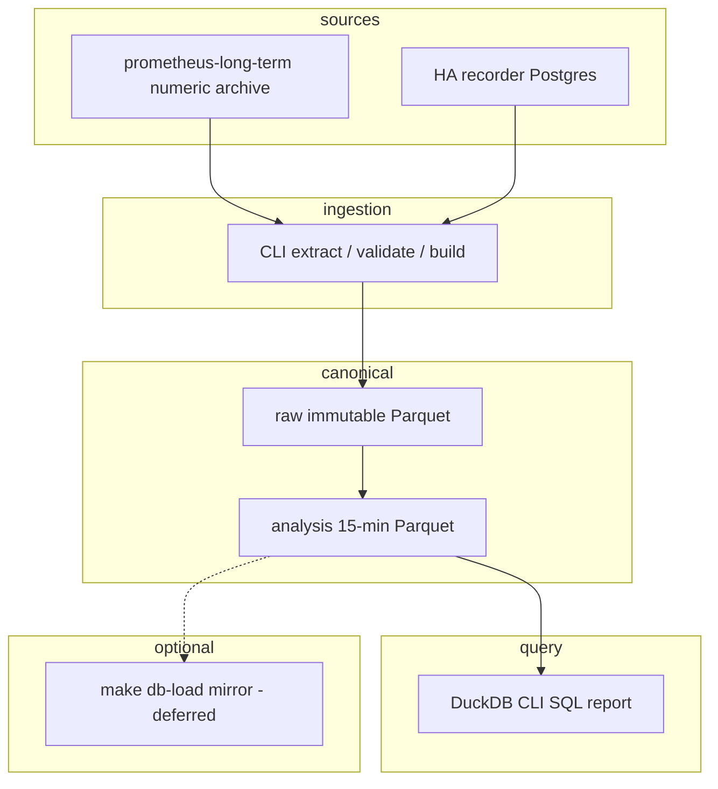

# ADR-0003: Phase 1 — measurement, reproducible dataset and strategy baseline

- **Status:** Proposed
- **Date:** 2026-10-23
- **Decision owners:** Homelab maintainers
- **Extends:** [ADR-0001](0001-home-battery-economic-dispatch.md), [ADR-0002](0002-appliance-aware-load-forecasting.md)
- **Supersedes scope of:** the original Phase 1/2 plan in [implementation plan](../../planning/home-battery-optimizer-implementation.md)

## Context

ADR-0001 and ADR-0002 proposed a broad build: a dedicated ingestion service, demand forecasts, an economic planner, appliance-aware NILM. An empirical audit of the existing telemetry showed that several planning premises were wrong and most of the proposed data infrastructure already exists. This ADR records the corrections and narrows scope to what measurement actually requires.

**This phase does NOT select controller architecture** — native Omnibattery, extending it, or bespoke — and does NOT require benchmarking Omnibattery as a completion criterion. No economic stop-threshold is imposed. The goal is: (1) reproducible chronological comparison of no-battery cost, (2) a simple causal price-only policy implementable without future knowledge, and (3) a physically feasible perfect-information optimum computed offline.

### Metering mapping (user-confirmed)

The Grafana dashboard "IoT - Energy" (uid `fe5f72fc-46b6-4cb0-adbf-cb08582dfd9e`, source [`apps/home-assistant/dashboards/iot-energy.json`](../../apps/home-assistant/dashboards/iot-energy.json)) defines "Total Energy" as `shellyem-main` channel 1 and "Circuit 1" as `ch1 − ch2`; circuit 2 is ch2 directly. **The physical wiring was confirmed by the user on 2026-10-23: `sensor.shellyem_main_channel_1_energy` is the whole-home feed, channel 2 is the aerotherm/appliance branch, and the servers are already included in ch1.** Servers are therefore nested within ch1 — and within the dashboard's `ch1 − ch2` circuit — not additive to it. This is the metering basis shared by the dashboard, this ADR, and the pipeline; it is a confirmed mapping, not an assumption to be validated against installer documentation.

**The export sign is untested.** No PV is installed and no forced-export condition has been created, so ch1's behaviour on export is not established from measurement. Nothing here asserts a reversed-CT wiring or diagnoses one — the available evidence neither supports nor rules it out. Determining the export sign is **not a requirement for this offline phase**: the pipeline treats ch1 as an import-dominant whole-home total and flags negative counter deltas as a data-quality event rather than assigning them a sign interpretation, so the baselines are unaffected while no generation or storage exists. Resolving it is a validation item for the phase that installs hardware.

### Prometheus data characteristics

`prometheus-long-term` holds the numeric archive; 1-minute scrape interval is configured. Per-series full history completeness **must be audited** rather than asserted as "2.5 years for all entities" — retention is 9999d but individual series may have started later. At scrape time, numeric series whose value is unchanged may be re-exported as repeated samples by the HA Prometheus integration; enum `sensor` domain strings are not exported as state-value gauges (only `hass_state_change_total`, `entity_available`, `last_updated_time_seconds` are available — no per-enum gauge for the `sensor` domain). Pod IP series churn requires identity stitching; overlaps must be investigated rather than unconditionally summed (instant max/sum is semantically different from counter-delta stitching across pod restarts). Prefer manifest-stable entity identity and label precedence over naive cumulative counter summation, which creates artificial resets.

**Counter deltas are the primary energy signal; power is a crosscheck.** `query_range` lookback fills repeated samples across short gaps, overstating apparent density. For true scraped-sample counts: use `timestamp()` on source samples, or extract raw range vectors in bounded chunks. `count_over_time` on a raw window counts ACTUAL samples received in that window — not all PromQL aggregation is unreliable; the issue is specific to `query_range` step interpolation filling gaps. Device freshness (when the device last reported) is separate from HA-export scrape freshness; `timestamp(series)` reflects Prom scrape time, not a device event timestamp. Preserve HA `last_updated` and availability metadata if known; flag explicitly as unknown otherwise.

### Cost model

The PVPC sensor is a published input. Per ESIOS documentation for indicator 1001 ("PVPC"), the published price **includes** access tolls, charges, and production cost; it **excludes** taxes (Impuesto Especial de Electricidad, IVA). Tax rates are effective-dated and sourced from verified invoices or official tariff documentation; the pipeline reads them from configuration keyed by date, never from hardcoded defaults. The installed sensor is `pvpc_updated` (HACS custom integration from [oscarrgarciia/HA-PVPC-Updated](https://github.com/oscarrgarciia/HA-PVPC-Updated)), which reads from the ESIOS API (`api.esios.ree.es`). The exact component composition delivered by the installed version **must be verified** against the live sensor output before double-adding tolls or decomposing into OMIE residuals — the upstream integration's behaviour may differ from the built-in [`pvpc` integration](https://www.home-assistant.io/integrations/pvpc/). See [ESIOS indicator 1001](https://www.esios.ree.es/es/indicadores/1001) for the official price definition.

The existing dashboard cost model has an identifiable defect: a `>= 0` guard silently discards negative-price intervals, destroying the best charging opportunities. The precise magnitude of this defect is **not claimed** here — the dashboard code shows the filter; its impact must be measured by the pipeline.

Fixed contracted power and rental charges are outside energy savings under an unchanged contract and are excluded from the energy objective. A constant tax factor scales a pure-energy objective uniformly and preserves argmin. However, an energy-vs-degradation mixed objective must use a coherent monetary basis — uniform scaling of the full objective preserves argmin; otherwise model taxed energy plus independently costed degradation and terminal value. Tax rate changes are date-dependent and invoice-scoped; billed comparisons use rates effective at each time.

## Decision

Build a narrow, reproducible measurement-and-baseline capability as an offline in-repo Python CLI package. Ingests from Prometheus numeric archive and HA recorder into immutable Parquet, normalizes to 15-minute analysis intervals, and produces DuckDB CLI SQL reports. No deployed service, no live actuation, no controller architecture selection.

### Scope boundary

| In scope | Out of scope |
|----------|-------------|
| Reproducible Parquet dataset from Prometheus | Any cluster deployment *in this phase* (a scheduled extractor CronJob is planned for a later phase — see [production execution plan](../../planning/energy-baseline-production-execution.md)) |
| Tariff-verified cost model (configurable tax) | Controller architecture selection |
| Three benchmark policies on historical intervals | Appliance-aware forecasting / NILM |
| Monthly reconciliation report | Live battery writes or actuation |
| Appliance enum extraction into Parquet | Recorder retention change / dedicated capture service |
| In-repo Python package with pytest and pre-commit | Optimiser deployment |
| Provisional battery assumptions (flagged) | Hardware measurement or bringup |

### Architecture

Price input comes from HA/Prometheus as the **current** input source. ESIOS tomorrow-prices are deferred. The optional `make db-load` mirror is dotted — no deployed DB is mandatory, and this phase deploys nothing. The offline dataset lives in a local output directory (private) or user-selected storage. Durable production storage is a **planned follow-on**: a prusik-backed PVC mounted by a scheduled extractor CronJob, described in the [production execution plan](../../planning/energy-baseline-production-execution.md) and deliberately not created by this phase. Concurrent DuckDB processes may read immutable Parquet; Postgres can snapshot for other consumers. TimescaleDB is preloaded in the observed Spilo image, making an optional mirror path plausible, but this is an extension availability observation, not a commitment. `openebs-zfspv` PVs are node-local and cannot mount on a remote node; scheduling guidance is limited to aligning PV affinity.

### Development and production deployment clarification (2026-10-23)

This ADR was committed with status **Proposed**. The following clarification was recorded on 2026-10-23 and does not change the decision or status:

- **Current development**: supervised offline work on a local PC, using `/tmp` for temporary exports. No cluster deployment, no persistent storage, no live battery/controller/Home Assistant configuration changes.
- **Future production**: when the extraction pipeline is mature, it will run as a **scheduled batch extractor CronJob** in the cluster via GitOps, with a persistent PVC on prusik. This is an architecture clarification for future implementation, not a deployment decision made now. The extractor is a batch job, not a deployed service.
- **Scope boundary preserved**: no live actuation, no controller architecture selection, no Home Assistant configuration changes. The production CronJob extracts data; it does not control anything.

See [planning/energy-baseline-production-execution.md](../../planning/energy-baseline-production-execution.md) for concrete requirements when the production CronJob is scheduled.

### Data contract

The analysis grid contains **gross household load only** (ch1), the user-confirmed whole-home feed. With no battery installed, raw ch1 approximates gross household load directly. Once a battery is active, gross load must be reconstructed from ch1 plus AC charge/discharge telemetry, or the interval must be flagged as unusable for gross-load analysis. Nested submetered loads (servers, circuits) are NOT added to avoid double-counting, since they are already inside ch1. The schema carries nullable `raw_grid` and `gross` columns with a quality flag and a `battery_absent` indicator. Raw prices retain hourly or actual cadence with original validity timestamps. The 15-minute load interval is computed from actual energy counter deltas, not interpolated from power. Counter deltas spanning gaps (missing scrapes, device outages) are not attributed to invented intervals — the gap is flagged and the energy total for that span is marked as known total over the full span with allocation-quality separate (unknown where gap). Optional power estimates, when computed, are explicitly labeled as estimates and are distinct from measured energy.

Each extraction records a reproducible manifest: schema version, code version, config version, extraction timestamp, stable input identity and content hash, units, data-quality flags, UTC start/end with actual duration (half-open intervals `[start, start + interval)`). `source_observed` and ingestion timestamps are distinct from any reconstructed series. Historical published-at times are flagged as unknown — this pipeline records extraction time, not as-of availability forecasts. All timestamps are stored in UTC. Europe/Madrid local days are 23 hours on spring-forward (2026-03-29) and 25 hours on fall-back (2025-10-26 or 2024-10-27). Tariff period assignment (P1/P2/P3) is defined in local time and must be applied via timezone-aware conversion. The pipeline must tag DST-transition intervals explicitly.

### Policy design

The baseline policy uses **only current price and past state** — fixed thresholds derived from a training period of past prices. No day-ahead price array is required or assumed. If a later policy variant uses a day-ahead price array, that assumption is explicitly labelled: the policy requires that prices are published and known ahead of time, and the pipeline verifies that the sensor actually archives them (e.g. `price_00h..price_23h`) rather than assuming realised prices are available ahead of time. Allowed inputs for the baseline: current price plus past state. No tomorrow needed. Threshold parameters are selected on an earlier train split and frozen for evaluation — this prevents overfitting to the evaluation period. Charge/discharge decisions use current-meter feedback. The policy is a current-price-plus-past-state feedback loop, simple enough to implement without future load knowledge.

### Battery physical simulator

SOC recurrence with signed flows, per-direction efficiencies, per-duration resolution. Net grid flow ≥ 0 (no intentional export). Import ceiling is configured or unknown — not asserted from any sensor reading. Negative-price pathologies are avoided by enforcing one binary mode per interval (charge OR discharge, never both simultaneously). The oracle computes a feasible chronological horizon with SOC bounds at each step; initial and terminal SOC are equal or have an explicit defensible valuation. No arbitrary daily or annual scaling.

**Technology choices:** Python, DuckDB, PyArrow, pytest, uv (chosen for per-package lock reproducibility — each run pins exact dependency versions). Package path: `scripts/energy-baseline/` (consistent with the repository `scripts/` directory). Solver: `scipy.optimize.milp` (bundles HiGHS) for the **offline benchmark oracle only**, not deployed MPC. The solver minimises cost; the incumbent feasible solution provides an upper bound on optimal cost and therefore a lower bound on optimal savings relative to baseline. The dual (lower cost bound) provides an upper bound on savings. When the solver gap exceeds the configured absolute or relative tolerance, the report states the feasible savings and the certified bound separately. A result is treated as proven optimum when the gap is within the configured tolerance, not when it is literally zero. Solver gap and time limit are always reported.

Coverage target: ≥ 1 full calendar year if available; audit for missing periods rather than assuming completeness. Full chronological evaluation, not a repeated 90-day window. No guessed realistic ranges or payback periods. Cost/savings, cycle EFC, and throughput boundaries are reported; gap exclusions are identical across all policies. Monthly quality thresholds are configured and declared.

Synthetic tests cover: negative prices, counter resets, series churn, DST transitions (2026-03-29 spring forward: 23 h → 92 slots at 15 min; 2025-10-26 or 2024-10-27 fall back: 25 h → 100 slots). Efficiency and SOC-window assumptions are distinct from each other (e.g. 80% usable capacity window ≠ 90% one-way efficiency); real values are user-configurable, not hardcoded. Battery nameplate is 5.12 kWh nominal; all else is a measurable assumption. The simulator respects physical constraints: energy conservation per interval, SOC bounds never violated, round-trip losses applied to both charge and discharge paths.

### Indicative dashboard observations

The existing dashboard shows whole-house consumption around 14.35 kWh/day over a recent 28-day window. This is indicative only, not a requirement or completion criterion. The main deliverable is the measurement tool, not an economic verdict. Specific savings estimates, oversizing conclusions, or payback ranges are intentionally omitted — they require the time-stepped simulation this phase builds. The dashboard also reveals that servers (submetered, nested within circuit 1) run at a relatively flat ~230-240 W, representing a non-shiftable baseload component. AppDaemon has already shifted some aerotherm consumption to cheaper hours, which reduces the incremental headroom available to a battery — but the magnitude of this prior optimization is not quantified here and must be measured by the pipeline.

### Appliance enum telemetry — resolved

`recorder.purge_keep_days` is a single global setting (default 10 days, verified in effect: the `states` window measures 10.19 days). `include`/`exclude` gate whether an entity is recorded at all, never how long it is kept. There is no per-entity retention in Home Assistant.

**Raising global retention was rejected.** The decisive factor: one entity, `sensor.rack_controller_fan_speed`, accounts for 45.8% of all recorder rows (~83k rows/day) while carrying one constant attribute blob and no value to this project. The appliance enum entities actually needed are a few hundred rows per day — roughly 0.1% of write volume. Raising global retention therefore pays a large amount of write growth, about half of it for that one sensor, to preserve a negligible row count. Secondary: long retention implies very large `states` tables, where autovacuum and history/API latency, not disk capacity, become the binding constraint.

**Adopted:** recorder configuration is left UNCHANGED — default 10-day retention, no include/exclude filters added, no PVC expansion. Appliance enum telemetry is preserved by periodic extraction into the canonical Parquet store via the CLI's `extract` command, reading the Home Assistant history API. During development this runs manually on a local PC; when mature, extraction will run as a scheduled CronJob in the cluster (see [production execution plan](../../planning/energy-baseline-production-execution.md)). No new always-running service and no live configuration change is introduced.

The recorder is the only coverage gap:

| Data type | Source | Retention |
|-----------|--------|-----------|
| Numeric sensors (power, energy, price) | `prometheus-long-term` | retention 9999d; per-series start must be audited |
| Numeric hourly aggregates | HA long-term statistics | indefinite |
| Binary sensors | Prometheus `hass_binary_sensor_state` | retention 9999d; per-series start must be audited |
| Enum state strings (washer/dishwasher status, cycle) | HA recorder only | 10 days — **the only gap** |

`sensor`-domain non-numeric states are not exported to Prometheus as value gauges (only `state_change` counters, availability and last-updated), which is precisely why extraction is required.

**Risk:** the 10-day recorder window is a hard deadline; enum history not extracted within it is permanently lost. Mitigations: run `extract` on a regular cadence (daily is comfortable against a 10-day window); the enum store is append-only and records which source window was pulled; gaps are flagged explicitly rather than silently assumed continuous; overlapping windows are cheap and idempotent to re-pull because the volume is negligible.

This decision is additive and reversible: nothing prevents raising recorder retention later for unrelated reasons, and no Home Assistant configuration change is required by this phase.

### Strategy comparison

Three benchmark policies evaluated on the same historical intervals:

1. **No battery** — existing AppDaemon scheduling, baseline cost. This is the counterfactual: what we pay today without any battery dispatch.
2. **Causal simple price-based policy** — a fixed-threshold rule (charge below a percentile, discharge above another) that uses only information causally available at decision time: current price and past state. Parameters are trained on an earlier split and frozen for evaluation. Represents a simple, interpretable dispatch strategy implementable without future knowledge.
3. **Perfect-information oracle** — an upper bound computed with full chronological knowledge of prices and load over the evaluation horizon, using `scipy.optimize.milp` to find the cost-minimizing charge/discharge schedule subject to physical SOC and power constraints. Not achievable in practice; a ceiling for comparison only.

Report EUR billed, distribution across intervals, equivalent full cycle count, and headroom versus the oracle bound. Gap exclusions are identical across all policies to ensure fair comparison. The no-battery monthly baseline is a historical counterfactual; savings from the causal policy and the oracle are simulated, not realised. The monthly reconciliation reports simulated cost reduction against the no-battery baseline as distinct from measured billed cost — no claim of realised saving is made in this phase.

These three policies are the complete set for this phase. They establish the data, the cost model, and benchmark references: no-battery cost and a physically constrained perfect-information optimum. The causal policy may underperform the no-battery baseline; report that outcome without clipping losses. No conclusion is drawn about which controller implementation should be used for live dispatch — that is a decision for a later phase with the evidence this phase produces.

### Definition of done

- CLI command vocabulary: `extract`, `validate`, `build`, `benchmark`, `report`, `inspect-sql`, `mirror` (optional).
- End-to-end: one reproducible run from source to report.
- Unit tests for solver invariants.
- Fixture data: committed synthetic only; no private activity in git.
- Hardware measurement is a future follow-up, not a completion criterion.
- No annual economic threshold is imposed; no assumption about controller choices, hardware purchase, or reversibility.

## Consequences

**Positive:** a reproducible, versioned dataset rebuildable from Prometheus; a user-confirmed metering mapping (ch1 = whole-home feed, ch2 = aerotherm/appliance branch, servers nested within ch1) that matches the existing dashboard's construction and gives the gross-load series a settled physical basis; a tariff-configurable cost model that handles negative prices; three benchmark policies (no-battery, causal price-based, perfect-information oracle) that define a benchmark reference envelope; explicit preservation of information assumptions; provisional battery assumptions flagged for later calibration; the canonical store also preserves the one data class Prometheus cannot (enum state strings) without touching live Home Assistant configuration.

**Costs:** engineering time for the CLI, Parquet pipeline, backtest framework, and reporting.

**Unresolved:** actual battery efficiency, idle draw, SOC mapping, response latency (all provisional assumptions; hardware calibration is a follow-up). The ch1 export sign is untested, which is explicitly not a blocker for this offline phase and carries no reversed-CT assertion. Controller architecture selection is explicitly deferred.

**What would change this decision:** reconciliation of the confirmed mapping against archived data showing ch1 does not behave as the whole-home parent feed — e.g. ch1 totals that disagree with the loads declared inside it, or negative counter deltas while no generation or storage exists (neither of which implies a reversed CT); confirmation that the tariff sensor excludes components or requires decomposition; a measured round-trip efficiency far below assumptions.

## Rejected or deferred alternatives

| Alternative | Decision | Rationale |
|-------------|----------|-----------|
| Build a dedicated TSDB/ingestion service | Rejected | Prometheus archive exists; no need to duplicate |
| Timescale as canonical store | Deferred | Mutable SQL requires explicit snapshots; simplicity/access decision deferred |
| Direct PromQL everywhere, no derived store | Rejected | No reproducible snapshot, no backtest |
| Appliance-aware forecasting / NILM | Deferred | Per ADR-0002, belongs to Phase 3+ |
| Tomorrow's price plumbing (ESIOS) | Deferred | This phase uses current prices with explicit assumptions |
| Deploy an optimiser service | Deferred | No live actuation; CLI backtest first |
| Naive dashboard-style cost model | Rejected | Drops negative prices, omits tax config |
| Select controller architecture | Deferred | This phase produces evidence; later phase selects |
| Hardware measurement and bringup | Deferred | Battery not yet installed; parameters flagged |
| Raise recorder retention to preserve enum states | Rejected | 45.8% of recorder writes are a single fan-speed sensor with no project value; enum extraction into Parquet is ~0.1% of the write volume |
| Change HA recorder include/exclude filters | Rejected | Not required; recorder config left unchanged |
| Production CronJob for enum extraction | Deferred | Development runs locally; production scheduling deferred until CLI is mature. See [execution plan](../../planning/energy-baseline-production-execution.md) |

## References

- [ADR-0001 — Forecast-informed economic dispatch](0001-home-battery-economic-dispatch.md)
- [ADR-0002 — Appliance-aware load forecasting](0002-appliance-aware-load-forecasting.md)
- [Home battery optimizer implementation plan](../../planning/home-battery-optimizer-implementation.md)
- [Production execution plan](../../planning/energy-baseline-production-execution.md)
- [IoT Energy dashboard source](../../apps/home-assistant/dashboards/iot-energy.json)
- [Home Assistant Prometheus integration](https://www.home-assistant.io/integrations/prometheus/)
- [Home Assistant Recorder](https://www.home-assistant.io/integrations/recorder/)
- [Home Assistant PVPC integration](https://www.home-assistant.io/integrations/pvpc/)
- [HA-PVPC-Updated custom integration (oscarrgarciia)](https://github.com/oscarrgarciia/HA-PVPC-Updated)
- [ESIOS indicator 1001 — PVPC](https://www.esios.ree.es/es/indicadores/1001)
- [Prometheus query_range API](https://prometheus.io/docs/prometheus/latest/querying/api/#range-queries)
