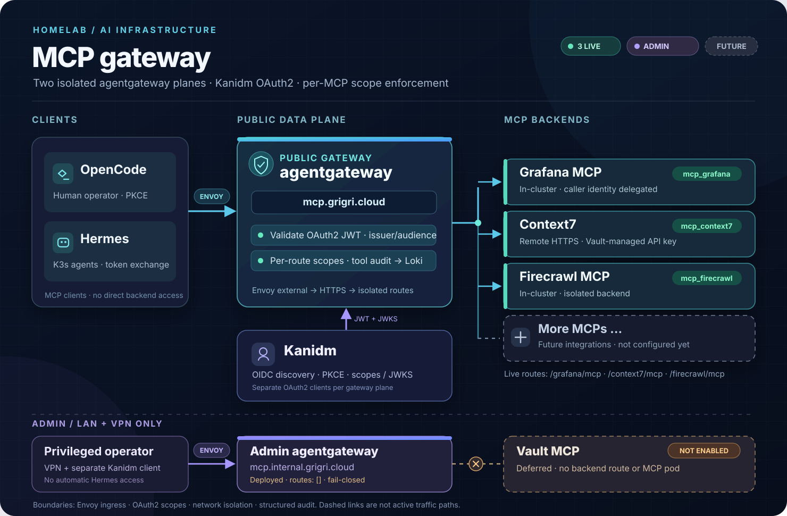

# MCP Gateway Architecture

**Status:** Live MVP (three public MCP routes); separate admin gateway deployed but fail-closed. The first live attempt of the
disabled-only foundation (`9049af3bf`, deployed and reverted on 2026-11-08) failed kubelet startup probes
on `:15021` while the process was healthy, and the grafana-mcp CNP (`838031375`) reproduced it on
2026-11-09. Both are now **explained by measurement**, not by argument: any policy set carrying an
**ingress** rule on an `httpGet`/`tcpSocket`-probed pod denies the kubelet probe, and on this cluster
(`enable-host-firewall: false`) the probe source is matchable **only** as `world` - `host`,
`remote-node`, `cluster` and a node-subnet `fromCIDR` all fail. The two explanations this doc gave
earlier ("a NetworkPolicy cannot name the node, so ingress had no permitted source", then the follow-up
"the pod→node response is dropped by an enforced egress policy") are both **falsified** - the second one
was measured out on 2026-11-09 (egress-only policy sets kept pods Ready with zero probe failures).
Matrix numbers and the reasoning trail:
`docs/troubleshooting/mcp-firecrawl-egress-regression.md` ("Measured answer"); durable rule and the
proven split-port shape: `docs/conventions/cilium.md`.
**Neither `9049af3bf` plane ever reached Ready**, so session-key stability across reconciles was never
observed *at that revision*. The MVP is now live and network-isolated: the public gateway uses the official
`agentgateway-standalone` v1.7.0 chart, while the admin gateway uses `app-template` 5.3.0: the public plane serves `/grafana/mcp`, `/context7/mcp`, and `/firecrawl/mcp`
plus three RFC 9728 protected-resource metadata routes; the admin plane serves `routes: []` (deliberate fail-closed; the
Vault backend is deferred by owner decision 2026-11-10). Backend parity through the gateway is
demonstrated (acceptance record in `planning/mcp-gateway-implementation.md`). Network isolation
re-land is done: three CiliumNetworkPolicies (`mcp-gateway`, `mcp-gateway-admin`, `grafana-mcp`) are
live and `Valid=True` in the measured split-port shape.
**Provisional placement:** both planes and the diagnostic canary are pinned to node `prusik` via
`nodeSelector: kubernetes.io/hostname=prusik` for diagnosis and initial rollout, accepting a
single-node failure domain. Placement will be revisited after the isolated planes run stably.
**Date:** 2026-11-10 (implementation status; probe matrix corrected 2026-11-09)
**Implementation plan:** [`planning/mcp-gateway-implementation.md`](https://github.com/pando85/homelab/blob/master/planning/mcp-gateway-implementation.md)

## Overview

Centralized MCP gateway giving AI agents and human operators a single entry point to homelab MCP
servers. The public gateway currently serves Grafana, Context7, and Firecrawl; SearXNG and other
integrations are future additions. A separate VPN-only admin gateway exists, but it has no backend
routes enabled. Both gateways deploy upstream [agentgateway](https://agentgateway.dev/) v1.7.0.

MVP consumers: OpenCode human operators and Hermes agent workloads. Home Assistant integration is
future work.

## Goals & Scope

### In Scope (MVP)

- **Upstream agentgateway**: Official `agentgateway-standalone` v1.7.0 chart on the public plane;
  `app-template` 5.3.0 deploying the same agentgateway binary on the admin plane
- **Two deployments**: Public `apps/mcp-gateway` and private `apps/mcp-gateway-admin` in separate namespaces.
  Admin does NOT expose Vault admin backend to public plane
- **Native MCP OAuth**: OpenCode → MCP OAuth discovery → Kanidm auth-code + PKCE → access token.
  Gateway validates (strict issuer + audience). No oauth2-proxy. Exact flow is a spike item
- **Existing Kanidm groups**: Reuse verified groups only after confirming memberships/suitability.
  Do NOT assume `hermes-users` implies workload permission or `vault-admins` exists.
  Create a new group only if no existing group fits, with approval.
  **Group membership**: Person accounts must be added manually (see `docs/user-guide/kanidm.md`); never encode person membership in CRDs or reconcile through Git. Service-account-only groups may use CRD membership
- **Per-MCP access**: Any configured existing group grants that MCP, not every MCP.
  Whole MCP = all tools allowed. Implemented as one human Kanidm group per route
  (`mcp-context7-users`, `mcp-firecrawl-users`, plus the existing `grafana-users`), with a matching
  `humanScopeMap` entry per route. Workloads use a single group (`mcp-gateway-agents`) that keeps
  every MCP scope; the asymmetry is deliberate (see the Execution log addendum in
  `planning/mcp-gateway-gap-closure-implementation.md`)
- **Network isolation**: Default-deny NetworkPolicy; gateway-only ingress. No NodePort/LB/hostPort
- **Auth delegation** where supported; otherwise per-MCP fixed service credential. No silent
  fallback; if blocked, decide per-MCP, do not impose broker
- **Credentials**: Kaniop-managed K8s Secrets for Kanidm tokens; Vault/ExternalSecrets for others.
  Do not force all Kanidm API tokens into Vault
- **Grafana MCP standalone**: Move from Hermes sidecar to dedicated pod in gateway ns.
  Gateway connects via ClusterIP/pod network. Remove sidecar after parity.
  Only first Hermes has the sidecar now
- **Baseline audit**: Full `jwt.sub` kept in Loki (180-day retention) because audit trails are wanted
  (owner decision 2026-11-10); the gateway log lines carry `jwt.sub`, `mcp.target`,
  `mcp.method.name`, `gen_ai.tool.name`, `http.status`, `trace.id`/`span.id`, no payload. Metrics
  inventory confirmed during spike

### Out of Scope

- **Home Assistant integration**: Future; HA MCP client compatibility not yet spiked
- **Per-tool authorization**: Whole MCP access or nothing
- **Generic credential broker**: No dynamic per-user credential generation in MVP
- **Platform hardening**: Privileged node/RBAC limitation brief only, not a comprehensive project
- **Session engineering**: Single replica allowed initially; session behaviour tested during spike.
  No "stateless / no initialize / pooling" claims without verification
- **Playwright remote browser**: Stage 1 landed (cluster browser, no ingress, port-forward access). Stage 2 (authenticated exposure) pending the two unknowns in `apps/playwright-mcp/README.md`

## Architecture Topology

### Two Deployments

  

**Public plane (live):** Envoy `external` routes `mcp.grigri.cloud` to
`apps/mcp-gateway` (namespace `mcp-gateway`). Its three active MCP routes are
`/grafana/mcp` (standalone in-cluster pod, caller token passthrough),
`/context7/mcp` (external HTTPS service, gateway-managed API key), and
`/firecrawl/mcp` (isolated in-cluster pod). Each has its own Kanidm OAuth2 scope.
Additional MCPs appear as an unconnected placeholder, not as deployed integrations.

**Identity:** OpenCode uses OAuth2 authorization code + PKCE; Hermes uses Kanidm-issued tokens.
The gateway validates issuer, audience, and per-route scope. In-cluster MCP backend services have no
independent public ingress; gateway audit events are sent to Loki.

**Admin plane (deployed, inactive):** Envoy `internal` routes `mcp.internal.grigri.cloud`
to `apps/mcp-gateway-admin` (namespace `mcp-gateway-admin`) with a separate Kanidm OAuth2
client. Its `routes: []` configuration fails closed: **Vault MCP is deferred, not deployed**,
and there is no live route to it. Hermes does not automatically receive admin access.

The Vault-backed secret store used by External Secrets (including the Context7 upstream API
key) is **separate** from the deferred Vault **MCP server** on the admin side.

### Traffic Flow

**Human operator (OpenCode desktop):**
1. OpenCode MCP client → MCP OAuth discovery → Kanidm auth-code + PKCE → access token
2. `Authorization: Bearer <access_token>` to a per-server URL such as
   `https://mcp.grigri.cloud/grafana/mcp`
3. Gateway validates access token (strict issuer, strict audience, expiry)
4. Gateway checks group membership / per-target assignment → routes to backend MCP
5. Backend MCP executes tool call, returns result
6. Gateway logs audit event with full `jwt.sub` (caller, backend, tool, outcome; owner decision
   2026-11-10 to keep full subject in Loki for audit trails)

**Hermes agent (cluster-side):**
1. Hermes pod → configured HTTPS MCP URL (`mcp.grigri.cloud/<backend>/mcp`) → Envoy external → gateway
2. Gateway validates Kanidm service account access token
3. Gateway checks group / target → routes to backend MCP
4. Backend authenticates via delegated credentials or fixed service credential
5. Audit event logged

## Authentication & Authorization

### Identity Model

- **Human operators**: Kanidm OAuth2 auth-code + PKCE → access token. Issuer derived from
  discovered/configured Kanidm OAuth metadata (exact match, no wildcard). Audience = configured
  MCP resource audience (verified during spike; must not accept arbitrary client audience).
  No ID token at the edge
- **Hermes agents**: Kanidm service account → access token. Same strict validation.
  Grant issuance pending verification
- **Group membership**: Via Kanidm OAuth scopes or supported lookup. Do NOT assume access token
  carries a `groups` claim; verify during spike
- **Caller identification**: Stable `sub` claim plus client identity. Username optional;
  do not assume `preferred_username` in access token

**Client pre-registration is mandatory.** Kanidm supports neither dynamic client registration nor
client-id metadata documents: every OAuth client must be pre-registered in git via
`KanidmOAuth2Client` and its `client_id` supplied to the client out of band. Human callers satisfy
this with browser authorization-code + PKCE using the pre-registered `client_id: mcp-gateway`;
in-cluster agents satisfy it with the token-exchange grant (`urn:ietf:params:oauth:grant-type:token-exchange`)
using a service-account subject token. See
[`docs/troubleshooting/kanidm-no-dcr-mcp-client-id.md`](../troubleshooting/kanidm-no-dcr-mcp-client-id.md).

### Token Validation

- Valid issuer: exact match to discovered/configured issuer, no wildcard
- Valid audience: exact match to configured MCP resource audience (verified during spike;
  must not accept arbitrary client audience)
- Not expired: `exp` claim
- Group/scope extraction: Kanidm OAuth scopes or supported lookup (spike to confirm mechanism)

### Scope Mapping (implemented 2026-11-10)

Human callers receive scopes via `kanidm.oauth2Client.humanScopeMap` in `apps/mcp-gateway/values.yaml`,
one entry per route:

| Kanidm group | Scope granted | Route gated |
|---|---|---|
| `mcp-context7-users` | `mcp_context7` | `/context7/mcp` |
| `mcp-firecrawl-users` | `mcp_firecrawl` | `/firecrawl/mcp` |
| `grafana-users` | `mcp_grafana` | `/grafana/mcp` |

Workloads use a single group (`mcp-gateway-agents`) that keeps **all three** MCP scopes plus
`openid`/`email`/`profile`. The asymmetry is deliberate: splitting workloads into the per-route human
groups would require encoding service-account membership there, and the Kaniop CRD `members` field is
authoritative when present, so a reconcile could clobber people the owner added by hand.

Each route's RFC 9728 discovery document advertises **exactly one** scope in `scopes_supported`
(`mcp_context7`, `mcp_grafana`, `mcp_firecrawl` respectively), with `authorization_servers` pointing at
`https://idm.grigri.cloud/oauth2/openid/mcp-gateway`. Corollary: Kanidm refuses the whole authorization
when any requested scope is not in the granted set, so a client that asks for a union of scopes (for
example all three at once) is refused wholesale unless the caller is a member of every corresponding
group. Per-server single-scope configuration is therefore required.

Person membership in the human groups is managed manually with
`kanidm group add-members <group> <account> -D idm_admin -H https://idm.grigri.cloud` and is never
encoded in CRDs (see `docs/user-guide/kanidm.md` "Group membership rules"). The `KanidmGroup` CRs for
the human groups are rendered with **no `members` field**, so a Kaniop reconcile leaves manual
membership intact (measured 2026-11-10: a reconcile ran after the manual membership change and did not
clobber it).

### Backend Credential Patterns

**Grafana MCP** (historical proven flow, `apps/hermes/values.yaml:23-91`). Delegation status after
live review: Grafana `13.3.0` trusts **one** JWT client - per-client JWKS with exact `iss` and `aud`. A
merged `jwk_set_file` covering both Kanidm clients is **retracted as unsafe** (pinning `iss` rejects the
second client, an `iss` array fails startup, and merging without `iss` pinning trusts any issuer holding
a listed key), so caller-preserving access-token delegation to the live instance is **blocked** until
compatible dual-client trust exists upstream, and `allow_insecure_email_lookup = true` (live value,
unchanged) must be settled before any delegation route is enabled:
- Current: SA API token → exchange → Grafana `id_token`. This is the proven service-account flow,
  not a target for human delegation or proof of `client_credentials` exchange
- Gateway presents backend bearer/header credential; isolation gate between caller and backend
- Caller-preserving delegation on this plane: the edge bearer stays the Kanidm **access** token and
  is forwarded verbatim. Grafana identifies the person from a stable claim (`sub`), not from a
  username it has never seen, and a person who already exists as an OAuth user is linked once by a
  bootstrap token that carries both `sub` and the identity claims. Live Grafana settings, per-person
  bootstraps and the two-person parity run remain owner gates; the local route stays disabled. **The
alias bootstrap is local positive but unapproved while the live settings
`allow_insecure_email_lookup=true` and `auto_sign_up=true` remain in place.** The local fixture
measured that a foreign `sub` carrying an existing email claim attached an existing JWT alias; **no
real compromise is alleged or observed**, and the live settings are untouched by this work.
  Details, measurements and the alternatives that were costed and rejected:
  `planning/mcp-gateway-implementation.md` (Task 2)

**Firecrawl MCP** (hosted existing MCP package):
- Backend currently lacks caller auth — gateway audit is the identity boundary
- No wrapper invented; deploy the existing `firecrawl-mcp` package
- Backend may observe MCP network source, not authenticated caller identity
- **Firecrawl reload/reapply remain blockers; the policies are absent; live SSRF verification was
  never run; the root cause is unknown and distinct from the later gateway event.**

**SearXNG / Context7**: Candidate centralized MCP packages. Context7 is NOT excluded because
  upstream is external — evaluate during spike

**Vault MCP** (planned, private plane): Official MCP exists. Measured with the official product
behind the gateway: stateful mode caches the backend credential per MCP session, so the session id
alone behaves like a bearer and rotation is ignored — stateful cannot carry per-caller secrets.
Per-request (stateless) forwarding of the caller's own native token does preserve Vault's own ACLs
and audit identity, at the cost of a deliberate per-route header allow plus a stateless route, which
is an owner decision. That support rests on **local fixture evidence only** (28/28 REQUIRED held, 4/4
known-bad CONTROLS reproduced, 12 OBSERVED, 2 NOT-TESTED; security negatives incomplete); **TLS now has
a real positive (valid-CA success) and a real negative (untrusted-CA exact x509 failure with connection
evidence), but this is still LOCAL/test-only and no route is ready.** **CRITICAL:** agentgateway info
logs the full request path including the query string; the probe observed a synthetic credential in
`?VAULT_TOKEN=`. Durable rule: never place credentials in query strings; gateway logs are a
credential-bearing surface; caller `X-Vault-Token` header only; any future route must redact/avoid
secrets in URLs. No real credential or user data was exposed; synthetic fixture only.
`planning/mcp-gateway-implementation.md` (Task 4)

**Unsupported delegation**: If a backend does not support delegation or the exchange chain is
  blocked, do NOT silently weaken identity or impose a new broker. Decide per-MCP using the shared
  accepted pattern and record the classification

### Known Gates (Spike Required)

1. **OpenCode MCP OAuth discovery + PKCE flow**: Exact Kanidm client config, token refresh for
   long-lived desktop clients
2. **Group membership mechanism**: OAuth scopes vs supported lookup — verify which Kanidm supports
3. **Existing group suitability**: Confirm `grafana-mcp-users`, `hermes-users` memberships and
   whether they fit the per-target model. No assumptions. **Resolved (2026-11-10):** per-route human
   groups landed (`mcp-context7-users`, `mcp-firecrawl-users`, plus the existing `grafana-users`);
   workload access is via `mcp-gateway-agents`. See the Scope Mapping subsection above.
4. **Kanidm user-token exchange**: Not verified for human delegation. If blocked, record per-MCP
   decision: supported delegated alternative, explicitly approved shared service credential,
   or defer target

## MCP Server Inventory

| Server | Phase | Current State | Target |
|--------|-------|---------------|--------|
| Grafana MCP | MVP | Live route, caller-preserving delegation | Standalone pod; Hermes sidecar removed |
| Context7 | MVP | Deployed route with Vault-delivered upstream key | Live |
| Firecrawl | MVP | Live route; backend pod deployed and isolated | Active `firecrawl-mcp` service |
| Vault MCP | Deferred | Admin gateway has `routes: []`; Vault MCP not deployed | Owner decision 2026-11-10: deferred |
| SearXNG | Next | REST API, internal | Deploy MCP package |
| Playwright | Stage 1 live | Cluster browser, port-forward only, no ingress | Stage 2: authenticated exposure pending two unknowns |
| HA, Postgres | Future | N/A | Separate phases |

## Network & Trust Boundaries

### NetworkPolicy

- **Isolation must be a CiliumNetworkPolicy, not a NetworkPolicy**: measured on 2026-11-09, *any* policy
  set with an ingress section on an `httpGet`/`tcpSocket`-probed pod breaks kubelet probes, and native
  NetworkPolicy has no way to express the one allowance that works. Native
  `policyTypes: [Ingress]` on these pods is therefore out.
- **Proven split-port shape** (matrix cases S2/S3/S5, `docs/conventions/cilium.md`):
  ingress `fromEntities: [world]` with `toPorts` limited to a **dedicated health/probe port** (15021, and
  8081 where a second health listener exists); `fromEndpoints` for the app port (3000 / backend 8000) and
  the metrics port (15020); egress `toEntities: [cluster]`. Keep `cluster` **off** the health port - when
  it shared the rule list it leaked the app port (case E5).
- **All MCP listener ingress**: Allowed only from gateway namespace AND gateway pods (label-based)
- **No direct backend exposure**: No NodePort, LoadBalancer, or hostPort for MCP backends
- **Ops exceptions on a separate PORT**: Metrics/probe on a different port, NOT a `/metrics` path
  distinction (L3/4 enforcement). Additive policies; verify denied for ordinary pods (S2 did exactly
  that: a non-permitted pod was DENIED on 3000/15020/8000 while permitted ones were allowed)
- **Accepted trade-off**: the `world` rule exposes only that dedicated health port to whatever can route
  to the pod IP (health body). If the owner rejects it, the alternatives are `exec` probes or
  `enable-host-firewall=true` (cluster-wide, untested here). Non-negotiable either way: an ingress rule
  that does not include `world` on the probe port is a pod-kill switch, not a hardening measure.
- **Timing**: attach the CNP at or before the workload - measured safe (policy present 6 m 32 s before
  the endpoint was recreated → Ready in 6 s, 0 probe failures). Keep `failureThreshold >= 6`.
- **Source fix done**: the reverted foundation chart carried a comment justifying leaving 15021 off the
  ingress list because a policy "cannot name the node". That reasoning was wrong and the cure it implied
  was measured useless; the comment has been removed and the three CNPs are live and `Valid=True`
- **ClusterIP is not isolation**: the CNP above is the isolation mechanism

### SSRF

- **Firecrawl**: Validate destination restrictions at actual fetchers, including redirects and
  DNS resolution, and bound duration/concurrency. Gateway-only validation is insufficient.
  Before public onboarding either verify controls or record explicit owner acceptance of
  remaining homelab risk

- **Historical 2026-11-08 attempt (not current route status):** Fetcher egress isolation was
  committed and pushed (`0b16b31b9`), auto-deployed by ArgoCD, and within ~12 s of attach the Firecrawl
  `api`, `worker` and both `nuq` pods began timing out kubelet health probes across two nodes (selected
  endpoints' BPF reloaded 1 s after the apply) while `browser` stayed `Ready`. A scoped revert
  (`8fff4f224`) synced at 19:08:11 and the **same** `api` process regained readiness **without a
  restart**; the baseline stayed stable for 30 min with the new policies absent. **Root cause is not
  established**: denied-packet counters read `0` but are cumulative and unattributable to a
  namespace/policy/port (not exoneration); no packet/eBPF/exec capture was taken, so "probe requests
  timed out" is not a confirmed node↔pod network denial; the live SSRF verification never ran, so no
  destination was ever demonstrated blocked; and the browser policy shares the byte-identical DNS and
  internet anchors with the fetchers, so rule shape is not a discriminator — only extra peers and rule
  count on the selected side. Full record, including retracted intermediate hypotheses and the capture
  gates required before any re-attempt:
  `docs/troubleshooting/mcp-firecrawl-egress-regression.md`.

  **Current status (2026-11-10):** `/firecrawl/mcp` is enabled and scope-gated, with live acceptance
  recorded in `planning/mcp-gateway-gap-closure-implementation.md`. This does **not** prove the
  underlying Firecrawl fetchers have comprehensive SSRF/egress isolation; that remains a separate
  security concern, and gateway-only NetworkPolicy is no substitute for fetcher egress control.

### Ingress

- Gateway: Envoy gateway `external` (VIP 192.168.193.14) for public plane via HTTPRoute, Envoy
  gateway `internal` (VIP 192.168.193.13) for admin plane. The old nginx Ingress objects still exist
  and ingress-nginx still runs, but they carry no MCP traffic (measured 2026-11-10: gateway access-log
  `src.addr` values are the external Envoy proxy pods). nginx remains the documented rollback path
  until ingress-migration Phase 6, which is why the CiliumNetworkPolicies still list the nginx
  controllers
- MCP backends: No ingress resources. All traffic through gateway

## Baseline Security Controls

### Credential Management

- **Kanidm identity tokens**: Existing Kaniop-managed Kubernetes Secrets
- **Other backend secrets**: Vault + ExternalSecrets
- **No custom credential broker**: Delegated caller credentials where supported; otherwise fixed
  per-MCP credentials. Dynamic credential issuance is future
- **No fail-open**: Expiry checked, no bypass on outage. No automatic static credential fallback

### Audit & Observability

- **Redacted audit**: Caller, backend principal, target, tool, outcome. No raw payload logging
- **Metrics**: Use supported metrics from pinned version; select during spike
- **Log destination**: Existing Loki pipeline; structured JSON logs

### Accepted Limitations

- **Whole MCP access includes write tools**: Group access = all tools, including writes
- **Shared backend permissions for non-delegated backends**: Callers in the same group share
  backend credentials where delegation is not supported. Delegated backends preserve caller
  permissions
- **Bounded revocation TTL**: Actual TTL measured and defined during spike. Removing a user
  takes effect at next token expiry check — no immediate revocation in MVP
- **No bypass on outage**: Gateway or Kanidm unavailable → access fails. No fallback
- **Session compatibility**: Verified during spike, not assumed
- **No platform hardening**: Focused on MCP gateway, not platform-wide security

## Future Improvements (Nonblocking)

- Per-tool authorization (if real need emerges)
- Enhanced revocation (short-lived JWTs, frequent refresh)
- Quotas & rate limiting
- Session management for long-running operations
- High availability (multiple replicas after session behaviour verified)
- Approval workflows for sensitive write operations
- Caller-bound dynamic credentials for backends that support it
- PostgreSQL MCP (see below)
- Playwright remote browser: Stage 1 landed (cluster browser, port-forward only). Stage 2 (authenticated exposure) pending the two unknowns in `apps/playwright-mcp/README.md`

## PostgreSQL MCP (Future)

Same access model as other MCPs. Choose during onboarding: rotated fixed DB login or Vault
dynamic credentials. Dynamic credentials do not automatically provide per-user attribution.
Scoped non-superuser roles, limits, expiry. Existing session caveat applies. Fine-grained
authorization is optional, not a requirement.

**References**:
- [Vault PostgreSQL database secrets engine](https://developer.hashicorp.com/vault/docs/secrets/databases/postgresql)
- [PostgreSQL RLS](https://www.postgresql.org/docs/current/ddl-rowsecurity.html)

## Related Documentation

- [Deploying new applications](../conventions/deploying-new-apps.md)
- [Cilium networking](../conventions/cilium.md)
- [Grafana MCP deployment with Kanidm authentication](../troubleshooting/grafana-mcp-hermes.md)
- [Hermes config overwrite recovery](../troubleshooting/hermes-config-overwrite-recovery.md)
- [Hermes agent deployment](../deployment/hermes-agent.md)
- [Conversation capabilities roadmap](../voice-assistant/conversation-capabilities-roadmap.md)
- [MCP gateway implementation plan](https://github.com/pando85/homelab/blob/master/planning/mcp-gateway-implementation.md)
