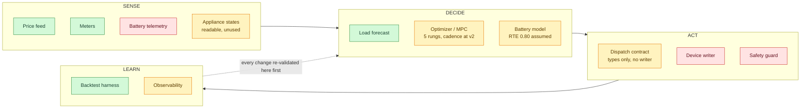

# Battery controller — component roadmap

- **Updated:** 2026-10-24
- **Purpose:** the component view of the battery controller — what each piece is, what
  state it is in, and how each one iterates from "working simply" to "fully improved".
  This replaces the phase-by-phase framing for day-to-day decisions; the phase list
  still lives in the [implementation plan](home-battery-optimizer-implementation.md).
- **Related:** [ADR-0001 architecture](../docs/adr/0001-home-battery-economic-dispatch.md),
  [ADR-0004 production architecture](../docs/adr/0004-battery-optimizer-production-architecture.md),
  [ADR-0003 Phase 1 baseline](../docs/adr/0003-phase1-measurement-and-baseline.md),
  [ADR-0002 appliance forecasting](../docs/adr/0002-appliance-aware-load-forecasting.md),
  [progress and handoff](energy-baseline-progress.md),
  [forecast experiments](energy-baseline-forecast-experiments.md),
  [package README](../scripts/energy-baseline/README.md)

No monetary figure appears in this file. Nothing described here is deployed, and no
battery is actuated by any of it.

## 1. The system in four columns

Green = built and tested. Amber = partial — the node does something real, but less than its column
implies. Red = absent.

The amber reasons, because "partial" hides different failures: **appliance states** are extracted and
now *readable* with correct as-of semantics, but nothing consumes them; **optimizer / MPC** has five
canonical rungs and ADR-0001's 15-minute cadence, but its v3 (degradation, throughput and robust price
handling) is absent and the fine cadence is unvalidated on real data; **battery model** ships one
assumed scalar (0.80) with no measured efficiency curve and idle draw assumed zero; **dispatch
contract** is types, validation and canonical serialization with physics delegated to the kernel, and
deliberately has **no writer, no I/O and no CLI subcommand** — which is why the rest of ACT, the device
writer and the safety guard, is still red.

The dotted arrow is the governing rule of the whole project: **nothing moves from
DECIDE to ACT until the backtest harness has re-validated it.** That is what makes
offline iteration safe, and it is why the absence of hardware blocks only one column.

## 2. How each component iterates

| Component | v1 — works simply | v2 | v3 | Hardware-gated? |
|---|---|---|---|---|
| **Price feed** | archived realised prices; published = realised (owner-asserted 2026-10-24, `verified_from_data: false`) | OMIE day-ahead plus PVPC adjustments, giving a real 14:00 estimate for the next day | daily attribute snapshot, converting the assertion into a measurement | No |
| **Load forecast** | trailing slot mean, 28-day window | server baseline and AppDaemon schedules as explicit inputs | quantiles P10/P50/P90, then appliance-conditioned using the preserved HA enum history | No |
| **Optimizer / MPC** | two-publication rolling horizon, ~34 h, two solves per local day — **done, and promoted: `rolling_horizon` is the fifth canonical rung (2026-10-24), the ladder is `no_battery`, `causal_price`, `day_ahead`, `rolling_horizon`, `oracle`, and `--policies all` runs all five** | 15-minute replan cadence over a 24–48 h horizon, executing only the next interval — **done as of 2026-10-24** (`replan_interval_slots` / `horizon_slots`; cadence 1 with `horizon_slots=96` is ADR-0001 §3), **now exercised on real data** across the four representative windows (the ladder 96 → 4 → 1 improves or ties monotonically), and roughly **48× the solve count** (about **37× the wall time**, since per-solve time is lower at a fine cadence). Causal load-forecast alignment **complete** (`--rolling-horizon-load-forecast-mode`): conservative event-local-day cutoff, entire horizon uses that cutoff, `"frozen"` preserved for goldens, `"causal"` now the benchmark and CLI default | degradation and throughput cost — **mechanism complete, uncalibrated**: `--throughput-cost-eur-per-kwh` planning flag, `economic_sensitivity.py` sweeps (user-supplied hypotheticals, no calibration, terminal optimization vs scoring separated). Then scenario or robust price handling | No |
| **Battery model** | scalar round-trip efficiency, nameplate capacity and power, SOC window — **the scalar is now 0.80** (adopted 2026-10-24, bottom of the community-measured 0.80–0.84 range, superseding 0.88; still an assumption, not a measurement), and the shipped block is pinned by a test | measured efficiency-versus-power curve plus idle draw | SOC hysteresis and real physical rate limits | **Yes, from v2** |
| **Dispatch contract** | absent — **no longer the state** | versioned schema: interval, mode, target power, SOC target, expected price, confidence, generation instant, expiry, sequence — **done 2026-10-24** (`src/energy_baseline/dispatch.py`, TODO-4.6): typed, validated, canonically serialized, physics delegated to `battery.py`, caller-supplied clock with no wall-clock fallback and an AST test proving it | acknowledged, one-in-flight, bounded retries | No — **the contract is not gated; the writer that would use it is** |
| **Appliance states** | preserved in Parquet by `extract`, invisible to Prometheus — **and now readable**: `src/energy_baseline/ha_states.py` with the `ha-states` subcommand (2026-10-24), deduplicating at read time and answering as-of queries that cannot leak a later transition | feeding those states into the load forecast | appliance-conditioned forecasting / NILM | No |
| **Device writer** | absent — Omnibattery native control only | single-writer adapter with lease and heartbeat | progressive power gates, observed → limited discharge → limited charge → full | **Yes** |
| **Safety guard** | offline invariants only | staleness detection → safe idle at 0 W | kill switch, verified idle handoff, alerting with explicit acknowledgement | **Yes** |
| **Observability** | offline artifacts (`benchmark.json`, `report.md`, schedules) | Grafana plan-versus-actual, forecast quality, opportunity cost | invoice reconciliation and realized savings against a matched baseline | Partly |
| **Deployment** | CLI on the development machine | `apps/battery-optimizer/` chart with a PVC on prusik | scheduled extraction cadence, HA custom-component deployment | Partly |

## 3. The scheduling fact that matters

Ten components in the table above — the appliance-states row was added on 2026-10-24 because the
reader turned "preserved but unreadable" into a component with a state of its own. The table and the
diagram cut the system at different granularity (the diagram has twelve nodes and no Deployment box),
so counts across the two are not meant to line up. **Three are hardware-gated** (battery model from
v2, device writer, safety guard), and two more are partly gated. Everything else can be built and
validated offline today.

That is now truer than it was: the two offline ACT-side prerequisites — a cadence the controller can
run on, and a typed contract to carry its decisions — both landed on 2026-10-24.

So the battery's absence is not a reason to wait. The productive ordering is to
finish DECIDE and the offline part of ACT before the unit arrives, which turns
integration into an ACT-and-LEARN exercise rather than a design exercise under
time pressure.

The single largest architectural risk sits in the gated column and should be
resolved early even though it cannot be implemented early: ADR-0001 requires that
**only one component writes battery setpoints at a time**, and that if Omnibattery
exposes no reliable public interface, the right move is to extend Omnibattery with a
higher-level dispatch-intent interface rather than write Modbus registers from a
second controller. The dispatch contract was specified to make that decision concrete before
hardware is in the loop, and on 2026-10-24 it was built — as a data contract only. That sharpens the
question rather than answering it: a typed intent with no writer still leaves "does Omnibattery expose
a usable interface?" untested, and the contract's own `CommandPolicy` shape (bounded retries, minimum
setpoint change, rate limit, safe-idle lease) is data, not behaviour.

## 4. Where we are

Built and tested, all offline:

- **SENSE** — Prometheus extraction with lineage and dedup; HA recorder extraction
  preserving appliance enum history that the durable archive does not carry, **now with a
  reader**: `ha_states.py` and the `ha-states` subcommand deduplicate at read time and answer
  as-of queries that cannot leak a later transition into an earlier snapshot. Read-side only
  — it does not feed `build`, does not change `dataset_id`, and no forecast or policy consumes
  it yet.
- **DECIDE** — trailing-slot-mean load forecast in both rolling and frozen forms; a
  physical battery kernel with SOC, power, no-export and import-ceiling semantics; a
  **five-rung policy ladder** (no battery, causal price rule, day-ahead rolling optimiser,
  rolling-horizon replan, certified perfect-information oracle). The rung that was an offline
  experiment on 2026-10-23 is canonical, and it now re-solves on a **configurable cadence**: the
  legacy two-event schedule by default, proven bit-identical to the experiment by golden
  digests, and ADR-0001's 15-minute cadence on request.
- **LEARN** — the backtest harness itself: immutable content-addressed datasets and
  runs, walk-forward splits, a shared scoring basis across policies, and per-run
  accounting that records exclusions and degradations instead of hiding them.

Present but not actuating: the **dispatch contract** (`dispatch.py`), which is ACT's first
committed piece and is types, validation and canonical serialization only — no writer, no I/O,
no subcommand. It cannot move a battery and was not built to.

Completed (committed): artifact-integrity sidecars (wired into the canonical benchmark and report
writers), economic-sensitivity sweeps, replay runtime (recording only, not deployed), and causal
load-forecast alignment (now the default load basis at the benchmark and CLI layer). None are
deployed.

Absent: the device writer and the safety guard — **ACT cannot actuate anything**, which is what
"the whole ACT column is absent" meant and still means in substance — plus battery telemetry in
SENSE. Nothing on this roadmap is deployed, and no hardware is authorized.

**The harness now has current numbers.** The shipped round-trip efficiency moved from
0.88 to 0.80 on 2026-10-24, `config_hash` changed, and `compute_dataset_id` hashes `config_hash`,
so every dataset and every benchmark figure in it — the ladder, the holdout grid, all of it — was a
superseded optimistic 0.88 result. The clean-tree rebuild **has** run: dataset
`2e01620ba72777ee8c25e5d8967151c095d2d5371450b85aecdbf7a8da69afd9` (70,176 rows, analysis content
byte-identical to its 0.88 predecessor), and the five-rung ladder has been re-run on it (run
`f816306cb8ad46afbb49a77e73e5ff1a`, oracle certified, frozen basis). On the full-year evaluation `rolling_horizon`
cost more than `day_ahead` — a load-forecast-basis asymmetry, since resolved at the causal basis
by run `fe3cbfec46b6…`: rolling-horizon closes 69.8% of the causal-to-oracle gap against
day_ahead's unchanged 65.1%, and now costs less on the full year and in all four representative
windows. The 81-configuration holdout grid has not been re-executed at 0.80, and that re-derivation
is optional rather than a completion gate. Treat any 0.88-era magnitude quoted in
the linked documents as historical, and treat the *orderings* the holdout grid establishes as unconfirmed
until re-derived.

Two findings shape what is worth doing next, and both cut against adding
sophistication:

- **Forecast accuracy is not the lever.** Across a frozen three-month holdout the
  most accurate load forecast did not produce the lowest dispatch cost, and history
  length moved cost very little. See [forecast experiments](energy-baseline-forecast-experiments.md).
- **Price-estimate accuracy is not the lever either.** At the owner-stated 80%
  accuracy for a 14:00 next-day estimate, the cost penalty was roughly one eighth of
  the margin between the two-publication policy and the single-publication one,
  because exact prices for a whole day arrive before that day starts.

What *did* pay was architectural: a longer horizon plus an evening revision was
cheaper in every configuration of the Q4 holdout grid (all 81 configurations were a
holdout immediately following the training cut). That is why the optimizer's v2 step was a
replan cadence, and not a better forecast — and that step is now built, which makes
the next one the v3 pair: degradation and throughput cost, then scenario or robust
price handling. That scope does not transfer to evaluation windows that extrapolate far
beyond the cut, and a measured counterexample now exists: on the 2025 full-year ladder
the same rung cost MORE than `day_ahead`. The identified asymmetry sufficient to explain
the reversal is the load-forecast basis: this rung's profile is frozen at the training
cut while `day_ahead` re-learns before each dispatch day. Re-running the identical
Q4-2025 window on the same dataset reproduced the win, which rules out the efficiency
correction as the cause. That counterexample has since been reversed: with the two
rungs on an aligned causal load-forecast basis, the rolling rung beats `day_ahead` on the full year
and in all four representative windows (winter, summer, DST spring, DST fall), and the cadence ladder
96 → 4 → 1 improves or ties monotonically. Note that both bullets above rest on 0.88-era figures; they are
information orderings, which is why they survived the efficiency decision intact as
claims about *shape* and not as magnitudes.

**Design decision (2026-10-24, now taken): align `rolling_horizon`'s load-forecast basis with
`day_ahead`'s causal rolling one.** The original claim was that the two rungs "differ only in price
information and cadence, not in load knowledge"; that claim was known to be false, and the
identified asymmetry (this rung's profile frozen at the training cut, `day_ahead` re-learning before
each dispatch day) was sufficient to explain the full-year reversal. Aligning the bases makes the
claim true and the comparison like-for-like. The tension was honest: the frozen profile was
**correct and deliberate in the experiment** — it keeps every noise arm on one identical load basis
so arms are comparable to each other, and it cannot leak evaluation data; carrying it into the
canonical ladder unchanged placed it beside a rung that does not freeze, and the two bases were
incommensurable. Changing the default would invalidate the golden-value tests that pin legacy
behaviour bit-for-bit, so it needed new goldens and an explicit decision, not a drive-by edit. The
decision is **causal, scoped to the canonical layers**: the benchmark and the CLI default to
`"causal"`, while `run_rolling_horizon`'s direct-call default stays `"frozen"` so the noise
experiments keep one shared load basis and the 14 legacy goldens pass untouched — one new causal
golden is added alongside them, none is regenerated. The decisive test — re-running the full year
with the two rungs on an aligned load-forecast basis — **has now been run**: the causal arm beats
`day_ahead` on the full year and in all four representative windows, reversing the frozen-basis
result. The earlier correction, and the guard test that pins the three artifact fields so the false
claim cannot silently return, are in commit `6fca56af`.

**Causal alignment complete.** `--rolling-horizon-load-forecast-mode` accepts `"causal"` (uses
the same trailing-slot-mean function as `day_ahead`) or `"frozen"` (legacy mode). Decision:
**event-local-day cutoff** — each solve sees only observations strictly before the event's local
day, and the entire horizon uses that one cutoff; no target day uses a forecast fitted through a
later midnight. `"frozen"` preserved for experiments. **`"causal"` is now the benchmark and CLI
default**; frozen remains the direct-call default for backward compatibility.

## 5. Sequencing rule

`compute_dataset_id` hashes `code_version()`, which is the git HEAD of a clean tree.
**Every commit therefore re-mints the dataset identity.** The practical consequence:
batch related code and config changes into one commit and rebuild once afterwards.
Rebuilding before the commit produces an identity that the commit immediately
invalidates.

The same coupling means a change to `config/tariff.yaml` is not cosmetic — it changes
`config_hash`, hence `dataset_id`, hence every downstream run identity. Comment-only
edits are inert, because the hash is taken over canonical re-dumped YAML and
re-dumping drops comments.

This rule is not hypothetical: the efficiency change from 0.88 to 0.80 is a
value line in that file, so it re-mints everything downstream. The correct order is
**commit, then rebuild, then re-run** — which is why the new dataset id and the corrected
figures were placeholders until the commit landed. The rebuild has since produced dataset
`2e01620ba727…` and run `f816306cb8ad…`.

## 6. Explicitly not now

- **Anything in ACT beyond the contract.** The contract landed; the device writer and the safety
  guard did not, and neither is next. ACT is still entirely unbuilt in the only sense that matters:
  nothing in this repository writes a setpoint, holds a lease, or stops a battery. The contract is the
  seam, not the actuator — and the roadmap's rule in §1 ("nothing moves from DECIDE to ACT until the
  backtest harness has re-validated it") now has teeth it did not have before, because there is
  something on the other side of the seam to validate against. The replay runtime exercises the
  planner and contract deterministically but is **recording only** — no writer, no HA adapter,
  not a resident service. It validates shape, not deployment.
- **A measured efficiency curve or idle-draw figure.** Hardware-gated. Until then the model carries one
  assumed scalar, now 0.80, pinned by a test that also pins that it is an assumption.
- **Machine-learning or NILM demand forecasting.** ADR-0001 already rejects
  "machine-learning forecast from day one" for lack of evidence that forecast error
  reduction creates value; the holdout results above are that evidence, and it points
  the other way. Revisit only if measured behaviour contradicts it. The appliance-states **reader**
  changed what is *available*, not what is *worth building*: nothing consumes those states yet, and
  the reader is deliberately the whole of that work for now.
- **Battery capacity sizing sweeps.** Moot — the unit is purchased.
- **Throughput cost calibration.** Mechanics exist (`economic_sensitivity.py`,
  `--throughput-cost-eur-per-kwh`); no calibration against measured degradation. Honest form is a
  break-even threshold, not an invented figure.
- **Degradation cost as a committed default.** Flag reachable (bit-identical at 0.0); setting a
  non-zero canonical value is a future explicit decision.
- **Quality gate enforcement.** Helper built with `reject` / `report` policies; not yet enabled on
  canonical pipeline (`min_usable_fraction = 0.0` is inert). Enabling requires a threshold decision.
- **Joint HVAC/DHW and battery optimisation.** Phase 8, and it requires its own ADR:
  AppDaemon currently owns comfort scheduling, and two controllers must not
  independently change the same load.
- **The daily price-publication snapshot.** Still worth taking eventually, because it
  is the only way to turn the owner's published-equals-realised assertion into a
  measurement. It is optional rather than blocking, and it needs weeks of calendar
  time to pay off, so it should not gate anything.
