# Home battery optimizer: phased implementation plan

**Status:** PROPOSED — documentation only; no equipment selected or deployment authorized  
**Architecture decision:** [ADR-0001 — Forecast-informed economic dispatch](../docs/adr/0001-home-battery-economic-dispatch.md)  
**Scope:** AC grid-charged home battery, initially targeting Marstek Venus E 3.0 (~5.12 kWh, ~2.5 kW); preserve vendor neutrality at the planner boundary.

## 1. Goal and current state

Reduce the **actual billed variable electricity cost** while maintaining the existing low-cost-hour aerothermal schedule and respecting local electrical limits. The homelab already provides:

| Source / system | Current repository location | Intended role |
|---|---|---|
| Home Assistant | `apps/home-assistant/` | Entity API, telemetry and user override |
| Shelly metering | `system/monitoring/blackbox-exporter-values.yaml` (`shellyem-main`, `shellypmmini-servers`) | Candidate signed grid sensor and server reference; verify topology |
| PVPC | `sensor.esios_pvpc`, used by `apps/home-assistant/appdaemon/apps/apps.yaml` | Day-ahead price feed; tax/tariff mapping still requires bill audit |
| Existing heating scheduling | `climate_control.py`, `dhw_control.py` | Authoritative HVAC/DHW schedules; do not replace |
| Omnibattery (proposed) | [upstream](https://ffunes.github.io/Omnibattery/) | Device integration and local feedback control |
| Monitoring | existing Prometheus/Grafana | Dispatch, energy and savings dashboards |

Approximate continuous server load: 250 W. There is no registered household PV generation in the previous study, but validate this for the actual meter boundary.

**Out of scope initially:** batteries providing UPS/blackout guarantees, purchasing hardware, automatic changes to aerothermal comfort, changes to existing AppDaemon dispatch, price prediction via LLM, photovoltaic generation control, and unattended writes before manual checks.

## 2. Execution order and dependencies

```mermaid
flowchart LR
    A[0. Audit and instrumentation] --> B[1. Reproducible data pipeline]
    B --> C[2. Baselines and oracle]
    C --> D[3. Demand predictor]
    D --> E[4. MPC and backtesting]
    E --> F[5. Shadow integration]
    F --> G[6. Guarded live operation]
    G --> H[7. Calibration and improvement]
    H --> I[8. Optional HVAC co-optimization]
```

Phases 0–4 can proceed without the physical battery. **Phase 5 requires verified battery connectivity and an exclusive actuator interface; Phase 6 requires a proven safe-stop path.** Each phase should be a separate, reviewable PR when implemented. No separate PR should silently enable live control.

## 3. Phase 0 — Verify reality before designing around it

- [ ] **TODO-0.1** Trace the main Shelly channels and clamp directions to the **net grid point of common coupling**. Verify the unit, sign, sample period, stale-data behaviour and import/export changes. A Shelly reading only a subcircuit cannot implement no-export control.
- [ ] **TODO-0.2** Validate the additional server power sensor independently (~250 W is an expectation, not an invariant).
- [ ] **TODO-0.3** Inspect the actual energy contract/invoices: PVPC or other tariff, VAT, electricity tax, marginal per-kWh charges, power period limits, and any changes mid-history. Do not model fixed charges as dispatch savings.
- [ ] **TODO-0.4** Inspect `sensor.esios_pvpc` and both AppDaemon schedulers: publication availability, timezone, price units, whether today's/tomorrow's arrays match their validity interval, and treatment of negative prices and DST. Observe future schedules without changing HVAC/DHW ownership.
- [ ] **TODO-0.5** Select/verify the battery model and firmware. Confirm supported local read/write method, power limits, SOC limits, response latency, partial-load efficiency/idle draw, and how it is safely stopped. For Marstek E v3, native Ethernet/Modbus TCP is the candidate; verify on the installed unit.
- [ ] **TODO-0.6** Check electrical protection and regulatory installation with a qualified installer. Hardware safety, anti-islanding and BMS protection must remain independent of this software.
- [ ] **TODO-0.7** Produce an anonymized meter and contract inventory with named unknowns instead of invented facts.

**Exit criteria:** independently verified signed net-grid power; confirmed marginal tariff computation; unambiguous battery/control path or an explicit no-device offline-only decision.

**Artifacts:** `planning/` audit notes and sensor mapping (no personal bill data or identifiers committed); upstream driver compatibility matrix and telemetry contracts.

## 4. Phase 1 — Build the time-series and accounting baseline

- [ ] **TODO-1.1** Ingest timestamped grid readings, gross home load (once validated), server power, PVPC prices, and AppDaemon planned HVAC/DHW hours; retain *raw* sources and derived records separately.
- [ ] **TODO-1.2** Use UTC instants plus Europe/Madrid display metadata, actual `interval_minutes`, and explicit half-open intervals. Test 23/25-hour DST days and nonhourly intervals. Never assume every day has 24 readings.
- [ ] **TODO-1.3** Reconcile cumulative Shelly readings and energy deltas. Detect communication gaps where a restored reading contains multiple hours of energy; do not attribute it to a single hour. Label interpolations and source quality.
- [ ] **TODO-1.4** Calculate billable marginal buy prices including time-applicable taxes and variable fees, preserving price/feed publication timestamps. Keep raw wholesale/PVPC readings separately. Accept negative prices.
- [ ] **TODO-1.5** Derive *uncontrolled* household load independently from battery charge/discharge telemetry when live; never train from grid import alone after installing the battery.
- [ ] **TODO-1.6** Build monthly invoice reconciliation, data-health metrics and export to a deterministic offline dataset.

**Exit criteria:** ≥99% documented usable interval coverage for a reference year, with all remaining gaps explicitly flagged; no unexplained sign inversions or DST duplicates; historical energy totals and the billable variable term reconcile within an agreed tolerance (document any missing billing components).

**Tests:** energy conservation; kW vs kWh; zero and negative prices; missing/duplicate/late meters; stepwise tariff and tax changes; PV generation presence/absence; 23-/25-hour days.

## 5. Phase 2 — Establish simple alternatives and an upper bound

- [ ] **TODO-2.1** Build a physical battery model with configurable usable kWh, charge/discharge kW, SOC limits, split efficiencies, standby draw, grid limits and optional degradation costs. Begin with provisional numbers only, flagged as assumptions.
- [ ] **TODO-2.2** Backtest **no battery**, **price percentile schedule**, **native Omnibattery tariff strategy** (if comparable offline), **simple price-only planner**, and **perfect-foresight oracle** with identical input assumptions.
- [ ] **TODO-2.3** Include year/day boundary SOC conservation and cost-to-go/terminal SOC treatment. Count every kWh purchased for charging; restrict AC delivery to actual usable household demand and **never credit exports**.
- [ ] **TODO-2.4** Report EUR/year, daily/monthly savings distribution, equivalent full cycles, standby costs, unmet cheap-hour opportunities, curtailed setpoints, and ROI/VAN sensitivity at 10/15 years; use 25-year curves only with explicit lifespan/replacement assumptions.
- [ ] **TODO-2.5** Compare 2 kWh/5 kWh/10 kWh and measured alternative hardware to avoid overfitting the strategy to a specific purchased model.

**Exit criteria:** reproducible comparison on the same historical intervals; oracle is never below an admissible real strategy on the same information/cost basis; energy and SOC constraints pass invariant/property tests.

## 6. Phase 3 — Predict demand only if it creates savings

- [ ] **TODO-3.1** Construct a baseline predictor: fixed/rolling server baseline, time-of-day/day-of-week and recency statistics, seasonality, and explicit scheduled HVAC/DHW windows. Avoid double-counting the aerothermal load.
- [ ] **TODO-3.2** Quantify P10/P50/P90 demand by interval; group metrics by expensive hours and compare with a conservative fixed 250 W fallback.
- [ ] **TODO-3.3** Use walk-forward validation (train before test only). Use only weather, schedules and prices **actually available at prediction time**; record publication lag to prevent leakage.
- [ ] **TODO-3.4** Evaluate CatBoost/LightGBM only if the incremental dispatch saving over the baseline forecast is material after complexity/maintenance costs. Define the economic improvement threshold from Phase 2 before trying candidate models.

**Exit criteria:** compared out-of-sample WAPE/MAE and **EUR regret vs oracle**; selected model wins on net saving rather than forecast accuracy alone; versioned feature specification and reproducible model training.

## 7. Phase 4 — Implement and benchmark MPC offline

- [ ] **TODO-4.1** Implement a time-stepped state model and constrained receding-horizon optimizer. Start with a deterministic LP solved with HiGHS; add MILP binary modes or piecewise converter efficiency when the relaxed solution is physically invalid.
- [ ] **TODO-4.2** Replan at a 15-minute cadence over a configurable 24–48 h horizon; execute only the next action in simulation. The next day's **unpublished** prices are forecasts/scenarios, not historical knowledge.
- [ ] **TODO-4.3** Add terminal SOC valuation (or extending horizon value), dwell/ramp limits as supported, charge/discharge efficiency vs power, degradation penalty sensitivity and the option of reserved SOC for backup (disabled by default for economic comparisons).
- [ ] **TODO-4.4** Test robust constraints and alternative demand percentiles. Explicitly prevent negative-price arbitrage through simultaneous charge/discharge or fictitious export.
- [ ] **TODO-4.5** Replay fully chronological months; compare simple price-only, baseline demand, advanced demand and oracle on the same days, using uncertainty bands (block bootstrap over days/weeks).
- [ ] **TODO-4.6** Publish a machine-readable dispatch plan contract: start/end UTC, mode (`idle/charge/discharge`), target power W, SOC target, expected buy price, confidence, generation timestamp and expiry/sequence ID.

**Exit criteria:** no violated physical constraints in simulated replay; out-of-sample net saving is positive against *no battery* and competitive with the cheapest practical control; advanced predictor retained only if justified. Record threshold, model and command parameters for reproducibility.

## 8. Phase 5 — Integrate in shadow mode (no actuator writes)

- [ ] **TODO-5.1** Install and validate the battery through Home Assistant/Omnibattery using GitOps-compatible configuration and HACS deployment instructions. Confirm grid meter sign, actual battery power, SOC, and exact HA entities and service APIs.
- [ ] **TODO-5.2** Document exactly **one writer** policy. Prove Omnibattery ownership transitions: manual-mode switch requires a verified 0 W handoff and excludes the battery from the automatic pool. Prefer one supported high-level interface for economic dispatch; otherwise design a narrowly scoped Omnibattery extension and test it upstream.
- [ ] **TODO-5.3** Deploy planner read-only in the homelab, emit predicted plans and compare them with live telemetry and actual native behavior, without requesting any battery commands.
- [ ] **TODO-5.4** Validate watchdogs: meter staleness, battery SOC/temperature unavailability, driver/API latency, HA restart, network loss, command timeouts, control lease expiry, optimizer solver errors and invalid price feed.
- [ ] **TODO-5.5** Instrument Grafana dashboard for current plan, latest telemetry, forecast quality, intended vs actual AC energy, opportunity cost and alerts. Keep all input data local; Vault-backed secrets if needed.

**Exit criteria:** at least two representative weeks of shadow operation (including cheap and expensive weekdays and weekend), zero unplanned battery writes, no unexplained telemetry/sign errors, documented safe handoff procedure, and reproducible estimated uplift relative to Omnibattery's native schedule.

## 9. Phase 6 — Enable guarded actuation progressively

- [ ] **TODO-6.1** Require explicit manual enable and verified emergency stop. Independently confirm idle command acknowledgement *and* power returning to an acceptable near-zero range before changing writer ownership.
- [ ] **TODO-6.2** Start at a conservative discharge ceiling and SOC window; cap requested discharge by *measured* available household load with margin, not by prediction alone. Apply contractual import limit before any charge command.
- [ ] **TODO-6.3** Implement a single command writer with sequence numbers, deadlines, acknowledgement, one in-flight command, bounded retries, and safe 0 W lease timeout. Avoid thrashing: hysteresis, minimum setpoint change and rate limits.
- [ ] **TODO-6.4** Roll out: observation only → limited discharge → limited charge → validated full permitted power. Verify power signs/limits at each gate and stop on measurable export/command anomalies.
- [ ] **TODO-6.5** Monitor actual grid-export energy, avoided tariff cost, converter/idle losses, SOC trajectory, charge/discharge power and control availability every day. Compare against a measured or carefully matched baseline, not forecast-only savings.
- [ ] **TODO-6.6** Provide a persistent kill switch in Home Assistant and document recovery/rollback to Omnibattery automatic control once output is confirmed idle.

**Exit criteria:** uninterrupted safe control over a representative month, no sustained commanded export beyond the documented metering/control transient tolerance, no unattended loss-of-control after HA/pod/network restart, and realized economic savings exceeding the simple native schedule over comparable price/load conditions.

**Rollback:** disable custom dispatch; command and **verify** 0 W; release ownership; re-enable native battery auto-control only after successful idle confirmation; preserve telemetry and incident diagnostics. If idle cannot be verified, do not silently transfer control—alert and require manual inspection.

## 10. Phase 7 — Calibrate and improve from actual operation

- [ ] **TODO-7.1** Measure AC→AC energy at several charge/discharge powers (include 250 W, 500 W, 1 kW, 2 kW if supported), separately estimate quiescent/idle draw, and fit an efficiency-vs-power model.
- [ ] **TODO-7.2** Reconcile model SOC with measured energy, characterize hysteresis and actual physical rate limits.
- [ ] **TODO-7.3** Compare predictions vs receipts weekly; roll back ML if its additional saving is insignificant or reliability degrades.
- [ ] **TODO-7.4** Refresh economic model quarterly: tariff, age/throughput, hardware cost, realized ROI and whether continued operation is profitable.
- [ ] **TODO-7.5** Set alerts for prolonged unavailability, repeated command failures, SOC anomalies, sensor bias and negative realized dispatch margin.

**Exit criteria:** empirically calibrated efficiency model and monthly savings dashboard; improvements backed by holdout/replay or measured controlled comparisons.

## 11. Phase 8 — Optional extensions (separate decisions)

- [ ] **TODO-8.1** Evaluate **joint** HVAC/DHW and battery scheduling only after comfort/temperature constraints and AppDaemon ownership are explicitly specified; propose another ADR before changing existing heating automations.
- [ ] **TODO-8.2** Add battery vendor adapter(s) behind the same planner contract (e.g. Zendure), only after proving actual capabilities and fail-safe semantics.
- [ ] **TODO-8.3** Add optional PV import/export compensation and backup reserve handling if the home's equipment changes.
- [ ] **TODO-8.4** Investigate multi-day stochastic tariff scenarios, adaptive SOC reserve and demand-response optimization only if economic gains justify the operational risk.

## 12. Verification checklist

- [ ] Replay fixture handles 2026 spring-forward/fall-back transitions correctly; no timezone-naive price lookups.
- [ ] Negative and zero PVPC values do not break scheduling or allow fake profit.
- [ ] Household load excludes battery charging and includes battery discharge when reconstructing gross consumption.
- [ ] Time-series gaps, sample duration and cumulative meter resets do not create phantom spikes.
- [ ] No forecast leaks post-publication tariffs or future household consumption.
- [ ] SOC, charge/discharge power, AC grid and no-export constraints are checked on each replay step.
- [ ] Physical command rate limiting, missing acknowledgements and stale grid sensor errors result in safe stop.
- [ ] Native Omnibattery and custom planner **never own battery writes concurrently**.
- [ ] A safe rollback can be executed without K3s or Internet availability, including a manual local intervention path.
- [ ] Tariff cost and energy accounting reconcile against household invoices and measured battery throughput.
- [ ] Reports separate realized savings from hypothetical oracle savings, exclude fixed fees and state equipment replacement assumptions.

## 13. Expected repository changes when executing the plan

| Proposed path | Planned changes | Phase |
|---|---|---|
| `planning/home-battery-optimizer-implementation.md` | This phased spec and decision trail | Now |
| `docs/adr/0001-home-battery-economic-dispatch.md` | Decision, alternatives and boundaries | Now |
| `scripts/battery-optimizer/` or a dedicated standalone project | Ingestion, offline simulation, predictor, optimizer and CLI | 1–4 |
| `test/` or project-local tests | Replay fixtures, controller property tests and financial correctness | 1–6 |
| `apps/home-assistant/` | Optional Omnibattery integration and observability, using existing HACS/runbook processes | 5 |
| `apps/battery-optimizer/` | Independent GitOps-managed planner, if the integration contract is verified | 5–6 |
| `system/monitoring/` | Optional new alert/dashboard rules | 5–7 |

Do not pre-create an application chart before the backtest proves value. Follow [deployment conventions](../docs/conventions/deploying-new-apps.md) when deploying and [the existing HACS process](../docs/troubleshooting/home-assistant-api-hacs-deploy.md) for HA custom components.

## 14. Operational troubleshooting and failure paths

| Symptom | Detection | Correct response |
|---|---|---|
| Missing PVPC or unexpected tariff validity | Missing/stale price publication and gaps in valid intervals | Mark optimization unavailable, stop economic dispatch; preserve existing HVAC/DHW fallback policy |
| Grid sensor stale or inverted | Source timestamps, energy-balance tests, contradictory grid/battery movement | Safe idle, never substitute a guessed grid reading |
| Large apparent household load after a gap | Counter delta spans many missing intervals | Quarantine aggregated sample; do not use as point forecast |
| Battery ignores setpoint | No ACK or measured response by timeout | Revoke plan, request/verify idle, alert; do not endlessly retry |
| Omnibattery and planner both issuing commands | Conflicting owner state / duplicated command observations | Refuse actuation and require validated single-writer handoff |
| Predictor misses large appliance use | Actual load differs from forecast | Controller caps discharge using *actual* grid/load readings; MPC replans |
| Battery reaches SOC floor early | SOC guard / deviations from modeled efficiency | Hardware/BMS limit takes priority; calibrate and replan |
| Unexpected grid export | Positive export measurements during discharge | Reduce/stop discharge immediately; investigate meter and command delay |

## 15. Evaluation gates and stop conditions

The project remains successful even if the result is *do not automate*: an offline backtest may show negligible improvement beyond Omnibattery's native controller. Stop after Phase 2–4 if the incremental net economic gain is too small to justify a permanent system or if no reliable hardware control contract is available. Report annualized savings and sensitivity rather than selecting a complex algorithm by default.

**No production control, hardware purchase, HVAC schedule change, or cluster deployment is part of this documentation PR.**
