# Home battery optimizer: phased implementation plan

**Status:** IN PROGRESS — the offline machinery is built and tested (Phase 1 **accepted**; Phases 2–4 partly delivered, including the dispatch-intent contract TODO-4.6, the configurable replan cadence, the five-rung policy ladder, and a bounded pre-migration milestone now **complete** with **1848 tests passing**: artifact-integrity sidecars wired into the canonical writers, economic-sensitivity sweeps with a throughput-cost planning flag, a replay-only dispatch runtime (recording only), and the causal load-forecast alignment for the fifth rung, validated on the 0.80 dataset). Battery hardware has been bought (owner statement, 2026-10-24), which moots device *selection* but not device *verification*. **The milestone is committed and the suite is green, but no deployment exists and no battery actuation is built or authorized** — the ACT column is entirely unbuilt. Component-level status and iteration plan: [the battery roadmap](energy-battery-roadmap.md).

**Architecture decisions:** [ADR-0001 — Forecast-informed economic dispatch](../docs/adr/0001-home-battery-economic-dispatch.md); [ADR-0002 — Appliance-aware load forecasting](../docs/adr/0002-appliance-aware-load-forecasting.md); [ADR-0004 — Production runtime and independent source repository](../docs/adr/0004-battery-optimizer-production-architecture.md)

**Scope:** AC grid-charged home battery, initially targeting Marstek Venus E 3.0 (~5.12 kWh, ~2.5 kW); preserve vendor neutrality at the planner boundary.

## 1. Goal and current state

Reduce the **actual billed variable electricity cost** while maintaining the existing low-cost-hour aerothermal schedule and respecting local electrical limits. The homelab already provides:

| Source / system | Current repository location | Intended role |
|---|---|---|
| Home Assistant | `apps/home-assistant/` | Entity API, telemetry and user override |
| Shelly metering | `system/monitoring/blackbox-exporter-values.yaml` (`shellyem-main`, `shellypmmini-servers`) | Candidate signed grid sensor and server reference; verify topology |
| PVPC | `sensor.esios_pvpc`, used by `apps/home-assistant/appdaemon/apps/apps.yaml` | Day-ahead price feed; tax/tariff mapping still requires bill audit |
| Existing heating scheduling | `climate_control.py`, `dhw_control.py` | Authoritative HVAC/DHW schedules; do not replace |
| Omnibattery (proposed) | [upstream](https://ffunes.github.io/Omnibattery/) | Device integration and local feedback control |
| Monitoring | existing Prometheus/Grafana | Dispatch, energy and savings dashboards |

Approximate continuous server load: 250 W. There is no registered household PV generation in the previous study, but validate this for the actual meter boundary.

**Out of scope initially:** batteries providing UPS/blackout guarantees, purchasing hardware, automatic changes to aerothermal comfort, changes to existing AppDaemon dispatch, price prediction via LLM, photovoltaic generation control, and unattended writes before manual checks.

## 2. Execution order and dependencies

```mermaid
flowchart LR
    A[0. Audit and instrumentation] --> B[1. Reproducible data pipeline]
    B --> C[2. Baselines and oracle]
    C --> D[3. Demand predictor]
    D --> E[4. MPC and backtesting]
    E --> F[5. Shadow integration]
    F --> G[6. Guarded live operation]
    G --> H[7. Calibration and improvement]
    H --> I[8. Optional HVAC co-optimization]
```

Phases 0–4 can proceed without the physical battery. **Phase 5 requires verified battery connectivity and an exclusive actuator interface; Phase 6 requires a proven safe-stop path.** Each phase should be a separate, reviewable PR when implemented. No separate PR should silently enable live control.

## 3. Phase 0 — Verify reality before designing around it

- [ ] **TODO-0.1** Trace the main Shelly channels and clamp directions to the **net grid point of common coupling**. Verify the unit, sign, sample period, stale-data behaviour and import/export changes. A Shelly reading only a subcircuit cannot implement no-export control.
- [ ] **TODO-0.2** Validate the additional server power sensor independently (~250 W is an expectation, not an invariant).
- [ ] **TODO-0.3** Inspect the actual energy contract/invoices: PVPC or other tariff, VAT, electricity tax, marginal per-kWh charges, power period limits, and any changes mid-history. Do not model fixed charges as dispatch savings.
- [ ] **TODO-0.4** Inspect `sensor.esios_pvpc` and both AppDaemon schedulers: publication availability, timezone, price units, whether today's/tomorrow's arrays match their validity interval, and treatment of negative prices and DST. Observe future schedules without changing HVAC/DHW ownership.
- [ ] **TODO-0.5** Select/verify the battery model and firmware. Confirm supported local read/write method, power limits, SOC limits, response latency, partial-load efficiency/idle draw, and how it is safely stopped. For Marstek E v3, native Ethernet/Modbus TCP is the candidate; verify on the installed unit.
- [ ] **TODO-0.6** Check electrical protection and regulatory installation with a qualified installer. Hardware safety, anti-islanding and BMS protection must remain independent of this software.
- [ ] **TODO-0.7** Produce an anonymized meter and contract inventory with named unknowns instead of invented facts.

**Exit criteria:** independently verified signed net-grid power; confirmed marginal tariff computation; unambiguous battery/control path or an explicit no-device offline-only decision.

**Artifacts:** `planning/` audit notes and sensor mapping (no personal bill data or identifiers committed); upstream driver compatibility matrix and telemetry contracts.

## 4. Phase 1 — Build the time-series and accounting baseline

- [ ] **TODO-1.1** Ingest timestamped grid readings, gross home load (once validated), server power, PVPC prices, and AppDaemon planned HVAC/DHW hours; retain *raw* sources and derived records separately.
- [ ] **TODO-1.2** Use UTC instants plus Europe/Madrid display metadata, actual `interval_minutes`, and explicit half-open intervals. Test 23/25-hour DST days and nonhourly intervals. Never assume every day has 24 readings.
- [ ] **TODO-1.3** Reconcile cumulative Shelly readings and energy deltas. Detect communication gaps where a restored reading contains multiple hours of energy; do not attribute it to a single hour. Label interpolations and source quality.
- [ ] **TODO-1.4** Calculate billable marginal buy prices including time-applicable taxes and variable fees, preserving price/feed publication timestamps. Keep raw wholesale/PVPC readings separately. Accept negative prices.
- [ ] **TODO-1.5** Derive *uncontrolled* household load independently from battery charge/discharge telemetry when live; never train from grid import alone after installing the battery.
- [ ] **TODO-1.6** Build monthly invoice reconciliation, data-health metrics and export to a deterministic offline dataset.
- [ ] **TODO-1.7** Inventory existing Home Assistant washing-machine/dishwasher entities and verify which operational states, programs, phases, remaining-time estimates, scheduled starts, completion events and optional power/energy readings *actually exist*. Record semantics, update latency, history availability and a versioned entity mapping; do not assume attributes.
- [ ] **TODO-1.8** Ingest timestamped HA appliance state changes and availability alongside power readings. Preserve event time vs observation/ingestion time, raw vs normalized state, provenance, clock skew, out-of-order events and missing/unknown values. Produce historical **as-of** snapshots that never use later cycle outcomes as input.
- [ ] **TODO-1.9** Assess whether the verified Shelly transport can supply useful higher-rate **gross household** power (e.g. ~1–2 s) without excessive overhead. Preserve true sample resolution; never synthesize event signatures from hourly aggregates or treat signed grid import as home demand while a battery is active.
- [ ] **TODO-1.10** Export a separate, optional appliance-events dataset and example labeled sessions; retain private activity histories locally, not in Git. Missing appliance telemetry must not block the baseline data pipeline. See [ADR-0002](../docs/adr/0002-appliance-aware-load-forecasting.md).

**Exit criteria:** ≥99% documented usable interval coverage for a reference year, with all remaining gaps explicitly flagged; no unexplained sign inversions or DST duplicates; historical energy totals and the billable variable term reconcile within an agreed tolerance (document any missing billing components).

**Tests:** energy conservation; kW vs kWh; zero and negative prices; missing/duplicate/late meters; stepwise tariff and tax changes; PV generation presence/absence; 23-/25-hour days. For the optional appliance stream: unavailable entities, delayed/out-of-order transitions, state pauses/restarts, program changes, incomplete cycles and strict as-of feature reconstruction.

## 5. Phase 2 — Establish simple alternatives and an upper bound

- [ ] **TODO-2.1** Build a physical battery model with configurable usable kWh, charge/discharge kW, SOC limits, split efficiencies, standby draw, grid limits and optional degradation costs. Begin with provisional numbers only, flagged as assumptions.
- [ ] **TODO-2.2** Backtest **no battery**, **price percentile schedule**, **native Omnibattery tariff strategy** (if comparable offline), **simple price-only planner**, and **perfect-foresight oracle** with identical input assumptions.
- [ ] **TODO-2.3** Include year/day boundary SOC conservation and cost-to-go/terminal SOC treatment. Count every kWh purchased for charging; restrict AC delivery to actual usable household demand and **never credit exports**.
- [ ] **TODO-2.4** Report EUR/year, daily/monthly savings distribution, equivalent full cycles, standby costs, unmet cheap-hour opportunities, curtailed setpoints, and ROI/VAN sensitivity at 10/15 years; use 25-year curves only with explicit lifespan/replacement assumptions.
- [ ] **TODO-2.5** Compare 2 kWh/5 kWh/10 kWh and measured alternative hardware to avoid overfitting the strategy to a specific purchased model.

**Exit criteria:** reproducible comparison on the same historical intervals; oracle is never below an admissible real strategy on the same information/cost basis; energy and SOC constraints pass invariant/property tests.

## 6. Phase 3 — Predict demand only if it creates savings

- [ ] **TODO-3.1** Construct a baseline predictor: fixed/rolling server baseline, time-of-day/day-of-week and recency statistics, seasonality, and explicit scheduled HVAC/DHW windows. Avoid double-counting the aerothermal load.
- [ ] **TODO-3.2** Quantify P10/P50/P90 demand by interval; group metrics by expensive hours and compare with a conservative fixed 250 W fallback.
- [ ] **TODO-3.3** Use walk-forward validation (train before test only). Use only weather, schedules and prices **actually available at prediction time**; record publication lag to prevent leakage.
- [ ] **TODO-3.4** Evaluate CatBoost/LightGBM only if the incremental dispatch saving over the baseline forecast is material after complexity/maintenance costs. Define the economic improvement threshold from Phase 2 before trying candidate models.
- [ ] **TODO-3.5** Benchmark an **appliance-conditioned aggregate** CatBoost/LightGBM forecast against the same simple whole-home baseline, using only HA states, program/phase/remaining-time information and recent power available at forecast issue time. Report performance separately for 15 min, 1 h, 6 h and 24 h.
- [ ] **TODO-3.6** Where independent device power or sufficiently isolated/labeled cycles exist, learn per-program empirical duration/remaining-energy profiles. Explore HSMM/sequence methods only if they improve the simpler solution; do not mistake total-home power changes for measured per-device energy.
- [ ] **TODO-3.7** Optionally prototype NILM event detection and appliance classification for devices not already observed in HA; use HA event timestamps as weak labels, explicitly handle overlapping loads and unknown/ambiguous classes, and calibrate confidence against verified held-out events. Do not force a device identity when evidence is insufficient.
- [ ] **TODO-3.8** Prevent appliance **double-counting**: first prefer a single aggregate model with appliance-state features; use an additive residual + appliance model only when subtraction/attribution is reliable and the residual is trained consistently. Handle future *unknown* appliance starts probabilistically rather than using observed future sessions.
- [ ] **TODO-3.9** Compare predictive uncertainty, forecasting error and replayed incremental net EUR savings against TODO-3.1 under identical as-of information; retain ADR-0001's baseline fallback if HA is stale, labels are uncertain or the economic threshold is not met. See [ADR-0002](../docs/adr/0002-appliance-aware-load-forecasting.md).

**Exit criteria:** compared out-of-sample WAPE/MAE and **EUR regret vs oracle**; selected model wins on net saving rather than forecast accuracy alone; versioned feature specification and reproducible model training. Appliance-specific models are optional and require session-disjoint/walk-forward evaluation, calibrated uncertainty and a positive economic go/no-go result before shadow deployment.

## 7. Phase 4 — Implement and benchmark MPC offline

- [ ] **TODO-4.1** Implement a time-stepped state model and constrained receding-horizon optimizer. Start with a deterministic LP solved with HiGHS; add MILP binary modes or piecewise converter efficiency when the relaxed solution is physically invalid.
- [ ] **TODO-4.2** Replan at a 15-minute cadence over a configurable 24–48 h horizon; execute only the next action in simulation. The next day's **unpublished** prices are forecasts/scenarios, not historical knowledge.
- [ ] **TODO-4.3** Add terminal SOC valuation (or extending horizon value), dwell/ramp limits as supported, charge/discharge efficiency vs power, degradation penalty sensitivity and the option of reserved SOC for backup (disabled by default for economic comparisons).
- [ ] **TODO-4.4** Test robust constraints and alternative demand percentiles. Explicitly prevent negative-price arbitrage through simultaneous charge/discharge or fictitious export.
- [ ] **TODO-4.5** Replay fully chronological months; compare simple price-only, baseline demand, advanced demand and oracle on the same days, using uncertainty bands (block bootstrap over days/weeks).
- [x] **TODO-4.6** Publish a machine-readable dispatch plan contract: start/end UTC, mode (`idle/charge/discharge`), target power W, SOC target, expected buy price, confidence, generation timestamp and expiry/sequence ID.

  **Built 2026-10-24 as a contract, in `scripts/energy-baseline/src/energy_baseline/dispatch.py`.** A frozen, validated `DispatchIntent` / `DispatchPlan` pair plus a `CommandPolicy` value, all serialized through one canonical-JSON and content-hash path (`canonical_json` / `content_hash` / `plan_to_canonical_json` / `plan_from_canonical_json`) so two components that agree on the bytes agree on the meaning. Every field this TODO lists is carried: `start` / `end` (aware UTC, validated), `mode` (`DispatchMode` — `idle` / `charge` / `discharge`, with charge and discharge mutually exclusive by construction), `target_power_w`, `soc_target_frac`, `expected_buy_price_eur_per_kwh` and `confidence` (both optional, absence distinguishable from a value), `generated_at`, `expires_at` and `sequence_id`. Physical feasibility is delegated to `battery.py` rather than restated, and the clock is a **required caller argument with no default**, so there is no fallback path to a wall clock.

  **Deliberately not built: no writer, no I/O, no CLI subcommand, and no device integration.** Nothing here opens a socket, holds a lease, or reaches Home Assistant, and `build`/`benchmark` do not import the module. `CommandPolicy` carries TODO-6.3's parameters as validated *data* — `max_attempts` (the send budget including the first), `min_setpoint_change_w`, `min_command_interval_seconds`, `lease_seconds`, and `allow_concurrent_in_flight`, which is refused if set to `True` — with pure predicates (`attempt_allowed`, `remaining_attempts`, `change_is_worth_sending`, `lease_deadline`) and **no default instance**, because those values are live-integration decisions gated by TODO-5.2/TODO-6.3 rather than measurements this repository holds. The obligation was only that the contract be *capable* of expressing the one-in-flight and bounded-retry behaviour TODO-6.3 requires; implementing that behaviour is TODO-6.3's own work and remains open.

**Exit criteria:** no violated physical constraints in simulated replay; out-of-sample net saving is positive against *no battery* and competitive with the cheapest practical control; advanced predictor retained only if justified. Record threshold, model and command parameters for reproducibility.

## 8. Phase 5 — Integrate in shadow mode (no actuator writes)

- [ ] **TODO-5.1** Install and validate the battery through Home Assistant/Omnibattery using GitOps-compatible configuration and HACS deployment instructions. Confirm grid meter sign, actual battery power, SOC, and exact HA entities and service APIs.
- [ ] **TODO-5.2** Document exactly **one physical battery writer**: Omnibattery retains Modbus ownership and fast PD control. [ADR-0004's source audit](../docs/adr/0004-battery-optimizer-production-architecture.md#omnibattery-integration-contract--source-review-2026-10-24) identifies existing candidate HA entities for `pd_target_grid_power`, `system_power_limits`, `system_max_charge/discharge_power` and per-battery `battery_allow_charge/discharge`, without entering individual manual mode. **Validate** which exist and work on the installed Venus E V3. Manual-mode handoff removes the battery from automatic PD and is not the preferred dispatch route; a new atomic high-level upstream API is a fallback only if necessary.
- [ ] **TODO-5.3** Deploy planner read-only in the homelab, emit predicted plans and compare them with live telemetry and actual native behavior, without requesting any battery commands.
- [ ] **TODO-5.4** Characterize and validate independent protection: meter staleness (upstream documentation allows up to ~65 s), battery SOC/temperature unavailability, driver/API latency, HA restart and **HA host powered off**, Modbus/network loss, command timeouts, expired economic intent, optimizer solver errors and invalid price feed. Test whether the **device** retains an old power command without HA; do not call an in-HA lease/watchdog a safe stop after HA failure.
- [ ] **TODO-5.5** Instrument Grafana dashboard for current plan, source freshness, controller ownership/blockers, last applied HA config and requested vs observed battery/grid power, forecast quality, intended vs actual AC energy, opportunity cost and alerts. Keep all input data local; Vault-backed secrets if needed.
- [ ] **TODO-5.6 — Omnibattery contract characterization (shadow/test bench).** Inventory current HA entity IDs and attributes. Test positive import targets during charge vs requested battery watts (include changing base load), a small positive import target during discharge, power-cap enable/disable, **cap=0 semantics**, permission switches and physical stop, controller target overrides (pricing, predictive, time slots, hourly balance, peak shaving), and command behavior across HA restarts. Confirm full control cycle sign conventions, meter cadences, sensor staleness, and the ~250 W BACKUP load's actual *AC Bypass* state versus true off-grid exclusion (default 50 W threshold + 5 min cooldown). Test partial updates and out-of-band HA configuration changes. Preserve settings set by the user/installer; do not overwrite them indefinitely.

**Exit criteria:** at least two representative weeks of shadow operation (including cheap and expensive weekdays and weekend), zero unplanned battery writes, no unexplained telemetry/sign errors, documented safe handoff procedure, and reproducible estimated uplift relative to Omnibattery's native schedule.

## 9. Phase 6 — Enable guarded actuation progressively

- [ ] **TODO-6.1** Require explicit manual enable and verified emergency stop. Independently confirm idle command acknowledgement *and* power returning to an acceptable near-zero range before changing writer ownership.
- [ ] **TODO-6.2** Start at a conservative discharge ceiling and SOC window; cap requested discharge by *measured* available household load with margin, not by prediction alone. Apply contractual import limit before any charge command.
- [ ] **TODO-6.3** Implement a **single economic-intent adapter** to HA entities, with sequence numbers, deadline/reconciliation, one in-flight ordered **multi-entity** update, bounded retries and source-ownership checks. HA's `number.set_value`/`switch.turn_on/off` actions are not atomic or leased. An economic command's expiry **cannot guarantee 0 W** on HA outage. Do not treat `system_max_*_power = 0` as a stop: **zero disables that power cap** in Omnibattery. Use directional blockers to request idle, and verify physical output separately. Limit transitions by hysteresis and rate limits; escalate/hold live dispatch when readback fails.
- [ ] **TODO-6.4** Roll out: observation only → limited discharge → limited charge → validated full permitted power. Verify power signs/limits at each gate and stop on measurable export/command anomalies.
- [ ] **TODO-6.5** Monitor actual grid-export energy, avoided tariff cost, converter/idle losses, SOC trajectory, charge/discharge power and control availability every day. Compare against a measured or carefully matched baseline, not forecast-only savings.
- [ ] **TODO-6.6** Provide a persistent kill switch in Home Assistant and document recovery/rollback to Omnibattery automatic control once output is confirmed idle.

**Exit criteria:** uninterrupted safe control over a representative month, no sustained commanded export beyond the documented metering/control transient tolerance, no unattended loss-of-control after HA/pod/network restart, and realized economic savings exceeding the simple native schedule over comparable price/load conditions.

**Rollback:** disable custom dispatch; command and **verify** 0 W; release ownership; re-enable native battery auto-control only after successful idle confirmation; preserve telemetry and incident diagnostics. If idle cannot be verified, do not silently transfer control—alert and require manual inspection.

## 10. Phase 7 — Calibrate and improve from actual operation

- [ ] **TODO-7.1** Measure AC→AC energy at several charge/discharge powers (include 250 W, 500 W, 1 kW, 2 kW if supported), separately estimate quiescent/idle draw, and fit an efficiency-vs-power model.
- [ ] **TODO-7.2** Reconcile model SOC with measured energy, characterize hysteresis and actual physical rate limits.
- [ ] **TODO-7.3** Compare predictions vs receipts weekly; roll back ML if its additional saving is insignificant or reliability degrades.
- [ ] **TODO-7.4** Refresh economic model quarterly: tariff, age/throughput, hardware cost, realized ROI and whether continued operation is profitable.
- [ ] **TODO-7.5** Set alerts for prolonged unavailability, repeated command failures, SOC anomalies, sensor bias and negative realized dispatch margin.

**Exit criteria:** empirically calibrated efficiency model and monthly savings dashboard; improvements backed by holdout/replay or measured controlled comparisons.

## 11. Phase 8 — Optional extensions (separate decisions)

- [ ] **TODO-8.1** Evaluate **joint** HVAC/DHW and battery scheduling only after comfort/temperature constraints and AppDaemon ownership are explicitly specified; propose another ADR before changing existing heating automations.
- [ ] **TODO-8.2** Add battery vendor adapter(s) behind the same planner contract (e.g. Zendure), only after proving actual capabilities and fail-safe semantics.
- [ ] **TODO-8.3** Add optional PV import/export compensation and backup reserve handling if the home's equipment changes.
- [ ] **TODO-8.4** Investigate multi-day stochastic tariff scenarios, adaptive SOC reserve and demand-response optimization only if economic gains justify the operational risk.

## 12. Verification checklist

- [ ] Replay fixture handles 2026 spring-forward/fall-back transitions correctly; no timezone-naive price lookups.
- [ ] Appliance events/remaining-time estimates are reconstructed **as known at forecast time**, not from final program outcomes; overlapping appliances or offline HA states never force fabricated power attribution.
- [ ] Appliance-conditioned or NILM-assisted forecasts are compared to the unchanged aggregate baseline with no double-counted load and with deterministic fallback.
- [ ] Negative and zero PVPC values do not break scheduling or allow fake profit.
- [ ] Household load excludes battery charging and includes battery discharge when reconstructing gross consumption.
- [ ] Time-series gaps, sample duration and cumulative meter resets do not create phantom spikes.
- [ ] No forecast leaks post-publication tariffs or future household consumption.
- [ ] SOC, charge/discharge power, AC grid and no-export constraints are checked on each replay step.
- [ ] Physical command rate limiting, missing acknowledgements and stale grid sensor errors result in safe stop.
- [ ] Native Omnibattery and custom planner **never own battery writes concurrently**.
- [ ] A safe rollback can be executed without K3s or Internet availability, including a manual local intervention path.
- [ ] Tariff cost and energy accounting reconcile against household invoices and measured battery throughput.
- [ ] Reports separate realized savings from hypothetical oracle savings, exclude fixed fees and state equipment replacement assumptions.

## 13. Expected repository changes when executing the plan

| Proposed path | Planned changes | Phase |
|---|---|---|
| `planning/home-battery-optimizer-implementation.md` | This phased spec and decision trail | Now |
| `docs/adr/0001-home-battery-economic-dispatch.md` | Decision, alternatives and boundaries | Now |
| `docs/adr/0002-appliance-aware-load-forecasting.md` | Optional appliance telemetry/NILM extension to the forecasting pipeline | Documentation |
| `scripts/energy-baseline/` (current), then a dedicated application repository | Preserve existing offline code and tests first; migrate CLI, forecasts, planner, simulation and reproducibility in a separate PR before independent releases | 1–5 |
| `test/` or project-local tests | Replay fixtures, controller property tests and financial correctness | 1–6 |
| `apps/home-assistant/` | Optional Omnibattery integration and observability, using existing HACS/runbook processes | 5 |
| `apps/battery-optimizer/` | Independent GitOps-managed planner, if the integration contract is verified | 5–6 |
| `system/monitoring/` | Optional new alert/dashboard rules | 5–7 |

Do not pre-create an application chart before the backtest proves value. Follow [deployment conventions](../docs/conventions/deploying-new-apps.md) when deploying and [the existing HACS process](../docs/troubleshooting/home-assistant-api-hacs-deploy.md) for HA custom components.

## 14. Operational troubleshooting and failure paths

| Symptom | Detection | Correct response |
|---|---|---|
| Missing PVPC or unexpected tariff validity | Missing/stale price publication and gaps in valid intervals | Mark optimization unavailable, stop economic dispatch; preserve existing HVAC/DHW fallback policy |
| Grid sensor stale or inverted | Source timestamps, energy-balance tests, contradictory grid/battery movement | Safe idle, never substitute a guessed grid reading |
| Large apparent household load after a gap | Counter delta spans many missing intervals | Quarantine aggregated sample; do not use as point forecast |
| Battery ignores setpoint | No ACK or measured response by timeout | Revoke plan, request/verify idle, alert; do not endlessly retry |
| Omnibattery and planner both issuing commands | Conflicting owner state / duplicated command observations | **Do not write Modbus from the planner.** Use Omnibattery HA permissions/targets only; disable competing native economic modes and verify physical and configuration ownership |
| Predictor misses large appliance use | Actual load differs from forecast | Controller caps discharge using *actual* grid/load readings; MPC replans |
| Battery reaches SOC floor early | SOC guard / deviations from modeled efficiency | Hardware/BMS limit takes priority; calibrate and replan |
| Unexpected grid export | Positive export measurements during discharge | Reduce/stop discharge immediately; investigate meter and command delay |

## 15. Evaluation gates and stop conditions

The project remains successful even if the result is *do not automate*: an offline backtest may show negligible improvement beyond Omnibattery's native controller. Stop after Phase 2–4 if the incremental net economic gain is too small to justify a permanent system or if no reliable hardware control contract is available. Report annualized savings and sensitivity rather than selecting a complex algorithm by default.

**No production control, hardware purchase, HVAC schedule change, or cluster deployment is part of this documentation PR.**

## 16. Production packaging and runtime rollout

[ADR-0004](../docs/adr/0004-battery-optimizer-production-architecture.md) makes the runtime/repository ownership decisions. This is the **single implementation checklist** for those decisions; do not create a second PDR. The [component roadmap](energy-battery-roadmap.md) remains the progress summary, and the [existing extraction plan](energy-baseline-production-execution.md) remains authoritative for retention and overlapping pulls.

### Runtime to implement (Phase 5, read-only first)

| Unit | Proposed design | Current gate |
|---|---|---|
| Python application | One long-running process with HA WebSocket/REST subscription, reconnect and state resynchronization; Prometheus range-query adapter; publication-aware PVPC adapter; snapshot/forecast/HiGHS MPC; typed intent generator; shadow sink by default | No **resident** service exists. `replay_runtime.py` exercises the planner and dispatch contract in a deterministic, replay-capable loop with a **recording-only** sink — not a service, no writer, no HA adapter, not deployed |
| Internal HTTP endpoint | FastAPI/ASGI, `GET /health/live`, `/health/ready`, `/status`, `/plan`, `/metrics`; ClusterIP only, no public ingress or unauthenticated writable commands | Not built |
| Extraction and offline jobs | Separate CronJob/Job for `extract → validate → build`, plus on-demand benchmark and optional training; immutable private Parquet manifests/DuckDB on a backed-up ZFS/OpenEBS PVC | Follow existing manual extraction policy until independently scheduled |
| Actuator integration | Prefer existing Omnibattery **HA entity adapter** (directional permission switches, grid-target and optional positive power caps), preserving single Modbus writer and fast Shelly feedback. Readback/reconcile ordered multi-entity changes; keep lease as optimizer-side data only. Optional upstream atomic intent API only if needed. | Entity availability, competing modes, physical response and HA-outage behaviour must be proved; **no live writer** |
| Observability | prometheus-client, ServiceMonitor, Grafana and alerts on stale sources, forecast/plan age, command reconciliation, import/export anomalies and missed extraction | Plan before live enablement |

Keep physics, optimization and forecast functions importable and pure so CLI, replay and service consume **the same package**. Use Python 3.12+, `asyncio`/`httpx`, SciPy/HiGHS and the existing DuckDB/PyArrow data format; only introduce CatBoost/LightGBM if net held-out EUR savings justify it. Never block the subscription/freshness event loop on solver CPU time; use a bounded executor/worker and discard obsolete plans. Replan every 15 minutes or at significant changes with debounce. Missing source fields and stale entities must degrade safely and be reported; do not manufacture phase/program attributes for appliances.

### Source repository and release ownership

- [ ] **PROD-1 — Extract application source when ready.** Create a **separate** repository (working name `pando85/battery-optimizer`, not yet created) containing the existing `scripts/energy-baseline` CLI, Python package, tests/fixtures, dependency lockfile, Dockerfile and developer docs. Preserve dataset/provenance traceability: current `compute_dataset_id` depends on clean Git HEAD and config hash; migration cannot silently change historical identities or claim equivalence. **No migration of the existing dataset is planned at this milestone**: the existing dataset at `2e01620ba727…` remains reproducible under the code version it was built from, and the newly committed modules (artifact integrity, economic sensitivity, replay runtime, causal alignment) do not rebuild or invalidate it. `code_version()` → `dataset_id` re-mints the identity for any fresh build from a new HEAD, but historical identities stay immutable and verifiable.
- [ ] **PROD-2 — Build independently.** CI must run Ruff, pytest/unit + property tests, chronological replay/golden tests and HA/Prometheus fake-adapter integration tests (disconnect, duplicate/out-of-order updates, stale SOC/grid, DST, failed acknowledgements, old intents). Hardware-in-the-loop tests require explicit supervision and are never required in public CI.
- [ ] **PROD-3 — Release artifacts.** Produce a Python wheel and immutable OCI image (e.g. GHCR) with pinned dependencies and recorded digest; add dependency/image scanning and SBOM/provenance where practical. Private energy traces and credentials must never enter CI artifacts or image layers.
- [ ] **PROD-4 — Deploy through homelab, separately.** Only `pando85/homelab` owns `apps/battery-optimizer/`, ArgoCD/Helm values, `ExternalSecret` references, NetworkPolicy (no optimizer → Modbus access), ServiceMonitor/alerts, HA entity/tariff mappings, private PVC/backup and runbooks. Pin the application **image digest**. Use one replica, no HPA, and initially avoid overlapping rollout pods (e.g. `Recreate`) until ownership is guaranteed at HA/Omnibattery itself.
- [ ] **PROD-5 — Verify shadow operation.** Start in `shadow` after reconnect/reconciliation; no actuator credentials or writes. Compare current forecast and planned versus native battery actions for at least the Phase 5 two-week window. Expose freshness, plan age, model/config version and rejected/fallback decisions. Metrics must not expose high-cardinality plan IDs or private household activity.
- [ ] **PROD-6 — Separate live gate (Phase 6).** Validate the [existing Omnibattery HA control entities](../docs/adr/0004-battery-optimizer-production-architecture.md#omnibattery-integration-contract--source-review-2026-10-24) with real Marstek E V3 firmware, signed Shelly net-grid measurement, BACKUP wiring, active slot/predictive/override interactions, import/SOC/power ceilings, multi-entity write failure and measured safe-idle transitions. Test **loss of HA itself** and the battery's behavior with its last commanded setpoint. An in-HA watchdog, economic TTL or successful HA API call is **not** independent hardware protection. Without a proven safe fallback remain in shadow; introduce an upstream atomic interface if necessary. Live enablement and rollback require a separate approved PR/runbook.

### Minimal runtime invariants

- On **start, reconnection, leader/ownership uncertainty, model mismatch or stale input**, actuation is disallowed until a fresh, complete snapshot and safe ownership transition are independently verified. A one-replica Deployment is not a device lock.
- A generated `DispatchIntent` is a **proposal**, not a guarantee of physically delivered power. Track timestamps, sequence/expiry, origin, command acknowledgement, observed power and reasons for refusals separately. Before live, choose durable private decision/command-journal semantics; Prometheus alone is not an audit log.
- The hardware/BMS/anti-islanding protections remain authoritative, and AppDaemon owns aerothermal/DHW schedules. Never use the 15-minute economic planner as the no-export feedback controller or assume HA can stop an inverter after HA itself fails.
- Keep the extraction CronJob/retention details in [Energy Baseline — Production Execution Plan](energy-baseline-production-execution.md); do not duplicate its schedule or change it from this document. Promote any new model only after reproducible, like-for-like economic tests.

**No resource described in §16 is deployed, and no live actuation is authorized by this documentation change.**
